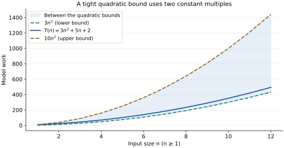

# Cases and bounds: two separate questions

**After this page, you should be able to:**

- Distinguish best/worst/expected input choices from O, Ω and Θ bounds.
- State probability assumptions and separate expected from amortised costs.

**Builds on:** [Exact comparison counts](counting-work.md) and [dominant growth](growth-rates.md).

**Cases select inputs; bounds describe functions.** Keeping these choices separate prevents a common mistake: treating Big-O as a synonym for worst case or Big-Ω as a synonym for best case.

(best-and-worst-cases)=
## Best and worst cases compare inputs of the same size

Use linear search that stops at the first match, and count equality comparisons with the target. For a list of n elements, with n ≥ 1:

| Case | Input situation | Comparison count |
|---|---|---:|
| Best | First element matches | 1 |
| Worst | No match, or the first match is last | n |

The list can keep the same stations while the query changes, or the query can stay fixed while their order changes. Both illustrate different inputs of the same size.

An empty input performs zero target comparisons, so the best-case formula 1 above explicitly assumes n ≥ 1. The complete function still performs fixed setup and return work on an empty list.

(average-case)=
## Average case requires a probability model

Suppose a successful search is guaranteed, keys are distinct, and the target is equally likely at any of the n positions. The expected comparison count is

$$
\mathbb{E}[C(n)]=\frac{1+2+\cdots+n}{n}=\frac{n+1}{2}.
$$

Now suppose the target is absent with probability p, and otherwise follows that uniform-position distribution:

$$
\mathbb{E}[C(n)]=pn+(1-p)\frac{n+1}{2}.
$$

For n = 4 and p = 1/2, the expectation is 3.25 comparisons. It need not be an integer, even though each actual search uses an integer count.

These are stated models, not a universal meaning of “typical input”. If the target is always first, the expected count is 1. Average cost is not obtained simply by taking the midpoint of minimum and maximum.

(asymptotic-bounds)=
## Compare functions up to constant multiples

Let T(n) and g(n) be nonnegative cost functions for sufficiently large n, with g(n) positive there. Asymptotic bounds ignore fixed multiplicative differences and allow a finite initial region before the comparison must hold.

(big-o)=
### Big-O: an asymptotic upper bound

T(n) ∈ O(g(n)) means constants c > 0 and n₀ exist such that, for every n ≥ n₀,

$$
0\le T(n)\le c\,g(n).
$$

Beyond that threshold, T stays below a fixed multiple of g. The multiplier cannot grow with n. The notation does not select the input case T represents.

(big-omega)=
### Big-Ω: an asymptotic lower bound

T(n) ∈ Ω(g(n)) means constants c > 0 and n₀ exist such that, for every n ≥ n₀,

$$
0\le c\,g(n)\le T(n).
$$

A lower bound can apply to a worst-case function just as it can apply to a best-case one.

(big-theta)=
### Big-Θ: a tight asymptotic bound

T(n) ∈ Θ(g(n)) means positive constants c₁, c₂ and n₀ exist such that, for every n ≥ n₀,

$$
0\le c_1g(n)\le T(n)\le c_2g(n).
$$

Both bounds hold with the same growth function. Θ(g(n)) is the intersection of O(g(n)) and Ω(g(n)). These symbols describe sets of functions; “T(n) = O(g(n))” is also common shorthand, not an ordinary numerical equality.

(tight-and-loose-bounds)=
## A correct bound can still be loose

For T(n) = 3n² + 5n + 2 and n ≥ 1, use 5n ≤ 5n² and 2 ≤ 2n²:

$$
3n^2\le 3n^2+5n+2\le 10n^2.
$$

The choices c₁ = 3, c₂ = 10 and n₀ = 1 prove tight quadratic growth.

| Claim about T | Correct? | Interpretation |
|---|---|---|
| O(n) | No | A fixed multiple of n cannot eventually contain quadratic growth |
| O(n²) | Yes | Upper bound matching its growth class |
| O(n³) | Yes | Valid but looser upper bound |
| Ω(n) | Yes | Valid but looser lower bound |
| Ω(n²) | Yes | Lower bound matching its growth class |
| Θ(n²) | Yes | Matching upper and lower growth bounds |

A cubic upper bound need not be false just because a quadratic bound is available. But when justified, the tight bound communicates more.

(cases-versus-bounds)=
## Combine a case with a bound

| Linear-search inputs | Target comparisons | Tight bound |
|---|---:|---|
| Best, n ≥ 1 | 1 | Θ(1) |
| Worst | n | Θ(n) |
| Successful, uniform-position model | Expected (n + 1)/2 | Θ(n) |

Each row selects inputs or a probability model, then bounds the resulting function. The best-case function is also O(1) and Ω(1). The worst-case function is also O(n) and Ω(n).

Do not confuse a bound for this implementation with a lower bound for **every** algorithm solving the problem. A problem-level lower bound needs a separate argument about the allowed algorithms and computational model.

(expected-versus-amortised-analysis)=
## Expected and amortised are different guarantees

Expected cost averages using an explicit probability model: a distribution over inputs, internal random choices, or both. The search expectation above describes a distribution of target positions, not a guarantee on each search. Expected O(1) hash lookup later relies on hashing assumptions; it does not say every key has a constant-time lookup.

Amortised analysis instead bounds the total cost of a sequence of operations and spreads that bound across the sequence. A dynamic-array append may copy many references on one call while geometric growth gives O(1) amortised append cost. No random inputs are required for that sequence argument. [Dynamic arrays](../linear-structures/dynamic-arrays.md#amortised-array-append) provide the worked example.

A complete statement names which guarantee is intended: an individual worst-case bound, an expected cost under a model, or an amortised cost across operations. These terms cannot be substituted just because all three are sometimes described informally as an average.

## Choose the function before choosing its bound

A reproducible claim identifies the input family and resource before simplifying. “Worst-case target comparisons for this linear-search implementation are Θ(n)” is different from “every comparison-based solution to this problem needs Ω(n) work.” The second statement quantifies over algorithms and needs its own model and lower-bound argument.

For n=4 under the stated half-absent, half-uniform-success model, successful searches contribute expected 2.5 comparisons and absent searches contribute 4; weighting those gives 3.25. Measuring another workload does not make this calculation wrong, but can show that its distribution does not describe the application.

Big-O permits loose upper bounds, but a justified tight Θ bound communicates more. The constants and threshold in a bound must work for every sufficiently large n in the selected cost function; choosing a new multiplier for each input size would not establish the asymptotic claim.

:::{tip} Common misconception
**Big-Ω describes the best case.** It describes a lower bound on whichever function was selected, including a worst-case or expected-cost function.
:::

(analysis-bounds-checks)=
## Check your understanding

Predict the count or assess the claim before opening the explanation.

**1. If T(n)=3n²+5n+2, can O(n³) and Θ(n²) both be correct?**

:::{dropdown} Show explanation
Yes. O(n³) is a loose upper bound; Θ(n²) states the tight growth class. A valid bound need not be the most informative one.
:::

**2. Is the midpoint of best and worst search counts always the average-case cost?**

:::{dropdown} Show explanation
No. It happens to match the uniform successful-position model here, but a different success probability or position distribution gives another expectation.
:::

Next: [Analysing code and space](code-and-space.md).

**Browse:** [Analysing algorithms](analysis.md) · [Concept index](../../concepts.md)
