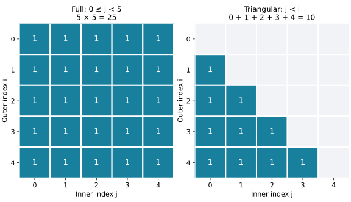

# Analysing code and additional storage

**After this page, you should be able to:**

- Derive loop, branch and halving counts from limits and stopping rules.
- Report working, output and peak auxiliary storage under an explicit model.

**Builds on:** [Cases and bounds](cases-and-bounds.md) and [shallow copies](../foundations/mutation-and-copying.md#shallow-copy).

**Code languages:** Python defines the explanations, figures and self-checks. Use the [language guide](../../code-languages.md) for native conventions and dependencies. Complete runnable topic examples: [JavaScript](../../examples/languages/analysis.js) · [Julia](../../examples/languages/analysis.jl).

The comparison counts are shared. JavaScript returns multiple results in arrays, Julia in tuples; graph/node references and absence use each language’s conventions.

Loop syntax suggests where to look, but iteration counts and operation costs determine the result. Explain the count first, then simplify its growth.

(consecutive-loops)=
## Consecutive loops add their costs

::::{tab-set}
:class: code-language-tabs

:::{tab-item} Python
:sync: python

```python
def count_two_passes(values):
    work = 0
    for value in values:
        work += 1
    for value in values:
        work += 1
    return work

print(count_two_passes(["KR", "MUS", "UTN"]))  # 6
```

:::

:::{tab-item} JavaScript
:sync: javascript

```javascript
function count_two_passes(values) {
    let work = 0;
    for (const value of values) work++;
    for (const value of values) work++;
    return work;
}
console.log(count_two_passes(["KR", "MUS", "UTN"]));
```

:::

:::{tab-item} Julia
:sync: julia

```julia
function count_two_passes(values)
    work = 0
    for value in values
        work += 1
    end
    for value in values
        work += 1
    end
    return work
end
println(count_two_passes(["KR", "MUS", "UTN"]))
```

:::

::::

For n items, the selected operation executes n + n = 2n times. Including setup and loop overhead does not change tight time Θ(n) under a unit-cost model. Two consecutive linear passes do not become quadratic.

(nested-and-triangular-loops)=
## Count the inner work in nested loops

::::{tab-set}
:class: code-language-tabs

:::{tab-item} Python
:sync: python

```python
def count_pairs(n):
    full = 0
    for i in range(n):
        for j in range(n):
            full += 1

    triangular = 0
    for i in range(n):
        for j in range(i):
            triangular += 1
    return full, triangular

print(count_pairs(5))  # (25, 10)
```

:::

:::{tab-item} JavaScript
:sync: javascript

```javascript
function count_pairs(n) {
    let full = 0, triangular = 0;
    for (let i = 0; i < n; i++) for (let j = 0; j < n; j++) full++;
    for (let i = 0; i < n; i++) for (let j = 0; j < i; j++) triangular++;
    return [full, triangular];
}
console.log(count_pairs(5));
```

:::

:::{tab-item} Julia
:sync: julia

```julia
function count_pairs(n)
    full, triangular = 0, 0
    for i in 0:n-1, j in 0:n-1
        full += 1
    end
    for i in 0:n-1, j in 0:i-1
        triangular += 1
    end
    return (full, triangular)
end
println(count_pairs(5))
```

:::

::::

The first nest performs n operations for each of n outer iterations: n² total. In the second, the inner range depends on i, so add the row lengths:

$$
0+1+\cdots+(n-1)=\frac{n(n-1)}{2}.
$$



Both counts have tight quadratic growth. For n ≥ 2, the triangular count lies between n²/4 and n²/2. Shorter rows reduce the count but do not make it linear. For n = 0 or 1, its inner body executes zero times; asymptotic claims concern large n.

Nesting does not always mean Θ(n²). If an inner loop performs a fixed three operations per outer iteration, the count is 3n. A full scan of n rows and m columns visits nm cells; retaining both parameters exposes that dependence.

(repeated-halving)=
## Repeated halving gives logarithmic iteration counts

::::{tab-set}
:class: code-language-tabs

:::{tab-item} Python
:sync: python

```python
def halving_steps(n):
    if n < 1:
        raise ValueError("n must be positive")
    steps = 0
    remaining = n
    while remaining > 1:
        remaining //= 2
        steps += 1
    return steps

print(halving_steps(16))  # 4
print(halving_steps(13))  # 3
print(halving_steps(1))   # 0
```

:::

:::{tab-item} JavaScript
:sync: javascript

```javascript
function halving_steps(n) {
    if (n < 1) throw new RangeError("n must be positive");
    let steps = 0, remaining = n;
    while (remaining > 1) { remaining = Math.floor(remaining / 2); steps++; }
    return steps;
}
console.log(halving_steps(16)); console.log(halving_steps(13)); console.log(halving_steps(1));
```

:::

:::{tab-item} Julia
:sync: julia

```julia
function halving_steps(n)
    n >= 1 || throw(ArgumentError("n must be positive"))
    steps, remaining = 0, n
    while remaining > 1
        remaining = div(remaining, 2)
        steps += 1
    end
    return steps
end
println(halving_steps(16)); println(halving_steps(13)); println(halving_steps(1))
```

:::

::::

Assume n is a positive integer. For 16, updates give 8, 4, 2, 1. For 13, floor division gives 6, 3, 1. After k updates, the remainder is floor(n/2ᵏ). The exact body count is **floor(log₂ n)**, not generally ceil(log₂ n). Division and the stopping condition determine the rounding.

Time is Θ(log n) asymptotically with constant-cost arithmetic. Θ(1 + log n) also makes fixed work at n = 1 explicit. Here n is the starting numerical value; measured against its binary bit length b, the iteration count is Θ(b). The integer precondition is part of the example; the code is not a general-purpose numeric validator.

(branch-costs)=
## Count the branch that runs

::::{tab-set}
:class: code-language-tabs

:::{tab-item} Python
:sync: python

```python
def inspect_count(values, detailed):
    if not values:
        return 0
    if not detailed:
        return 1
    return count_two_passes(values)
```

:::

:::{tab-item} JavaScript
:sync: javascript

```javascript
function inspect_count(values, detailed) {
    if (values.length === 0) return 0;
    if (!detailed) return 1;
    return count_two_passes(values);
}
```

:::

:::{tab-item} Julia
:sync: julia

```julia
function inspect_count(values, detailed)
    isempty(values) && return 0
    !detailed && return 1
    return count_two_passes(values)
end
```

:::

::::

This calls `count_two_passes` from the first example on this page. For a nonempty list, the non-detailed path takes fixed time, while the detailed path traverses it twice. Over both choices of `detailed`, best-case time is Θ(1) and worst-case time is Θ(n). If `detailed` is fixed by the specification, analyse that restricted input family.

Alternative branches are not automatically added as if both ran. Conditions and all work along the selected path still count.

(analysis-code-contracts)=
## Check helper inputs, returns and dependencies

These are analysis examples under explicit preconditions, rather than general-purpose validating APIs. List arguments are finite and remain unchanged; n is a nonnegative integer for `count_pairs`, a positive integer for `halving_steps`, and `detailed` is boolean for `inspect_count`. Passing other types or invalid sizes is outside the stated examples unless an explicit error is shown.

| Function | Result / mutation | Empty or boundary behaviour |
|---|---|---|
| `count_two_passes(values)` | Return 2n; observe the list | Empty list returns 0 |
| `count_pairs(n)` | Return `(n², n(n−1)/2)`; no input mutation | n=0 returns `(0, 0)`; n=1 returns `(1, 0)` |
| `halving_steps(n)` | Return floor(log₂ n); no input mutation | n=1 returns 0; n<1 explicitly raises `ValueError` |
| `inspect_count(values, detailed)` | Return 0 for empty, 1 for non-detailed, otherwise 2n | Run `count_two_passes` above first; this is a helper dependency |
| `count_values(values)` | Return n; observe the list | Empty list returns 0 |
| `copy_values(values)` | Return a new shallow outer list; observe the original | Empty list returns a new empty list |

The two-pass count assumes a reusable list. Replacing it with a single-use iterator would consume it in the first pass and change the result. The returned list from `copy_values` has its own slots while sharing references to the original elements.

:::{note} Pause and trace
Finish the loop and branch counts first. For a second pass, set the counts aside and classify existing input, new output and temporary working storage. The same function can have different time and space growth.
:::

(space-complexity)=
## Time and space measure different resources

Space complexity describes storage as size grows. Distinguish existing input, returned output and additional working storage. Count the maximum live storage, not every allocation that ever occurred.

(auxiliary-and-output-space)=
### State whether output storage is included

::::{tab-set}
:class: code-language-tabs

:::{tab-item} Python
:sync: python

```python
def count_values(values):
    count = 0
    for value in values:
        count += 1
    return count

def copy_values(values):
    result = []
    for value in values:
        result.append(value)
    return result
```

:::

:::{tab-item} JavaScript
:sync: javascript

```javascript
function count_values(values) {
    let count = 0;
    for (const value of values) count++;
    return count;
}
function copy_values(values) {
    const result = [];
    for (const value of values) result.push(value);
    return result;
}
```

:::

:::{tab-item} Julia
:sync: julia

```julia
function count_values(values)
    count = 0
    for value in values
        count += 1
    end
    return count
end
function copy_values(values)
    result = Any[]
    for value in values
        push!(result, value)
    end
    return result
end
```

:::

::::

| Function | Time | Working storage excluding input/output | Output storage |
|---|---|---|---|
| `count_values` | Θ(n) | Θ(1) words | Θ(1) words |
| `copy_values` | Θ(n) | Θ(1) words | Θ(n) references |

Here list append is amortised constant time, and a counter or reference occupies one word in our model. The copy creates a new outer list, not copies of every object; see [shallow copying](../foundations/mutation-and-copying.md#shallow-copy).

In this book, **auxiliary space excluding the input includes newly allocated result storage**, unless explicitly stated otherwise. Thus `copy_values` uses Θ(n) auxiliary space. If output is excluded, report its Θ(1) additional working space **and** Θ(n) output separately. Make the convention explicit.

Under a bit-level model, a counter up to n needs Θ(log n) bits, rather than one word. These introductory analyses use the stated word model. Recursive calls also consume working storage through the call stack, developed in [Topic 3](../recursion/recursion.md).

(complete-complexity-claim)=
## Write a complete complexity claim

Define input size, choose a resource, specify the case and cost assumptions, derive the count, and state the most informative justified bound.

For example: “For n list elements with constant-cost equality, linear search uses n target comparisons in the worst case, giving tight time Θ(n), and maintains Θ(1) extra words.” This explains more than “the code is Big-O”.

## Compare costs for the actual listings

| Example | Time under the stated word/operation model | Working storage excluding input/output; returned storage |
|---|---|---|
| Two full list passes | Θ(n+1) | O(1) words; O(1) words |
| Full and triangular pair counts together | Θ(n²+1) | O(1) words; O(1) words |
| Floor-halving positive integer n | Θ(1+log n) | O(1) words; O(1) words |
| Non-detailed inspection | Θ(1) | O(1) words; O(1) words |
| Detailed inspection of a list | Θ(n+1) | O(1) words; O(1) words |
| Count list values | Θ(n+1) | O(1) words; O(1) words |
| Shallow list copy | Θ(n+1), including amortised append allocation | O(1) logical workspace; Θ(n+1) returned slots |

The added constant makes empty/singleton setup visible; it does not change the growing-input class. Python `range` objects do not allocate all loop indices in advance. Counters and loop indices are counted as words here; Python big-integer bit costs require a more detailed analysis.

The copy's table treats its dynamic-list backing storage as output space. During an occasional resize, old and replacement backing arrays can coexist temporarily, still within O(n+1) total additional space. A fixed count of local variable names therefore does not imply a fixed amount of live storage.

If a task first constructs or sorts its representation, include that preparation in the complete task's time and peak storage. Keeping multiple parameters, such as rows and columns, can be more informative than turning every loop into a claim about one n.

:::{tip} Common misconception
**Two nested loops always mean quadratic time.** Count actual row lengths and operation costs: a fixed inner limit gives linear work, while distinct n and m limits give a two-parameter nm count.
:::

(analysis-code-checks)=
## Check your understanding

Predict the count or assess the claim before opening the explanation.

**1. For count_pairs(5), why are the counts 25 and 10 rather than 25 and 15?**

:::{dropdown} Show explanation
The triangular inner range is range(i) for i=0 through 4, so its row lengths are 0,1,2,3,4. They sum to 10.
:::

**2. halving_steps(13) makes how many updates, and does copy_values use constant auxiliary space under this book's default convention?**

:::{dropdown} Show explanation
Three updates: 13→6→3→1. The copy uses linear auxiliary space because the default convention includes its new output list; its logical workspace excluding output is constant.
:::

Next: [Correctness and proof habits](correctness.md).

**Browse:** [Analysing algorithms](analysis.md) · [Concept index](../../concepts.md)
