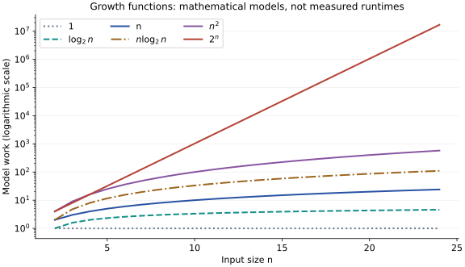

# Growth rates and dominant terms

**After this page, you should be able to:**

- Explain dominant terms and compare growth without ignoring finite-size costs.
- Predict doubling ratios and relate logarithms to fixed-factor reductions.

**Builds on:** [Input size and cost models](counting-work.md), powers and simple arithmetic.

An exact count describes work at a particular size. A growth rate describes how that count changes as size increases. This helps compare methods whose costs cross over as inputs grow.

(asymptotic-growth)=
## Asymptotic analysis looks beyond a fixed input size

Consider T_A(n) = 3n + 20 and T_B(n) = n² + 2. Their units are counted operations, not seconds.

| n | T_A(n) | T_B(n) |
|---:|---:|---:|
| 2 | 26 | 6 |
| 6 | 38 | 38 |
| 10 | 50 | 102 |
| 100 | 320 | 10,002 |

Method B has less modelled work at n = 2, while A has less at n = 100. A lower growth rate does not promise less work at every finite size.

**Asymptotic analysis** studies behaviour as input size becomes sufficiently large. It distinguishes fixed multiplicative differences from changes to the long-run growth pattern.

(dominant-term)=
## Why the dominant term matters

For T(n) = 3n² + 5n + 2, divide by n²:

$$
\frac{T(n)}{n^2}=3+\frac{5}{n}+\frac{2}{n^2}.
$$

As n grows, the final two terms approach zero. The quadratic contribution controls growth, although the other terms still affect the exact count.

This reasoning applies to fixed-coefficient polynomials with a positive leading term. It does not justify visually deleting terms from any expression. If a coefficient, exponent or loop limit itself depends on n, that dependence matters.

(growth-classes)=
## Common growth classes

| Function | Name | Representative pattern |
|---|---|---|
| 1 | Constant | Fixed work independent of n |
| log₂ n | Logarithmic | Repeatedly halve a positive problem size |
| n | Linear | Visit every item once |
| n log₂ n | Linearithmic | Logarithmically many levels, each with linear work |
| n² | Quadratic | Examine every ordered pair |
| 2ⁿ | Exponential | A search space that doubles for each added choice |

These are patterns to justify from an algorithm, not labels to attach from its name. Implementations of the same idea can have different costs.

The vertical axis is logarithmic so the fastest curves do not hide the others. Equal vertical distances represent equal multiplicative changes, not equal additions. These mathematical curves have multiplier 1; they are not benchmarks.

(doubling-input)=
## What happens when the input doubles?

Compare f(2n) with f(n), for n > 1:

| f(n) | Effect of doubling n |
|---|---|
| 1 | No change |
| log₂ n | Adds 1 |
| n | Multiplies by 2 |
| n log₂ n | Ratio 2(1 + 1/log₂ n), approaching 2 |
| n² | Multiplies by 4 |
| 2ⁿ | Multiplies by 2ⁿ |

The n log n row is not exactly “double”: its logarithmic factor also changes. The exponential ratio itself grows with n.

(logarithms-and-base)=
## Logarithms count repeated reductions

The equation 2ᵏ = n asks how many factors of 2 produce n. Its inverse is k = log₂ n. Repeated halving asks the same question in reverse: how many reductions take n down to a constant-sized remainder?

Changing to another fixed base greater than 1 changes only a constant multiplier:

$$
\log_b n=\frac{\log_2 n}{\log_2 b}.
$$

We therefore often write “log n” for a growth class, while specifying the base for exact counts. The [halving trace](code-and-space.md#repeated-halving) explains integer division and stopping details.

## Growth is not yet a bound claim

Identifying a dominant term prepares us to state a bound. We still need to choose upper, lower or tight bounds, and specify which input cases the cost function describes.

## Read the growth claim with its assumptions

The functions on this page describe counted work, not a universal execution time. For T(n)=an²+bn+c with fixed coefficients and a>0, quadratic growth follows because lower-order contributions become small relative to n². Multipliers and setup still matter at actual input sizes: T_A and T_B in the table tie at n=6 even though their long-run growth differs.

For logarithms, specify a positive domain and a fixed base greater than 1. The loop's rounding and stopping test determine an exact iteration count; its growth class does not settle that count. Likewise, an observed doubling ratio near 2 does not by itself distinguish n from n log n over a short range. Use the derivation as well as measurements.

A growth expression is not tied to one resource: time and maximum live storage can have different functions for the same algorithm. Nor does the expression alone choose a best, worst or expected input family. The [next reading](cases-and-bounds.md) makes those quantifiers explicit.

:::{tip} Common misconception
**A lower growth class is faster for every input size.** Fixed setup, constant factors, representation and workload can reverse the comparison over a finite range.
:::

(analysis-growth-checks)=
## Check your understanding

Predict the count or assess the claim before opening the explanation.

**1. For T(n)=3n²+5n+2, is T(2n) exactly four times T(n)?**

:::{dropdown} Show explanation
No. T(2n)=12n²+10n+2, while 4T(n)=12n²+20n+8. The ratio approaches 4 as the quadratic term dominates.
:::

**2. If f(n)=2ⁿ, does doubling n merely double the work?**

:::{dropdown} Show explanation
No. f(2n)/f(n)=2ⁿ. Adding one to n doubles this model; doubling n has a much larger effect.
:::

Next: [Cases and bounds](cases-and-bounds.md).

**Browse:** [Analysing algorithms](analysis.md) · [Concept index](../../concepts.md)
