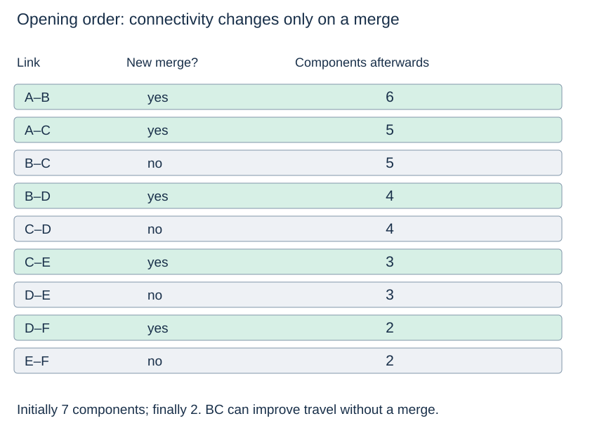

# An operator asks whether places are connected

(transport-incremental-connectivity)=
## Answer after each arriving connection

Imagine opening candidate links in the declared input order. Before any are opened, every place is separate. After each opening, an operator asks how many groups remain. This is a useful [union–find](../union-find/union-find.md) workload: merges and membership queries are interleaved.

```python
place_index = {place: i for i, place in enumerate(places)}
sets = DisjointSet(len(places))
opening_log = []
for u, v, minutes, build_units in links:
    merged = sets.union(place_index[u], place_index[v])
    opening_log.append((u, v, merged, sets.components))
```

(transport-connectivity-trace)=
## A connection can be useful without merging two components

AB merges two sets; AC merges another. BC then returns `False`, since B and C are already connected through A. Later BD, CE and DF each merge a new place into that group. The final component count is **two**: A–F together and isolated G.



A false union result does not mean the link is useless for transport. BC is central to the 13-minute route even though it does not change reachability when it opens. A new link may improve time or provide redundancy without changing the partition.

(transport-connectivity-versus-routes)=
## Preserve graph edges when routes are needed

The disjoint-set parent arrays are bookkeeping, not input connections. Compression can create shortcuts between members that have no direct link. Recover actual routes from the graph's adjacency lists and traversal/shortest-path predecessors, not from union–find parents.

For one static snapshot, BFS/DFS can label all undirected components in linear time. Union–find earns its role when connectivity queries recur between added links. Removing an arbitrary link is different: ordinary union–find does not split a merged component or determine whether a redundant alternative remains.

**Think first:** does `union(B,C) == False` justify removing BC from the fastest-route graph? **Reasoning:** no. It preserves reachability at that snapshot but can destroy the best travel-time route.

Next: [Network design](transport-design.md).
