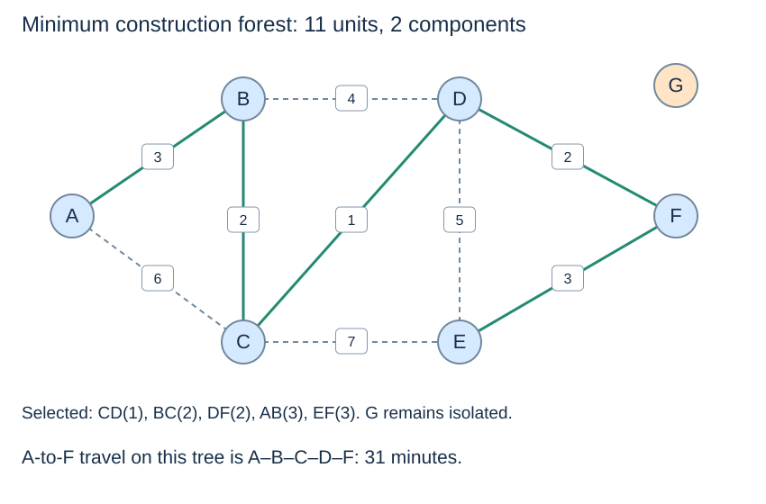

# A planner asks for the cheapest connecting network

**After this page, you should be able to:**

- Specify the construction objective and interpret a forest when full connectivity is infeasible.
- Check optimal cost, coverage and travel consequences as separate properties.

**Builds on:** [Connectivity](transport-connectivity.md) and [minimum spanning forests](../graph-algorithms/spanning-trees.md).

(transport-construction-objective)=
## Change the objective and choose the matching weight

Suppose the candidate links have not yet been built. The planner wants a connected network at minimum total **construction units**, without a travel-time requirement or redundancy constraint. With an undirected model, this is a minimum-spanning-tree question inside each candidate-connected component.

Because G has no candidate link, no spanning tree can connect all seven places. An algorithm can construct a [minimum spanning forest](../graph-algorithms/spanning-trees.md), but it cannot invent a missing harbour connection.

```python
construction_edges = [(cost, u, v) for u, v, minutes, cost in links]
chosen_build, build_total, build_components = kruskal_forest(
    places, construction_edges
)
prim_chosen, prim_total, prim_components = prim_forest(build_graph)
```

(transport-mst-result)=
## Verify both the total and the retained coverage

Kruskal accepts **CD(1), BC(2), DF(2), AB(3), EF(3)**. They form a tree covering A–F with construction total **11**. G remains a singleton tree, so the result has two components and 7−2=5 selected edges. Prim agrees on the total and component count; its accepted order and edge orientation need not match Kruskal's list.



The cut/exchange argument justifies accepting these light edges without sacrificing an optimum completion. By contrast, taking every input-order edge that initially merges components would select AB, AC, BD, CE and DF, costing **22** units. Avoiding cycles alone does not establish minimum cost; Kruskal's increasing-weight scan matters.

(transport-design-route-tradeoff)=
## A cheap network can make travel slower

```python
chosen_pairs = {frozenset((u, v)) for cost, u, v in chosen_build}
built_links = [row for row in links
               if frozenset((row[0], row[1])) in chosen_pairs]
built_time_graph = adjacency_view(places, built_links, 2)
built_distance, built_parent = dijkstra(built_time_graph, "A")
built_route = weighted_path_to("A", "F", built_distance, built_parent)
```

On this constructed tree, A-to-F follows **A–B–C–D–F**, taking **31 minutes**: 12+2+9+8. The full candidate network offered 13 minutes. Minimising edge construction cost did not preserve fastest routes; the chosen tree also has no backup route if an edge fails.

## Design contract, choices and costs

Both algorithms return `(chosen_edges, total, components)` in fresh result containers. Chosen edges use `(construction_cost, u, v)`, not the source table's `(u, v, minutes, cost)` format. The original links and adjacency views remain available. The graph is simple and undirected, with valid endpoints and finite positive construction weights. Under positive costs, removing a cycle edge reduces cost without losing connectivity, so a cheapest network within a component can be a tree.

Kruskal sorts all candidate edges and tracks an acyclic partition with union–find. Prim grows one tree using the cheapest edge crossing from its reached set; after finishing that component, it starts another. The respective cut arguments establish optimality. The check `selected edges = n − components` verifies a forest's size once acyclicity and component coverage are established; that equation alone does not prove minimum cost.

Use Kruskal when a weighted edge table is already available, or Prim when weighted adjacency is convenient. Kruskal here takes O(n+m log(m+1)) usual time and O(n+m) extra storage; lazy Prim takes O(n+m log(m+2)) time and O(n+m) auxiliary/result storage. Kruskal's sorted copy and Prim's stale crossing candidates count as storage. A forest returns n−c edges for c components; it never silently drops isolated vertices. Equal weights can allow several optima on other inputs, so compare totals and coverage rather than requiring identical edge order.

Filtering the source table to selected unordered pairs takes O(n+m) expected time with O(n+m) storage as an upper bound, followed by building another time view. Running Dijkstra on that view is a new query with a new edge set; its answer cannot be inherited from the full candidate network.

:::{tip} Common misconception
**Minimum construction cost implies fastest trips and resilience.** This forest changes A-to-F travel from 13 to 31 minutes and offers no alternative path inside its tree if a selected link fails.
:::

(transport-design-checks)=
## Check your understanding

Predict the result or justify the choice before opening the explanation.

**1. An input-order union scan finds an acyclic network costing 22 units. Has it solved minimum-cost construction?**

:::{dropdown} Show explanation
No. It preserves connectivity without cycles, but lacks Kruskal's increasing-weight safe-choice rule. The minimum forest here costs 11 units, so feasibility alone is not optimality.
:::

**2. Must a planner reject an extra link after constructing the minimum forest? Can that forest claim to serve G?**

:::{dropdown} Show explanation
An extra positive-cost link increases construction expenditure but may improve travel time or resilience under a revised objective. G remains isolated because no candidate connection reaches it; a minimum forest is not evidence of full seven-place service.
:::

Next: [Compare decisions and model limits](transport-decisions.md).
