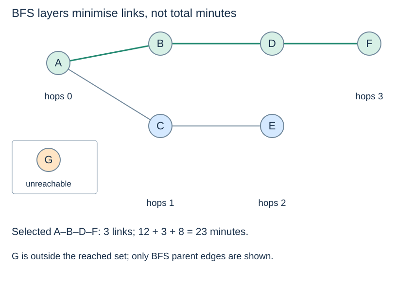

# A visitor asks for the fewest links

**After this page, you should be able to:**

- Interpret a BFS route as a minimum-hop answer with an explicit tie policy.
- Distinguish reached-only results, an absent route and an invalid place identifier.

**Builds on:** [The shared model](transport-model.md) and [BFS](../graphs/breadth-first-search.md).

**Code languages:** Python defines the explanations, figures and self-checks. Use the [language guide](../../code-languages.md) for native conventions and dependencies. Complete runnable topic examples: [JavaScript](../../examples/languages/applications.js) · [Julia](../../examples/languages/applications.jl).

Reuse the translated graph algorithms and the same invented dataset. Julia travel/build columns are 3 and 4, versus 2 and 3 in Python/JavaScript. The translated construction adjacency is named build_graph_view to distinguish it from the graph-builder function. All versions keep the isolated harbour, distinguish absence from a zero-length route, and separate minutes from construction units.

(transport-bfs-question)=
## Give every edge the same contribution

The question is: from Gate A to Park F, which route uses the fewest links? This is a hop-count objective. It could describe fewest direct connections traversed, but does not yet describe fewest vehicle transfers: the model contains no service identities.

The [BFS implementation](../graphs/breadth-first-search.md#bfs-code) stores discovered hop distances in a dictionary, waiting vertices in a deque, and one predecessor per discovered vertex. It marks at enqueue, so alternative routes do not add the same vertex repeatedly.

::::{tab-set}
:class: code-language-tabs

:::{tab-item} Python
:sync: python

```python
order, hop_parent, hop_distance = bfs(hop_graph, "A")
fewest_route = path_to(hop_parent, "F")
fewest_minutes = route_total(fewest_route, links, 2)
```

:::

:::{tab-item} JavaScript
:sync: javascript

```javascript
var [order, hop_parent, hop_distance] = bfs(hop_graph, "A");
var fewest_route = path_to(hop_parent, "F");
var fewest_minutes = route_total(fewest_route, links, 2);
```

:::

:::{tab-item} Julia
:sync: julia

```julia
order, hop_parent, hop_distance = bfs(hop_graph, "A")
fewest_route = path_to(hop_parent, "F")
fewest_minutes = route_total(fewest_route, links, 3)
```

:::

::::

(transport-bfs-result)=
## Read the route and its guarantee separately

With the declared neighbour order, `order` is `["A","B","C","D","E","F"]`. Hop distances are A:0, B:1, C:1, D:2, E:2, F:3. G is absent from the reached-distance dictionary because it is unreachable from A.

The returned route is **A–B–D–F**: three links and **23 minutes**, from 12+3+8. Another three-link route, A–C–D–F, takes 20 minutes. BFS is allowed to return the 23-minute route because its contract minimises hops, not travel time or a secondary time tie-break.



The queue processes layers in nondecreasing hop distance. Reordering neighbour lists can change a chosen route among tied hop counts; it cannot reduce the minimum count below three. Following parent links recovers one answer, not every shortest route.

(transport-bfs-boundaries)=
## Distinguish absence, a zero-length trip and a different objective

`path_to(hop_parent, "G")` returns `None`. The route to A is `["A"]`, with zero links and zero minutes. An unknown label is invalid input rather than another declared isolated place.

## Query contract, state and costs

Run the listings after the shared model in the same session. The graph is fixed during the query. `bfs` returns `(order, parent, distance)` in fresh containers and does not mutate adjacency lists. The dictionaries contain reached places only; each non-source parent is an actual graph neighbour one layer nearer A. Marking on enqueue makes each discovered vertex enter the FIFO frontier once. That layer invariant establishes the hop optimum.

An unknown BFS source raises `KeyError`. The recovery helper `path_to` returns `None` for any key absent from `parent`, so it does not itself distinguish an unknown target from declared but unreachable G. Check target membership in `places` when that distinction matters. The helper assumes parents came from a matching traversal and are not an arbitrary cyclic dictionary.

With n declared vertices and m undirected links, BFS has O(n+m) time and O(n) state/output upper bounds; its actual traversal visits only A's component. Recovering a k-edge route takes O(k+1) time and returned storage. The subsequent minute measurement is another operation, including an O(m) lookup preparation; those minutes do not affect BFS's decisions. For many destinations from the same source, reuse the traversal result while the graph stays unchanged.

:::{tip} Common misconception
**BFS minimises every measure of route length.** It minimises the number of edges here. Minutes and transfers require their own model and contract.
:::

(transport-hops-checks)=
## Check your understanding

Predict the result or justify the choice before opening the explanation.

**1. If neighbours are sorted by travel minutes first, does BFS then guarantee the fastest route?**

:::{dropdown} Show explanation
No. It still removes vertices from a FIFO queue by hop layer, rather than by cumulative minutes. Sorting can select a different tied hop route, but does not establish a travel-time optimum.
:::

**2. If the two neighbours of A are visited in the opposite order, must the returned route still be A–B–D–F?**

:::{dropdown} Show explanation
No. A–C–D–F can be chosen instead. It still uses three links, now totalling 20 minutes. The minimum hop count stays three; the selected route and its time can change.
:::

Next: [Least travel time](transport-times.md).
