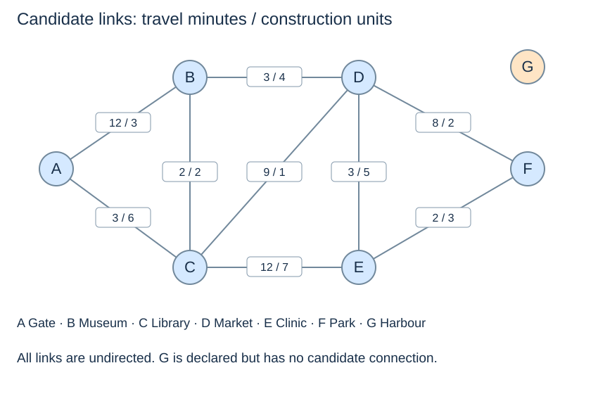

# Model places, links and two kinds of cost

**After this page, you should be able to:**

- Translate a transport question into vertices, edges and a weight with explicit units.
- Derive consistent graph views while preserving isolated places and input assumptions.

**Builds on:** [Maps and sets](../maps-sets-hashing/maps-sets-hashing.md) and [graph representations](../graphs/graph-representations.md).

(transport-case-model)=
## Decide what vertices and edges represent

A vertex is a place, not a passenger or a vehicle. An undirected edge is a candidate direct connection. The route scenarios assume all candidate links are available; the design scenario asks which subset to construct. These are distinct interpretations of the same candidate data.

A trip along a link has a travel time. Building that link has a separate construction cost. Adding those quantities together would be meaningless: minutes and construction units measure different things.



(transport-data-representations)=
## Keep one source table and derive each adjacency view

```python
from transport_network import (
    bfs, path_to, dijkstra, weighted_path_to,
    DisjointSet, prim_forest, kruskal_forest,
)

places = {
    "A": "Gate", "B": "Museum", "C": "Library",
    "D": "Market", "E": "Clinic", "F": "Park", "G": "Harbour",
}
# (endpoint, endpoint, travel_minutes, construction_units)
links = [
    ("A", "B", 12, 3), ("A", "C", 3, 6),
    ("B", "C", 2, 2), ("B", "D", 3, 4),
    ("C", "D", 9, 1), ("C", "E", 12, 7),
    ("D", "E", 3, 5), ("D", "F", 8, 2),
    ("E", "F", 2, 3),
]

def adjacency_view(places, links, weight_column=None):
    if weight_column not in (None, 2, 3):
        raise ValueError("choose unweighted, travel time or construction cost")
    graph = {place: [] for place in places}
    for row in links:
        u, v = row[:2]
        if weight_column is None:
            graph[u].append(v)
            graph[v].append(u)
        else:
            weight = row[weight_column]
            graph[u].append((v, weight))
            graph[v].append((u, weight))
    return graph

hop_graph = adjacency_view(places, links)
time_graph = adjacency_view(places, links, 2)
build_graph = adjacency_view(places, links, 3)
```

The `places` dictionary is an exact-key map from a stable identifier to a display name. All places become graph keys, including G, which has no incident link. Each undirected link appears once in `links` and twice in adjacency storage. The input contract requires distinct valid endpoints per link, no repeated unordered pairs, and finite positive weights. The helper derives views from this declared valid table; it is not a general data-cleaning routine.

The link order controls neighbour order, and therefore tie choices in BFS. It does not give a priority to cheap edges. A coordinate on the diagram indicates layout only; it is not used to calculate a weight.

(transport-route-measurement)=
## Measure an answer with the same units as its question

```python
def route_total(route, links, weight_column):
    if weight_column not in (2, 3):
        raise ValueError("choose travel time or construction cost")
    if route is None:
        return None
    weights = {frozenset((row[0], row[1])): row[weight_column]
               for row in links}
    return sum(weights[frozenset((u, v))]
               for u, v in zip(route, route[1:]))
```

This helper assumes an actual route from the graph algorithms, with valid vertices and consecutive endpoints connected by declared links. A one-vertex route costs zero; `None` remains absence, not a zero-cost trip. A `frozenset` makes an unordered endpoint-pair key, appropriate here because there are no parallel links and direction is deliberately ignored.

## Adapter contracts and preparation costs

`adjacency_view` returns fresh adjacency lists without changing `places` or `links`. The unweighted view contains neighbour identifiers; weighted entries are `(neighbour, weight)` pairs. Column `None`, 2 or 3 selects the representation. Another selector raises `ValueError`; an undeclared endpoint raises `KeyError` when its adjacency list is accessed. Invalid row shapes, duplicate pairs or non-finite weights are outside this helper's contract and are not comprehensively checked. Validate external data before adapting it.

`route_total` returns a number in the selected units or `None` for an absent route. A selector other than 2 or 3 raises `ValueError`, even if the route is `None`. A missing consecutive pair raises `KeyError`; this does not make the helper a complete route validator. In particular, a singleton with an unknown identifier has no pair to check. Callers must supply a valid route, rather than use a zero sum as proof of validity.

For n places and m links, each view takes O(n+m) time and returned storage under expected constant-time hashing. All three views preserve the same vertex set and edge pairs, but project different edge information. Keeping one source table prevents the time and construction views from accidentally describing different networks. Measuring a k-edge route rebuilds a pair lookup and scans k pairs; the final page accounts for that extra preparation and the Python slice.

:::{tip} Common misconception
**One adjacency view can serve every objective unchanged.** An unweighted view discards minutes; a construction-weighted view optimises different units. Choose the view from the question.
:::

(transport-model-checks)=
## Check your understanding

Predict the result or justify the choice before opening the explanation.

**1. Should unreachable Harbour G be omitted from `places` to simplify the graph?**

:::{dropdown} Show explanation
No. G is a declared place with an empty adjacency list. Removing it would hide the service gap and change the component count from two to one.
:::

**2. What do `route_total(["A"], links, 2)` and `route_total(None, links, 2)` mean?**

:::{dropdown} Show explanation
The first returns 0 minutes for a valid trip that stays at A. The second returns None because no route was supplied. Absence is not a zero-cost journey.
:::

Next: [Fewest links](transport-hops.md).
