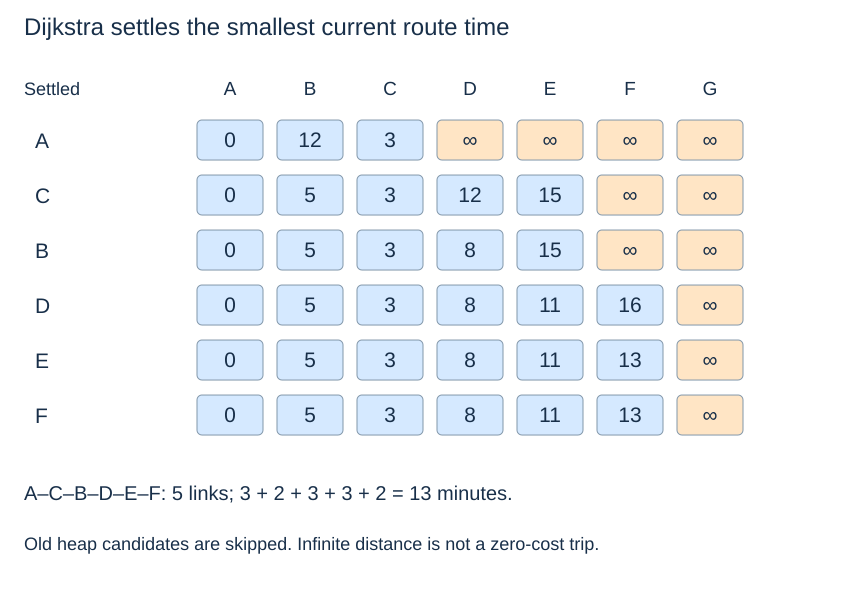

# A visitor asks for the least travel time

(transport-dijkstra-question)=
## Accumulate minutes along the route

Now minimise travel minutes from Gate A. The time graph contains positive weights, satisfying [Dijkstra's nonnegative-weight condition](../graph-algorithms/dijkstra.md). The heap prioritises a tentative whole-route cost, and relaxation can replace an earlier, slower route.

```python
time_distance, time_parent = dijkstra(time_graph, "A")
fastest_route = weighted_path_to("A", "F", time_distance, time_parent)
fastest_minutes = route_total(fastest_route, links, 2)
```

(transport-dijkstra-trace)=
## A better route can have more links

After A is processed, B has tentative distance 12 and C has 3. Processing C improves B to 5 via A–C–B, proposes D at 12 and E at 15. Processing B then improves D to 8. D improves E to 11 and proposes F at 16; E finally improves F to 13.

Valid heap pops settle vertices in order **A, C, B, D, E, F**. The old candidates remain in the lazy heap and are discarded when they no longer match current labels. Final distances are A:0, B:5, C:3, D:8, E:11, F:13; G has infinite distance.



The answer is **A–C–B–D–E–F**, five links and **13 minutes**. Taking more links reduces time in this model. All algorithmic time weights came from column 2; construction cost did not enter the heap key.

(transport-travel-assumptions)=
## Qualify what fastest means

The model adds fixed link times. It excludes waiting, congestion, timetables, fares and transfer penalties. Therefore “least travel time” here means least sum of these supplied weights, rather than a prediction of a real door-to-door journey.

`weighted_path_to("A", "G", time_distance, time_parent)` returns `None`, while the source has distance zero. This implementation initialises all declared vertices, unlike BFS's reached-only distance dictionary. Different containers express different conventions; an absent BFS key and an infinite Dijkstra label both indicate unreachable G here.

**Think first:** why not mark B final when A first inserts it at 12? **Reasoning:** the later route through C costs 5. The nonnegative settlement argument applies at a valid minimum-cost pop, not at insertion.

Next: [Incremental connectivity](transport-connectivity.md).
