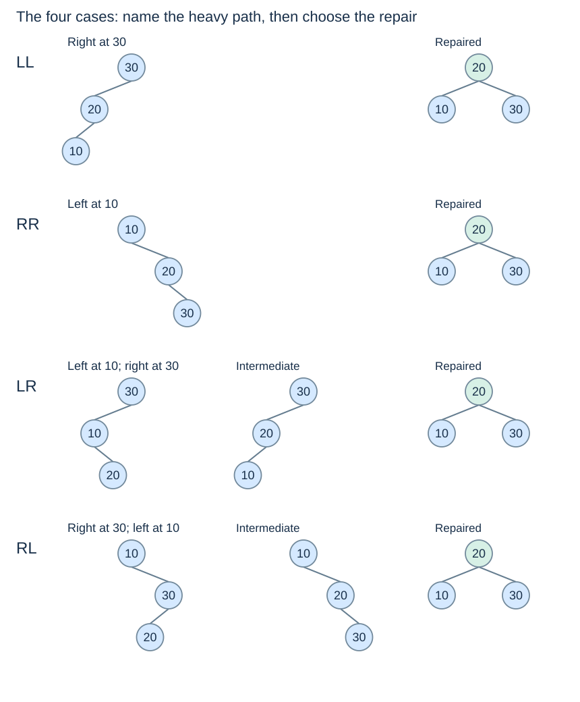

# LL, RR, LR and RL cases

**After this page, you should be able to:**

- Identify straight and bent imbalance patterns from child factors.
- Choose repairs that also handle deletion’s zero-factor child.

**Builds on:** [Rotations](avl-rotations.md) preserve key order and transferred subtrees.

## Repair contract

`rebalance(node)` takes a nonempty node whose child subtrees are already valid AVL trees with correct heights. After one valid single-key update, it refreshes this node and returns the repaired subtree root with the same keys. Its caller must reconnect the result. It is not a validator or repair routine for arbitrarily corrupted trees.

(avl-four-cases)=
## Name the heavy path from the unbalanced node

Let `z` be the ancestor being repaired. The first letter describes its heavy child; the second describes the heavy direction within that child. The names describe the **shape causing imbalance**, not the direction of the corrective rotation.

| Case | Example insertion order | Repair |
|---|---|---|
| LL | 30, 20, 10 | Right rotation at 30 |
| RR | 10, 20, 30 | Left rotation at 10 |
| LR | 30, 10, 20 | Left rotation at 10, then right at 30 |
| RL | 10, 30, 20 | Right rotation at 30, then left at 10 |



(avl-double-rotation)=
## Straighten an inner bend before promoting it

In LR, node 20 is too deep in the left child's right branch. First rotate that child left, converting the local shape to LL. Then rotate the old root right. RL is the mirror image.

A single rotation in the original LR shape may preserve sorted order but fail to establish AVL balance. Order preservation and balance repair are different obligations; a correct repair must do both. Larger examples retain the middle and outside subtrees exactly as described on the [rotation page](avl-rotations.md).

(avl-rebalance)=
## Choose the repair from child balance factors

```python
def rebalance(node):
    update_height(node)
    bf = balance_factor(node)
    if bf > 1:
        if balance_factor(node.left) < 0:
            node.left = rotate_left(node.left)
        return rotate_right(node)
    if bf < -1:
        if balance_factor(node.right) > 0:
            node.right = rotate_right(node.right)
        return rotate_left(node)
    return node
```

This helper requires a nonempty node whose child subtrees are already AVL-valid with correct heights. The current node may need repair after a single-key update. Bottom-up recursion establishes that precondition at each level.

The strict `< 0` and `> 0` inner tests matter for deletion: a heavy child with factor **zero** uses a single rotation. Insertion-only rules based on the newly inserted key cannot simply be reused for deletion, where no inserted key identifies a path.

## Implementation choices and local costs

Child-factor tests handle both insertion and deletion, including a zero-factor heavy child. Each call does O(1) work and at most two rotations with O(1) local workspace. This does not include reaching the node or checking the full update path. Choosing cases by a newly inserted key is an insertion-specific alternative; it cannot stand in for the shared deletion-capable helper.

:::{tip} Common misconception
**LL names the direction of the repair.** It names the imbalance path; LL is repaired by a right rotation.
:::

(tree-cases-checks)=
## Check your understanding

Predict the returned result, links or invariant before opening the explanation.

**1. BF(z)=+2 and BF(z.left)=−1. Where does the first returned root reconnect?**

:::{dropdown} Show explanation
At z.left after a left rotation on the child. Then rotate z right and retain the whole subtree’s new root.
:::

**2. If the heavy child has factor zero after deletion, must repair be double?**

:::{dropdown} Show explanation
No. The shared helper selects a single rotation in that case.
:::

Next: [Insertion](avl-insertion.md).
