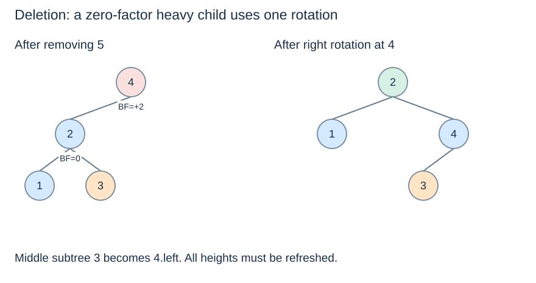

# AVL deletion and upward repair

(avl-deletion)=
## Remove as in a BST, then restore balance

First apply [ordinary BST deletion](../searching/bst-deletion.md): remove a leaf, retain the whole child subtree for a one-child node, or copy a successor key and delete its original node. Then update heights and rebalance each remaining ancestor on the return path.

This code uses the same `rebalance` helper as insertion. An absent key leaves the key set unchanged. Keys are distinct and no associated values are stored in this teaching model.

```python
def avl_delete(node, key):
    if node is None:
        return None
    if key < node.key:
        node.left = avl_delete(node.left, key)
    elif key > node.key:
        node.right = avl_delete(node.right, key)
    else:
        if node.left is None:
            return node.right
        if node.right is None:
            return node.left
        successor = node.right
        while successor.left is not None:
            successor = successor.left
        node.key = successor.key
        node.right = avl_delete(node.right, successor.key)
    return rebalance(node)
```

Call it as `root = avl_delete(root, key)`. When a removed node returns its only child, that child's unchanged subtree already has valid heights. Its parent receives the result and performs the next balance check. A singleton deletion returns `None` directly.

(avl-deletion-zero-child-factor)=
## A zero-factor heavy child needs a single rotation

Start with root 4, left child 2 (with children 1 and 3), and right child 5. Deleting 5 makes 4 left-heavy by two; child 2 has factor zero. A single right rotation gives root 2, left child 1 and right child 4, whose left child is 3.



The example tests two details at once: the factor-zero case must not trigger an unnecessary double rotation, and the nonempty middle subtree 3 must survive. A deletion implementation that handles only the four three-key insertion examples can miss this case.

(avl-deletion-cascade)=
## Continue because subtree height can shrink

After deletion and a local repair, a subtree can be shorter than it was before deletion. Its parent can therefore become unbalanced, and repair may be needed at several ancestors. The function above continues all the way upward, computing each decision from current child heights rather than from the deleted key's former position.

There are $O(\log(n+1))$ ancestors. Each performs constant local work and at most two rotations, so deletion remains $O(\log(n+1))$ time and stack space. Unlike insertion, the number of local repairs can grow with tree height.

(avl-validation)=
## Check all three maintained properties

A convincing check verifies the key set and strict ancestor bounds, recomputes actual heights from the links, and confirms both cached heights and balance factors at every node. Sorted inorder output alone cannot detect a stale height or an unbalanced but ordered tree.

Useful transitions include deleting the root, deleting an absent key, removing a successor with a right child, repeated deletion until empty, and inserting again afterwards. These are structural checks, not just examples of ordinary lookup.

Further reading: [Cornell's AVL notes](https://courses.cs.cornell.edu/cs2112/2017fa/lectures/lec_avl/index.html). Return to the [topic overview](balanced-trees.md) or compare the different split rules in [k-d trees](../kd-trees/kd-trees.md).
