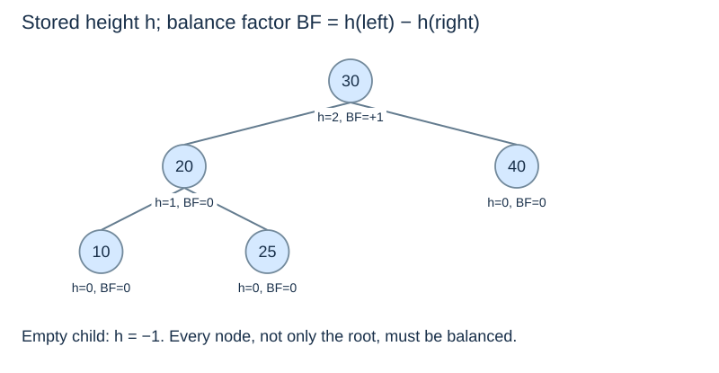

# Heights, balance factors and AVL invariants

(avl-invariant)=
## Add balance to BST order

An **AVL tree** satisfies both the strict BST ordering rule and this local height condition at **every** node:

$$ |h(v.left)-h(v.right)|\leq1. $$

A small height difference only at the root is insufficient. A descendant can be unbalanced while the root's two subtrees happen to have equal heights. Likewise, a short unordered binary tree is not an AVL search tree.

(avl-height-convention)=
## Store heights consistently

We count edges on the longest downward path. An empty subtree has height −1, a leaf has height 0, and a nonempty node has height one plus the larger child height.

```python
class AVLNode:
    def __init__(self, key):
        self.key = key
        self.left = None
        self.right = None
        self.height = 0

def height(node):
    return -1 if node is None else node.height

def update_height(node):
    node.height = 1 + max(height(node.left), height(node.right))

def balance_factor(node):
    return height(node.left) - height(node.right)
```

The helper reads cached child heights. It does not traverse their descendants. Recomputing every subtree height from scratch at each ancestor would defeat the intended constant local work per update level.

(avl-balance-factor)=
## The sign identifies the heavy side

With $BF=h(left)-h(right)$, positive means left-heavy and negative means right-heavy. Valid AVL factors are −1, 0 and +1. A single insertion or deletion into an otherwise valid AVL tree can temporarily produce +2 or −2 along the affected ancestor path.



Other references may use the opposite sign or count nodes instead of edges. The algorithm must use one consistent convention; changing the sign without changing the rotation conditions gives incorrect decisions.

(avl-height-bound)=
## Local balance implies logarithmic global height

Let $N(h)$ be the minimum number of nodes in an AVL tree of height $h$. To obtain that height with as few nodes as possible, the child heights are $h-1$ and $h-2$:

$$N(-1)=0,\quad N(0)=1,\quad N(h)=1+N(h-1)+N(h-2).$$

For heights 0, 1, 2, 3 and 4, the minimum node counts are 1, 2, 4, 7 and 12. This Fibonacci-like growth is exponential in height, so height is $O(\log(n+1))$ in the number of nodes. That is the reason path-based lookup and updates can have logarithmic worst-case bounds.

AVL balance does **not** require a perfect or complete binary tree, equal child sizes, or the smallest possible height. It permits enough shape flexibility to support local repair. Next: [Rotations](avl-rotations.md).
