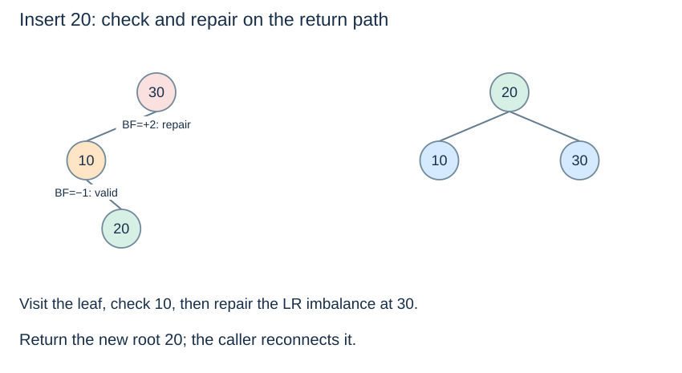

# AVL operations under the same ordered-set contract

**After this page, you should be able to:**

- Reuse the same ordered queries and public contracts with AVL update helpers.
- Separate logarithmic paths, rotation work, traversal output and metadata storage.

**Builds on:** [AVL insertion](avl-insertion.md), [AVL deletion](avl-deletion.md) and Topic 7's [OrderedSet adapter](../searching/ordered-set-operations.md).

**Code languages:** Python defines the explanations, figures and self-checks. Use the [language guide](../../code-languages.md) for native conventions and dependencies. Complete runnable topic examples: [JavaScript](../../examples/languages/balanced-trees.js) · [Julia](../../examples/languages/balanced-trees.jl).

The same BST readers and OrderedSet interface are reused from Topic 7. Julia updates use function calls, not dot methods. All variants use empty height −1, leaf height 0, and left height minus right height; rotations must return and reconnect the new subtree root.

(avl-operation-contract)=
## Purpose and operation contracts

AVL balancing changes how short the paths stay, not what a set operation means. Use the same [operation table](../searching/ordered-set-operations.md#ordered-set-contract): add ignores duplicates; remove is strict and returns `None`; discard tolerates absence; inspections leave the tree unchanged; extraction removes and returns an extreme. Missing extremes or neighbours raise `KeyError` in that adapter.

The raw `avl_insert` and `avl_delete` helpers instead return the resulting subtree root. Missing-key raw deletion leaves the key set unchanged. Do not mistake this low-level policy for the public strict-remove policy, or a rotation's root result for an inserted/deleted record.

## Representation and all maintained invariants

- Strict BST ordering holds at every node, with one node per distinct key.
- Each cached height agrees with the actual child links: empty −1, leaf 0.
- Every node has balance factor between −1 and +1.
- The adapter's total count equals the number of reachable nodes.

The first invariant makes ordinary BST queries correct; the next two bound path length; the last makes size/empty constant time. AVLNode stores no parent pointer, cached minimum or subtree counts for rank/select.

## Trace the same operations through a different shape

Insert 30,10,20. The insertion reading's LR repair yields root 20 with children 10 and 30. Repeating add(20) changes neither the keys nor the count. Successor(15) returns 20 without mutation. Extract-minimum returns 10; the remaining sorted keys are 20,30, regardless of any valid shape chosen by later repairs.



(avl-shared-interface)=
## Python implementation and reuse

Read the Topic 7 query helpers and adapter, then Topic 8's node/height, rotation, rebalance, insertion and deletion definitions in one session. The shared readers inspect only `key`, `left` and `right`; no separate AVL search algorithm is required.

::::{tab-set}
:class: code-language-tabs

:::{tab-item} Python
:sync: python

```python
balanced = OrderedSet(avl_insert, avl_delete)
for key in [30, 10, 20]:
    balanced.add(key)
balanced.add(20)
assert balanced.size() == 3
assert balanced.keys() == [10, 20, 30]
assert balanced.successor(15) == 20
assert balanced.range_keys(15, 30) == [20, 30]
assert balanced.extract_min() == 10
assert balanced.keys() == [20, 30]
```

:::

:::{tab-item} JavaScript
:sync: javascript

```javascript
var balanced = new OrderedSet(avl_insert, avl_delete);
for (const key of [30, 10, 20]) balanced.add(key);
balanced.add(20);
console.assert(balanced.size() === 3);
console.assert(JSON.stringify(balanced.keys()) === "[10,20,30]");
console.assert(balanced.successor(15) === 20);
console.assert(JSON.stringify(balanced.range_keys(15, 30)) === "[20,30]");
console.assert(balanced.extract_min() === 10);
console.assert(JSON.stringify(balanced.keys()) === "[20,30]");
```

:::

:::{tab-item} Julia
:sync: julia

```julia
balanced = OrderedSet(avl_insert, avl_delete)
for key in [30, 10, 20]; add!(balanced, key); end
add!(balanced, 20)
@assert length(balanced) == 3
@assert ordered_keys(balanced) == [10, 20, 30]
@assert successor(balanced, 15) == 20
@assert range_keys(balanced, 15, 30) == [20, 30]
@assert extract_min!(balanced) == 10
@assert ordered_keys(balanced) == [20, 30]
```

:::

::::

## Implementation choices and correctness

The adapter always reconnects the updated root, including after rotations. Only the AVL insert/delete pair may mutate this AVL-backed instance; calling ordinary `bst_insert` on its nodes could introduce nodes without height metadata and bypass balancing. Read-only BST queries are safe to reuse because AVL ordering is the same.

Using cached heights makes each local check constant work. Recomputing whole-subtree heights at every ancestor would change the update cost. A manual rotation preserves key order when its structural precondition holds, but it need not restore balance unless chosen by the repair algorithm.

(avl-all-operation-costs)=
## Time and space costs

Let L=log₂(n+2), so even an empty-tree operation has a constant bound.

| Operation | Worst-case time | Extra workspace, excluding results |
|---|---|---|
| Exact lookup / membership | O(L) | O(1), iterative |
| Add/remove/discard | O(L), including adapter prechecks | O(L), recursive update stack |
| Minimum/maximum; successor/predecessor | O(L) | O(1), iterative |
| Extract minimum/maximum | O(L), several paths by a constant factor | O(L) during deletion |
| Preorder/inorder/postorder snapshot | O(n+1) | O(L) stack, plus O(n) result |
| Closed range, r answers | O(L+r) | O(L) stack, plus O(r) result |
| Size / empty | O(1) | O(1) |
| Build by n repeated insertions | O(n log(n+2)) | O(L) stack beyond the growing tree |

Persistent storage is O(n+1), including one height per node and the adapter's total count. Rotations use O(1) extra local storage. One insertion needs at most one single/double repair at the lowest unbalanced ancestor, though this code still returns through all ancestors. Deletion may repair several levels and still stays logarithmic. Traversal and reporting all keys cannot be logarithmic because the output itself has n items.

## When to use it

AVL trees suit changing ordered data when worst-case path bounds matter. They require more update bookkeeping than an ordinary BST. For one static collection, compare sorted-array search and its preparation costs; for exact-key membership alone, compare a hash set's qualified expected bounds. The common contract allows behaviour to be compared separately from these trade-offs.

:::{tip} Common misconception
**Balancing makes every operation logarithmic.** Full traversal still visits n nodes; a range must return every matching key.
:::

(avl-operations-checks)=
## Check your understanding

**1. Can the iterative BST successor helper be used on AVL nodes without computing balance factors?**

:::{dropdown} Show explanation
Yes. It only reads the BST ordering and links. AVL height bounds make the same path logarithmic; balance factors are needed for updates, not this read-only query.
:::

**2. Is a sorted inorder list enough to validate an AVL update?**

:::{dropdown} Show explanation
No. Also check strict ancestor bounds, actual and cached heights, every node's balance, and the adapter count. An ordered tree may still be unbalanced or hold stale metadata.
:::

Continue in sidebar order to [spatial search](../kd-trees/kd-trees.md), which changes the partition invariant. For the graph route, you can instead go directly to [priority queues and heaps](../heaps/heaps.md), or return to [balanced search trees](balanced-trees.md).
