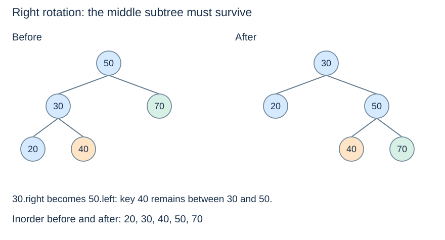

# Rotations and subtree transfer

**After this page, you should be able to:**

- Trace the middle subtree and reconnect the returned root.
- Update cached heights in dependency order and state rotation preconditions.

**Builds on:** [AVL height and balance conventions](avl-invariants.md).

**Code languages:** Python defines the explanations, figures and self-checks. Use the [language guide](../../code-languages.md) for native conventions and dependencies. Complete runnable topic examples: [JavaScript](../../examples/languages/balanced-trees.js) · [Julia](../../examples/languages/balanced-trees.jl).

The same BST readers and OrderedSet interface are reused from Topic 7. Julia updates use function calls, not dot methods. All variants use empty height −1, leaf height 0, and left height minus right height; rotations must return and reconnect the new subtree root.

## Rotation contract and preconditions

`rotate_right(z)` requires a nonempty left child; `rotate_left(z)` requires a nonempty right child. Child subtrees must already satisfy strict BST order and have correct cached heights. Each helper changes links, updates the affected heights and returns the new subtree root. It preserves all keys and inorder order; it is not an add/remove operation, and an arbitrary rotation need not restore AVL balance.

(bst-rotation)=
## Change parent relationships while keeping key order

A **rotation** changes a constant number of links around a node and one child. It preserves the inorder order of every key. It does not sort keys again, rebuild the entire tree, or discard the opposite subtree.

For a right rotation, let the old root be `z`, its left child `y`, and `y.right` the **middle subtree**. The key ranges occur in this order:

$$ \text{left of y} < y < \text{middle} < z < \text{right of z}. $$

(rotation-middle-subtree)=
## The middle subtree changes parent, not key range

When `y` becomes the root and `z` its right child, the middle subtree must become `z.left`. Its keys exceed `y` but remain below `z`, so this is precisely the location preserving all ancestor bounds.



The example deliberately keeps the opposite subtree 70 and the transferred subtree 40 visible. A rotation can be explained on an already balanced tree; that does not mean the balancing algorithm should rotate it. A height violation determines **whether** a repair is necessary.

(rotation-code)=
## Save, reconnect, update and return

The helpers below reuse `height` and `update_height` from the previous page. Right rotation requires an existing left child; left rotation requires an existing right child.

::::{tab-set}
:class: code-language-tabs

:::{tab-item} Python
:sync: python

```python
def rotate_right(z):
    y = z.left
    middle = y.right
    y.right = z
    z.left = middle
    update_height(z)
    update_height(y)
    return y

def rotate_left(z):
    y = z.right
    middle = y.left
    y.left = z
    z.right = middle
    update_height(z)
    update_height(y)
    return y
```

:::

:::{tab-item} JavaScript
:sync: javascript

```javascript
function rotate_right(z) {
    const y = z.left, middle = y.right;
    y.right = z; z.left = middle;
    update_height(z); update_height(y); return y;
}
function rotate_left(z) {
    const y = z.right, middle = y.left;
    y.left = z; z.right = middle;
    update_height(z); update_height(y); return y;
}
```

:::

:::{tab-item} Julia
:sync: julia

```julia
function rotate_right(z)
    y = z.left; middle = y.right
    y.right = z; z.left = middle
    update_height!(z); update_height!(y); return y
end
function rotate_left(z)
    y = z.right; middle = y.left
    y.left = z; z.right = middle
    update_height!(z); update_height!(y); return y
end
```

:::

::::

(rotation-height-updates)=
## Update the lower node before the new root

After a rotation, the former root `z` is below `y`. Update `z.height` first so that updating `y.height` reads the correct child height. Swapping that order can leave stale metadata even when the links and inorder keys look correct.

(rotation-reconnection)=
## The caller must retain the returned root

For a whole-tree right rotation, write `root = rotate_right(root)`. For a child subtree, reconnect it through the parent, such as `parent.left = rotate_right(parent.left)`. Merely calling the helper and ignoring its return value leaves the external reference at the former root and can make part of the tree unreachable from that reference.

Each rotation performs $O(1)$ local work using cached heights. A double rotation is two such operations, still constant work locally. This does not make an entire search-tree update constant-time: the algorithm must first reach the edited location and then check its ancestors.

## Implementation choices and suitability

Saving `middle` before overwriting links keeps the transferred subtree reachable. Reconnect the returned root through its owner; there are no parent pointers to do this automatically. Each rotation uses O(1) time and workspace with cached heights, and allocates no new node. Use the rebalance helper to decide when and which rotation to apply rather than rotating merely because a shape is recognisable.

:::{tip} Common misconception
**The middle subtree can be dropped during a rotation.** Its key range determines its new parent link.
:::

(tree-rotations-checks)=
## Check your understanding

Predict the returned result, links or invariant before opening the explanation.

**1. After rotating right around 50 with left child 30 and middle subtree 40, where does 40 go?**

:::{dropdown} Show explanation
It becomes 50.left. Its keys remain greater than 30 and less than 50.
:::

**2. Why update the old root’s height before the new root’s?**

:::{dropdown} Show explanation
The new root reads the former root as a child, so that child height must already be current.
:::

Next: [The four cases](avl-cases.md).
