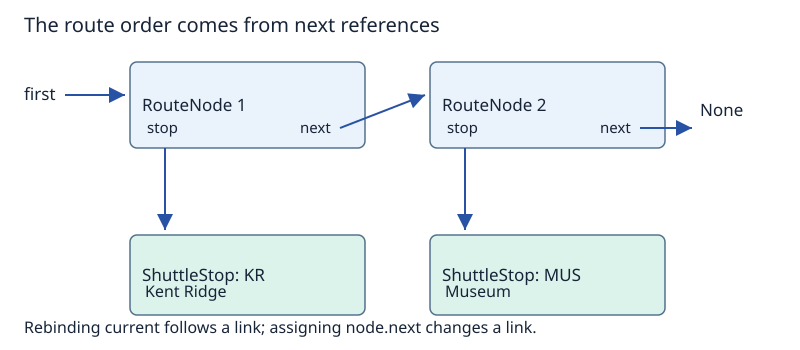

# Collections, classes and invariants

Built-in collections give us useful representations immediately. Classes let us define objects with named state and operations. Both approaches require clear decisions about what the data means and which states are valid.

(built-in-collections)=
## Lists, tuples, dictionaries and sets

| Type | Main interpretation | Mutable? | Example |
|---|---|---|---|
| `list` | Ordered sequence; repeated items allowed | Yes | `["KR", "MUS", "KR"]` |
| `tuple` | Fixed sequence, often a small record | No | `(1.2937, 103.7845)` |
| `dict` | Unique keys associated with values | Yes | `{"KR": "Kent Ridge"}` |
| `set` | Distinct elements and membership | Yes | `{"KR", "MUS"}` |

Python dictionaries preserve insertion order, but that is not sorted-key order. Sets provide no insertion-order guarantee. Dictionary keys and set elements must be [hashable](../maps-sets-hashing/hashing.md#hashability-in-python); dictionary values do not have that requirement. `{}` creates an empty dictionary; use `set()` for an empty set.

A tuple is useful for coordinates because each position has a fixed interpretation. That is a design convention, not a runtime restriction that tuples may only contain coordinates or that lists cannot store them.

(unpacking-and-comprehensions)=
## Unpacking and comprehensions

```python
location = (1.2937, 103.7845)
latitude, longitude = location

passenger_counts = {"Kent Ridge": 12, "Museum": 7, "University Town": 18}
busy_stops = [
    name
    for name, count in passenger_counts.items()
    if count >= 10
]
print(busy_stops)  # ['Kent Ridge', 'University Town']
```

Unpacking gives names to the two coordinate fields. In the comprehension, `.items()` supplies key-value pairs. For each pair, the condition selects a name for the new list. Reading it as “iterate, test, produce” helps distinguish the input representation from the output collection. The resulting order follows the dictionary’s iteration order, not a ranking by passenger count.

(classes-and-instances)=
## Classes, instances, attributes and methods

A **class** defines a type of object and its behaviour. An **instance** is a particular object of that class. An **attribute** holds named state or another accessible member; a **method** supplies behaviour associated with an object.

The following teaching model records a passenger count associated with each shuttle stop. It is deliberately small: it illustrates state updates, rather than modelling all transport operations.

```python
class ShuttleStop:
    def __init__(self, code: str, name: str) -> None:
        self.code = code
        self.name = name
        self._passengers = 0

    def board(self, number: int = 1) -> None:
        self._check_number(number)
        self._passengers += number

    def alight(self, number: int = 1) -> None:
        self._check_number(number)
        if number > self._passengers:
            raise ValueError("Not enough passengers")
        self._passengers -= number

    def _check_number(self, number: int) -> None:
        if type(number) is not int or number < 0:
            raise ValueError("Expected a nonnegative integer count")

    def __repr__(self) -> str:
        return (
            f"ShuttleStop({self.code!r}, {self.name!r}, "
            f"passengers={self._passengers})"
        )

museum = ShuttleStop("MUS", "Museum")
utown = ShuttleStop("UTN", "University Town")
museum.board(3)
utown.board(8)
museum.alight(1)
print(museum)  # ShuttleStop('MUS', 'Museum', passengers=2)
print(utown)   # ShuttleStop('UTN', 'University Town', passengers=8)
```

`__init__` initialises each newly created instance. Assignments to `self.code`, `self.name` and `self._passengers` establish instance attributes. Each stop has its own count; updating Museum does not change University Town. `__repr__` supplies an informative representation for inspection. Here `!r` requests the representation of each string, including its quotes.

(self)=
## What does self mean?

In `museum.board(3)`, the method receives Museum as its `self` argument. For this ordinary instance method, the call can be understood as `ShuttleStop.board(museum, 3)`. `self` is the conventional name for that parameter; it is not a separate shared stop or a copy of the instance.

(invariants)=
## Invariants describe valid states

An **invariant** is a condition intended to hold in every valid state at the boundaries of the supported operations. In this model the recorded passenger count must be a nonnegative integer.

Initialisation establishes the invariant. `board` accepts only nonnegative integer increments. `alight` also checks that enough passengers exist before subtraction. Rejected requests raise an exception before changing the count. Accepting a negative boarding count would defeat the invariant, so checking only the alighting limit would be insufficient.

For simplicity, the validation accepts Python’s `int` type exactly and rejects other types, including Boolean values. The particular validation policy is a design choice; the important point is that it matches the stated contract.

(encapsulation-and-hints)=
## Conventions and type hints are not runtime barriers

A leading underscore communicates that `_passengers` is an internal implementation detail. Python still permits direct assignment to it, so a client could bypass the intended methods and create invalid state. Encapsulation here relies on the interface and a documented usage convention.

Annotations such as `number: int` document intent and support static tools. They do not ordinarily enforce the type at runtime; the explicit `_check_number` code supplies that check. Similarly, our constructor annotates `code` and `name` but does not validate those arguments.

Default equality for ordinary instances of this class is based on identity. Two separately constructed stops do not become equal merely because their code and name match; value-based equality would need an explicit design, such as defining `__eq__`.

(linked-objects)=
## References connect instances into structures

```python
class RouteNode:
    def __init__(self, stop, next_node=None):
        self.stop = stop
        self.next = next_node

second = RouteNode(ShuttleStop("MUS", "Museum"))
first = RouteNode(ShuttleStop("KR", "Kent Ridge"), second)

current = first
while current is not None:
    print(current.stop.name)
    current = current.next
```

The output is Kent Ridge followed by Museum. Each node refers to a stop and either another node or `None`. The stop is an object in its own right; the node is the object that gives it a position in this route.



Rebinding `current` advances the traversal without changing `first` or any node’s `next` attribute. Assigning `first.next = None` would instead change the structure and make the traversal stop after the first node. The loop finishes for this finite, acyclic chain. If links form a cycle, the same stopping test alone is insufficient.

Insertion, removal and safe reference-update order belong to [linear structures](../linear-structures/linear-structures.md). This introduction supplies the object model needed to read those operations.

Next: [Abstract data types: behaviour before representation](adt-basics.md).

**Browse:** [Foundations](foundations.md) · [Concept index](../../concepts.md)
