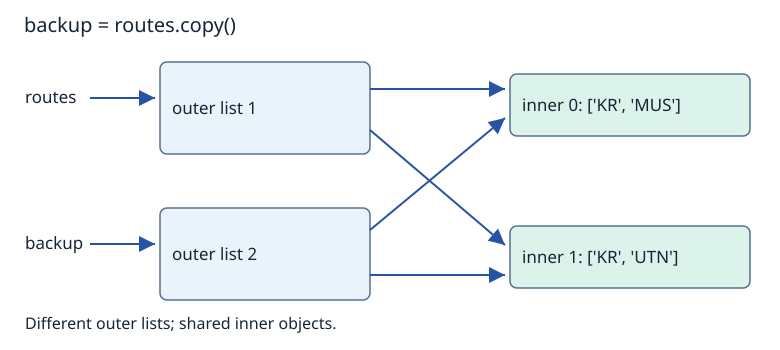

# Mutability, rebinding and copying

When a program seems to change two variables at once, the underlying cause is often shared access to one mutable object. Trace the objects and references before deciding what changed.

(mutability)=
## Mutable and immutable objects

An object is **mutable** if its state can change after creation. Lists, dictionaries and sets are familiar mutable types. Integers, floats, Booleans, strings and tuples are immutable types.

Immutability concerns the object itself. A tuple’s sequence of references cannot be replaced or extended, but an object referenced from that tuple may still be mutable:

```python
record = ("KR", [12, 15])
record[1].append(18)
print(record)  # ('KR', [12, 15, 18])
```

The tuple still refers to the same string and list. The list’s state changed. Assigning a different list to `record[1]` would raise `TypeError`.

(mutation-and-rebinding)=
## Mutation changes an object; rebinding changes a name

```python
route_a = ["KR", "MUS"]
route_b = route_a
route_b.append("UTN")
print(route_a)  # ['KR', 'MUS', 'UTN']

route_b = ["CLM"]
print(route_a)  # ['KR', 'MUS', 'UTN']
print(route_b)  # ['CLM']
```

`append` mutates the shared list, so both names initially observe its effect. The assignment of `["CLM"]` creates a new list and rebinds `route_b`. It does not redirect `route_a`, which still refers to the earlier list.

For an immutable integer, `count += 1` binds `count` to an integer representing the new result. The previous integer is not edited. Be careful generalising this to collections: list `+=` can mutate a list, whereas list `+` creates a new list. The effect depends on the operation and type.

(function-arguments)=
## Function parameters can share the caller’s object

```python
def replace_route(route):
    route = ["Botanic Gardens"]

def extend_route(route):
    route.append("Botanic Gardens")

stops = ["Kent Ridge"]
replace_route(stops)
print(stops)  # ['Kent Ridge']
extend_route(stops)
print(stops)  # ['Kent Ridge', 'Botanic Gardens']
```

On each call, the local parameter `route` initially refers to the object supplied as the argument. `replace_route` changes only that local binding. `extend_route` mutates the shared list. Python does not automatically copy an argument when entering a function, and assigning to the parameter does not assign to the caller’s variable.

Both functions return `None` because neither returns a value explicitly. In particular, `stops = extend_route(stops)` would mutate the list and then bind `stops` to `None`. Similarly, `list.append` itself returns `None`; do not replace the list with its return value.

(shallow-copy)=
## A shallow copy creates a new outer container

```python
routes = [["KR", "MUS"], ["KR", "UTN"]]
backup = routes.copy()
print(backup is routes)        # False
print(backup[0] is routes[0])  # True
backup[0].append("CLM")
print(routes[0])              # ['KR', 'MUS', 'CLM']
```

`copy()` duplicates the outer list, keeping references to the same inner objects. Appending to the shared first inner list affects what both outer lists expose. Appending an entirely new inner list to `backup`, however, would change only that outer list.



This also explains why `[[]] * 3` produces three references to one inner list. Use `[[] for _ in range(3)]` when three independent lists are required. [Chained hash tables](../maps-sets-hashing/chaining.md#separate-bucket-objects) rely on this distinction.

(deep-copy)=
## A deep copy follows nested structure

```python
from copy import deepcopy

original = [["KR", "MUS"], ["KR", "UTN"]]
independent = deepcopy(original)
independent[0].append("CLM")
print(original[0])     # ['KR', 'MUS']
print(independent[0])  # ['KR', 'MUS', 'CLM']
```

For this nested-list example, `deepcopy` creates independent inner lists. It is not a rule that every reachable object becomes a unique copy: immutable objects may be reused, and deep copying preserves repeated sharing within the copied structure using a memo. Custom objects can also define copying behaviour. Choose the sharing policy you actually need; copying everything may be expensive or inappropriate.

(mutable-defaults)=
## Mutable default arguments persist across calls

Default argument expressions are evaluated when the function is defined, rather than freshly for every call. A default such as `route=[]` can therefore retain state from earlier calls.

```python
def add_stop(stop, route=None):
    if route is None:
        route = []
    route.append(stop)
    return route

first = add_stop("KR")
second = add_stop("MUS")
print(first, second)  # ['KR'] ['MUS']
print(first is second)  # False
```

Here a missing argument selects `None`, and the function creates a fresh list inside the call. If the caller explicitly supplies a list, the function appends to that list. The interface deliberately distinguishes those two cases.

## Questions to revisit

Does the operation redirect a reference or change an object? Which references still reach that object? If a copy was made, which levels remain shared? These questions explain the result more reliably than saying “Python copies variables”.

Next: [Collections, classes and invariants](collections-and-classes.md).

**Browse:** [Foundations](foundations.md) · [Concept index](../../concepts.md)
