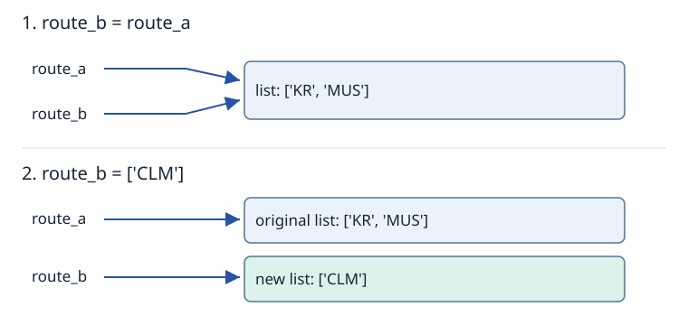

# Objects, references, identity and equality

**After this page, you should be able to:**

- Distinguish names, objects, references, identity, equality and explicit absence.
- Locate the updated name, collection slot or attribute in a reference diagram.

**Builds on:** [Problem specifications and representations](data-and-algorithms.md); familiar assignment and collection syntax.

**Code languages:** Python defines the explanations, figures and self-checks. Use the [language guide](../../code-languages.md) for native conventions and dependencies. Complete runnable topic examples: [JavaScript](../../examples/languages/foundations.js) · [Julia](../../examples/languages/foundations.jl).

These are language comparisons: Python-specific identity, type-hint and default-argument explanations remain about Python. JavaScript arrays use identity equality; the comparison example checks contents explicitly. Julia uses mutable structs and function-style methods; its default expressions, like JavaScript’s, are evaluated per call.

To understand a Python data structure, we need a model of what its names and fields refer to. Otherwise, an innocent-looking assignment can be mistaken for a copy, and a reference update can be mistaken for a change to the referenced object.

(objects-and-bindings)=
## Objects, names and assignment

An **object** has an identity, a type and a value. A **name** is bound to an object. A **reference** is the connection through which a program refers to an object. These are useful reasoning terms; our diagrams do not claim to show physical memory addresses or Python’s internal layout.

::::{tab-set}
:class: code-language-tabs

:::{tab-item} Python
:sync: python

```python
stop = "Kent Ridge"
passengers = 12
stop = "Museum"
print(stop)  # Museum
```

:::

:::{tab-item} JavaScript
:sync: javascript

```javascript
let stop = "Kent Ridge";
let passengers = 12;
stop = "Museum";
console.log(stop); // Museum
```

:::

:::{tab-item} Julia
:sync: julia

```julia
stop = "Kent Ridge"
passengers = 12
stop = "Museum"
println(stop) # Museum
```

:::

::::

The first assignment binds `stop` to a string object. The final assignment rebinds that name to another string. It does not edit the characters of the original string.

Objects can be referenced from names, collection entries and attributes. A list entry can therefore refer to another list, and an object attribute can refer to another node. This is how separate objects form larger structures.

(aliasing)=
## Assignment can create aliases

::::{tab-set}
:class: code-language-tabs

:::{tab-item} Python
:sync: python

```python
route_a = ["KR", "MUS"]
route_b = route_a
print(route_a is route_b)  # True
```

:::

:::{tab-item} JavaScript
:sync: javascript

```javascript
let route_a = ["KR", "MUS"];
let route_b = route_a;
console.log(route_a === route_b); // true
```

:::

:::{tab-item} Julia
:sync: julia

```julia
route_a = ["KR", "MUS"]
route_b = route_a
println(route_a === route_b) # true
```

:::

::::

Evaluating `route_a` supplies the existing list object; assigning it to `route_b` gives that object another name. It does not construct another list. The names are **aliases**.



An arrow means “refers to”. A box represents an object. Two arrows ending at one box indicate sharing; two boxes indicate different objects even if their contents happen to be equal. The lower panel illustrates the rebinding developed on the [next page](mutation-and-copying.md).

(identity-and-equality)=
## Identity and equality answer different questions

::::{tab-set}
:class: code-language-tabs

:::{tab-item} Python
:sync: python

```python
x = ["KR", "MUS"]
y = ["KR", "MUS"]
z = x
print(x == y)  # True
print(x is y)  # False
print(x is z)  # True
```

:::

:::{tab-item} JavaScript
:sync: javascript

```javascript
let x = ["KR", "MUS"], y = ["KR", "MUS"], z = x;
// JavaScript array equality tests identity, so compare elements for contents.
console.log(x.length === y.length && x.every((v, i) => v === y[i])); // true
console.log(x === y); // false
console.log(x === z); // true
```

:::

:::{tab-item} Julia
:sync: julia

```julia
x = ["KR", "MUS"]
y = ["KR", "MUS"]
z = x
println(x == y)  # true: contents
println(x === y) # false: identity
println(x === z) # true
```

:::

::::

For these lists, `==` compares their contents and `is` tests whether they are the same object. Separate list expressions create separate lists, so changing x can leave y unchanged even though they began equal. Conversely, z provides another reference to x’s list.

The meaning of equality depends on the type. A user-defined class can supply its own equality rule; Python does not automatically compare all attributes of every class. See [classes and instances](collections-and-classes.md#classes-and-instances).

Do not use `is` to compare the values of numbers or strings. Implementations may reuse some immutable objects, so an identity observation is not a reliable rule for value equality. `id(obj)` can identify an object during its lifetime, but its numerical value is not needed for these traces and may later be reused after an object ceases to exist.

(none-sentinel)=
## None represents an explicit absence

`None` is a singleton object: it is a value a reference can identify, not an uninitialised hole. We use it when a function has no search result or a node has no next node.

::::{tab-set}
:class: code-language-tabs

:::{tab-item} Python
:sync: python

```python
next_node = None
print(next_node is None)  # True
```

:::

:::{tab-item} JavaScript
:sync: javascript

```javascript
let next_node = null;
console.log(next_node === null); // true
```

:::

:::{tab-item} Julia
:sync: julia

```julia
next_node = nothing
println(next_node === nothing) # true
```

:::

::::

Use `is None` and `is not None` for these tests. An empty list is a different object with a different meaning: it is a collection containing zero items. A function that reaches its end without a `return` value also returns `None`.

(reference-update-locations)=
## Identify where the reference is stored

A reference can be held by a local name, a collection slot or an object attribute. The location being updated matters:

| Operation | What changes? | What does not follow automatically? |
|---|---|---|
| `b = a` | Bind b to the object currently reached by a | No new copy of that object is made |
| `b = []` | Redirect b to a new empty list | Other names are not redirected |
| `a[0] = value` | Replace one reference stored in a list | The previously referenced object's state is not edited by that assignment |
| `node.next = other` | Change the node's next attribute | Neither the old nor new target is cloned |
| `del b` | Remove the name binding b | An object still reachable through another reference does not disappear |

Changing a slot or attribute is a mutation of its containing object, even when the change redirects a reference. This is why “assignment changes an arrow” and “mutation changes an object” must be read with the arrow's owner in mind: local rebinding differs from updating a shared list or node.

## Read a reference diagram in three steps

First locate the names or attributes. Then follow their arrows to the objects. Finally distinguish an operation that changes a box’s state from an assignment that redirects an arrow. This method scales from two list aliases to linked nodes and trees.

## Use the model to state sharing and costs

If `a` and `b` are aliases, the useful invariant is `a is b` until one binding changes. Their contents may be mutated in between without breaking that identity. Equal contents alone do not establish sharing; two distinct lists can compare equal and respond independently to later changes.

Binding one name to an existing object does not traverse and copy its contents. Equality may examine contents or run custom code, while identity asks whether the two references reach the same object. Do not infer equality cost, deep memory size or physical address layout from a diagram containing one arrow. The [next reading](mutation-and-copying.md) makes copying and ownership choices explicit.

:::{tip} Common misconception
**Two equal objects must be aliases.** Equal values and shared identity are different observations; use the appropriate test for the question.
:::

(foundation-reference-checks)=
## Check your understanding

Predict the result or draw the references before opening the explanation.

**1. x and y are separately created equal lists, while z=x. Which identity tests are true: x is y, x is z?**

:::{dropdown} Show explanation
x is y is False; x is z is True. Equality of x and y does not merge their identities.
:::

**2. After a=["KR"], b=a, and b=[], what does a contain?**

:::{dropdown} Show explanation
a still contains ["KR"]. Only b was rebound to the new empty list; no operation emptied a's original object.
:::

Next: [Mutability, rebinding and copying](mutation-and-copying.md).

**Browse:** [Foundations](foundations.md) · [Concept index](../../concepts.md)
