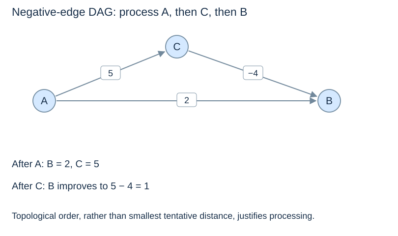

# Shortest paths in a DAG

(dag-shortest-paths)=
## Precedence supplies a different safe processing order

A topological order processes every possible predecessor before its destination. Once all incoming routes to a vertex have been considered, no later vertex can send a route backwards to improve it. This argument permits negative edge weights because it depends on acyclicity, not on nonnegative distances.

```python
def dag_shortest_paths(graph, source):
    if source not in graph:
        raise KeyError(source)
    unweighted = {u: [v for v, _ in graph[u]] for u in graph}
    order = topological_sort(unweighted)
    distance = {v: inf for v in graph}
    parent = {v: None for v in graph}
    distance[source] = 0
    for u in order:
        if distance[u] == inf:
            continue
        for v, w in graph[u]:
            candidate = distance[u] + w
            if candidate < distance[v]:
                distance[v] = candidate
                parent[v] = u
    return distance, parent
```

This uses `topological_sort` and `inf` from earlier pages. It checks the entire graph for acyclicity, so even an unreachable directed cycle causes rejection. The weighted graph itself is left unchanged.

(dag-negative-example)=
## A negative edge can improve an earlier-looking choice

For A→B(2), A→C(5), C→B(−4), the topological order is A, C, B. A first gives B distance 2 and C distance 5; C then improves B to 1 before B is processed. The shortest route is A–C–B despite using two edges rather than one.



(dag-path-cost)=
## Count ordering, conversion and relaxation

Constructing the unweighted adjacency lists, computing the order, and scanning each weighted edge take $O(n+m)$ time under the standard dictionary model. This implementation's converted adjacency lists require $O(n+m)$ additional storage, alongside $O(n)$ distance, parent and ordering state. A weighted-aware topological routine could avoid that particular conversion.

A DAG cannot have a negative cycle because it has no directed cycle at all. This does not mean every graph with a negative edge is a DAG. Choose the algorithm from all its assumptions, not just the sign of one edge.

Next: [Spanning trees](spanning-trees.md).
