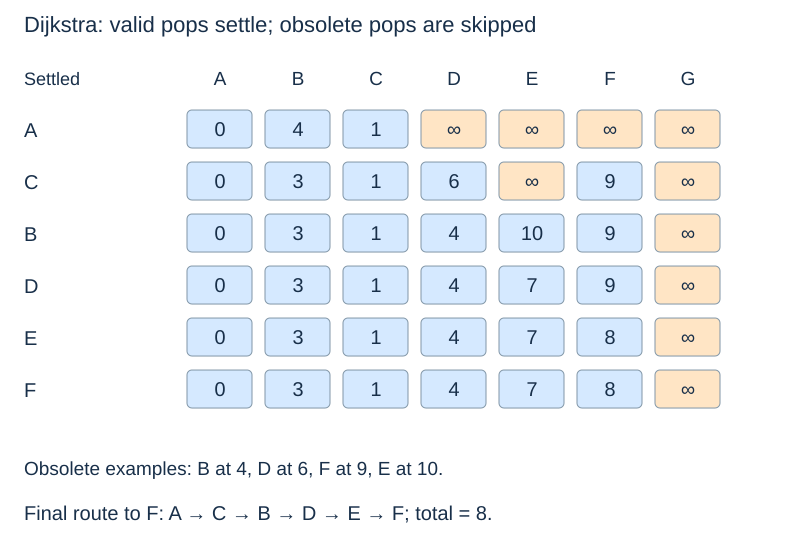

# Dijkstra's algorithm and lazy heap entries

(dijkstra)=
## Settle the smallest current tentative distance

Under **nonnegative** edge weights, the smallest current tentative distance can be finalised. Any competing route through an unsettled vertex would reach that vertex at a cost at least as large, then add only nonnegative edges. It cannot lead back to a smaller answer for the selected vertex.

That is a greedy correctness argument, not just a statement that a heap is fast. Marking a vertex final when first inserted is wrong: B in the shared graph improves from 4 to 3 after its first insertion.

(lazy-dijkstra-code)=
## Insert improved candidates and skip obsolete ones

```python
from heapq import heappush, heappop
from itertools import count

def dijkstra(graph, source):
    if source not in graph:
        raise KeyError(source)
    if any(w < 0 for edges in graph.values() for _, w in edges):
        raise ValueError("Dijkstra requires nonnegative weights")
    distance = {v: inf for v in graph}
    parent = {v: None for v in graph}
    distance[source] = 0
    sequence = count()
    heap = [(0, next(sequence), source)]
    while heap:
        cost, _, u = heappop(heap)
        if cost != distance[u]:
            continue
        for v, w in graph[u]:
            candidate = cost + w
            if candidate < distance[v]:
                distance[v] = candidate
                parent[v] = u
                heappush(heap, (candidate, next(sequence), v))
    return distance, parent
```

This reuses `inf` from the preceding page. The counter resolves equal-cost heap ties without comparing vertex objects, as in [priority-queue entries](../heaps/heap-applications.md). The code checks negativity across the whole input, including unreachable edges. Its other input preconditions include finite weights and destinations that are graph keys.

(dijkstra-stale-entries)=
## A heap pop is not always a settlement

When B improves to 3, its old entry at 4 remains in the heap. The equality test discards that entry later. Successful relaxations create new candidates rather than modifying entries already inside the heap.



The settlement order is **A, C, B, D, E, F**; G never enters the heap. Zero-weight edges are permitted. A fixed vertex's distance cannot improve after its valid pop under the preconditions, but obsolete candidates for it may still pop later.

(dijkstra-cost)=
## Lazy storage changes the space bound

Each validly reached vertex scans its outgoing list once; each successful relaxation creates an entry, at most m across m edges. The heap can contain $O(m+1)$ entries, so a push/pop costs $O(\log(m+2))$.

Including initialisation and the whole-input weight check gives $O(n+m\log(m+2))$ time and $O(n+m)$ auxiliary storage for a nonempty graph. These assume expected constant-time dictionary operations and constant-cost arithmetic. For a simple graph, the usual $O((n+m)\log(n+1))$ time bound follows. The lazy heap is not limited to one entry per vertex.

(dijkstra-negative-weights)=
## The nonnegative condition is essential

With A→B(2), A→C(5), C→B(−4), greedily declaring B final at 2 would be wrong: its optimum is 1. The function above rejects such input. For an acyclic graph with negative edges, use [DAG shortest paths](dag-shortest-paths.md). General graphs with negative edges require another algorithm and attention to negative cycles; see the book's [extension roadmap](../../coverage-review.md).
