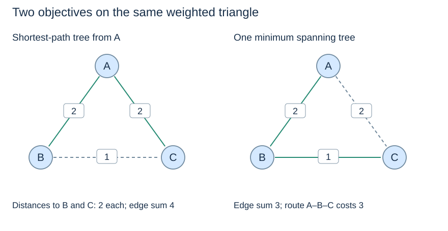

# Compare graph objectives before selecting an algorithm

(graph-algorithm-selection)=
## Similar data structures can serve different goals

| Question | Method | Essential condition |
|---|---|---|
| Which vertices can be reached? | BFS or DFS | Follow the graph's direction |
| Which unweighted route uses fewest edges? | BFS | Hop count is the objective |
| Which dependency order is valid? | Kahn topological sort | Directed acyclic graph |
| Which route has smallest weight sum from a source? | Dijkstra | Nonnegative weights |
| Which routes are cheapest in a DAG? | Topological relaxation | Directed acyclic graph; negative edges permitted |
| Which connections minimise total network edge cost? | Prim or Kruskal | Undirected graph; produce a forest if disconnected |

A queue, heap or parent dictionary alone does not identify the algorithm. Ask what its entries mean: BFS stores a frontier by hops; Dijkstra's heap stores complete route costs; Prim's heap stores individual connection costs; Kruskal sorts edges and uses union–find for connectivity.

(shortest-path-tree-versus-mst)=
## A shortest-path tree need not be an MST

Consider triangle AB(2), AC(2), BC(1). A shortest-path tree from A uses AB and AC, preserving distance 2 to both other vertices, with selected-edge sum 4. An MST uses BC and either AB or AC, with sum 3, but one route from A then costs 3 rather than 2.

The two results optimise different quantities. Changing the MST's starting vertex can change a tied result, but cannot turn its objective into preservation of every source distance.

(graph-algorithm-boundaries)=
## Test assumptions at the boundaries

Include empty graphs, isolated vertices, disconnected components, equal-weight alternatives, zero weights and directed cycles in reasoning. Negative weights are acceptable for MSTs and DAG relaxation, but are rejected by the shown Dijkstra implementation. A topological order must include isolated vertices, even when they affect no prerequisite.

Proof obligations differ too: Kahn preserves remaining indegrees; Dijkstra justifies settlement; DAG relaxation processes predecessors first; MST algorithms preserve safe completion. Memorising the same “greedy” label for all these methods does not replace those arguments.

Review [Topic 12](../union-find/union-find.md) for the reusable connectivity structure, continue to [Topic 14: algorithm design strategies](../strategies/strategies.md), or apply these methods in [Topic 16: the transport case](../applications/applications.md). The [coverage review](../../coverage-review.md) records further extensions.
