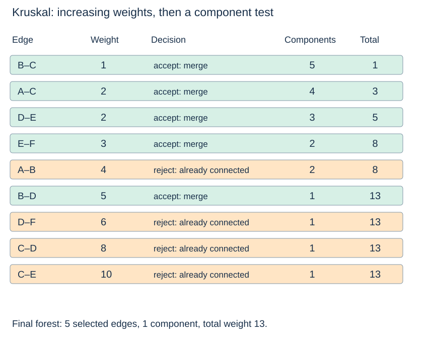

# Kruskal: sort edges and merge components

(kruskal-algorithm)=
## Consider the globally lightest remaining edge

Kruskal scans edges in nondecreasing weight order. Initially each vertex is its own component. Accept an edge exactly when its endpoints currently belong to different components; then merge those components. An edge within one component would close a cycle and is rejected.

Read [Topic 13's disjoint-set class](../union-find/union-compression.md) first. This page deliberately reuses that class rather than presenting a second version with different tie or compression rules.

(kruskal-code)=
## Union reports whether a merge actually occurred

```python
def kruskal_forest(vertices, edges):
    vertices = list(vertices)
    index = {v: i for i, v in enumerate(vertices)}
    if len(index) != len(vertices):
        raise ValueError("vertices must be unique")
    sets = DisjointSet(len(vertices))
    chosen, total = [], 0
    for w, u, v in sorted(edges, key=lambda edge: edge[0]):
        if sets.union(index[u], index[v]):
            chosen.append((w, u, v))
            total += w
    return chosen, total, sets.components
```

The edge list contains each undirected edge once, with valid endpoints and finite numeric weights. Sorting creates a new list; it does not mutate the input. Equal weights retain input order because Python's sort is stable. This makes the trace reproducible without comparing vertex labels, but another tie order could yield another equally good forest.

(kruskal-trace-correctness)=
## Accepted components remain acyclic and safely extendable

In the shared graph, accept BC(1), AC(2), DE(2), EF(3); reject AB(4), which closes a cycle; then accept BD(5). The final total is **13**, with five selected edges and one component.



For an edge joining two components, consider the cut around one current component. Any lighter crossing edge would already have merged it with another component. The chosen edge is therefore a light crossing edge for a cut respecting the accepted forest. The exchange argument proves that accepting it preserves an optimum completion.

(kruskal-cost)=
## Sorting and union–find have different costs

Initialisation takes $\Theta(n)$, sorting m edges takes $O(m\log(m+1))$, and the edge checks take $O(m\alpha(n))$ amortised with union by size and path compression for n≥2. The usual summary is $O(n+m\log(m+1))$ for this implementation, with the tiny union–find factor understood in the standard model. Isolated vertices must still be included in the n term.

The copied sorted edge list uses $O(m)$ storage; parent and size arrays use $O(n)$. Chosen edges add at most n−c entries. The full scan handles disconnected graphs uniformly. Once a nonempty connected graph has one component, an implementation could stop early, but this code continues and rejects the remaining cycle-forming edges.

The union–find parent forest is bookkeeping; its parent links are not necessarily selected graph edges. Return `chosen` when the actual spanning forest is needed. Next: [Compare the objectives](graph-algorithm-choices.md).
