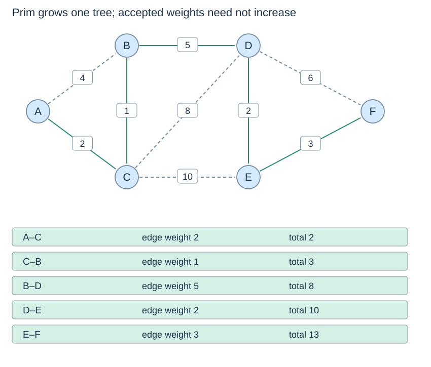

# Prim: grow a tree across a cut

(prim-algorithm)=
## Candidates are edge costs, not source distances

Start at any vertex and maintain the set already reached in its component. Choose a cheapest edge crossing from that set to an unreached vertex. Its weight is the cost of **that edge**, not a cumulative distance from the start. This is how Prim differs from Dijkstra despite both using heaps.

(lazy-prim-code)=
## Ignore edges whose destinations have already joined

```python
def prim_forest(graph):
    seen, chosen = set(), []
    total, components = 0, 0
    sequence = count()
    for root in graph:
        if root in seen:
            continue
        components += 1
        seen.add(root)
        heap = []
        for v, w in graph[root]:
            if v not in seen:
                heappush(heap, (w, next(sequence), root, v))
        while heap:
            w, _, u, v = heappop(heap)
            if v in seen:
                continue
            seen.add(v)
            chosen.append((w, u, v))
            total += w
            for x, cost in graph[v]:
                if x not in seen:
                    heappush(heap, (cost, next(sequence), v, x))
    return chosen, total, components
```

The imports `count`, `heappush` and `heappop` are from the Dijkstra page. Input adjacency lists must represent an undirected graph with reciprocal edges of equal weights. The function leaves them unchanged and returns chosen edges, their total and the component count.

(prim-invariant-trace)=
## The next valid pop is a light crossing edge

Every candidate originates at an already reached vertex. New edges are offered when their source joins. Some later become internal edges because their destination is reached another way. Skipping those preserves a cheapest valid edge across the current cut, and the cut argument makes that choice safe.



From A, the accepted weights are **2, 1, 5, 2, 3**, totalling 13. They need not be nondecreasing: reaching a new vertex can reveal a cheaper edge. The orientation C–B in the output denotes the same undirected edge as B–C.

(prim-forest-cost)=
## Restarts cover disconnected inputs

When the heap empties, that connected component is finished. The outer loop starts another tree at any unseen vertex. An isolated vertex increases the component count without adding an edge. An empty graph returns `([], 0, 0)`.

Each undirected edge is offered at most once from its earlier reached endpoint, so there are $O(m)$ candidate entries and pops. Including outer-loop work gives $O(n+m\log(m+2))$ time and $O(n+m)$ auxiliary storage, with expected dictionary/set costs and constant-time weight arithmetic. Lazy candidate storage may be linear in the number of edges, not just vertices.

Next: [Kruskal](kruskal.md), after the [union–find implementation](../union-find/union-compression.md).
