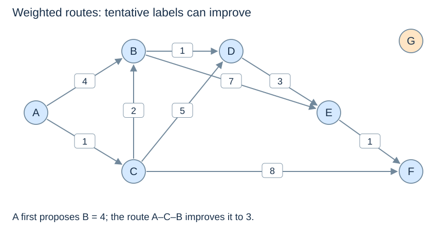

# Shortest paths and relaxation

(weighted-shortest-path)=
## Minimise the sum along a source-to-target route

A weighted shortest path minimises its edge-weight sum. It differs from BFS's hop count: a direct edge of weight 10 can lose to two edges of weight 2. In a directed graph, every step must follow an outgoing edge.

The shared graph uses these outgoing lists. G remains an explicit isolated vertex.

```python
weighted = {
    "A": [("B", 4), ("C", 1)],
    "B": [("D", 1), ("E", 7)],
    "C": [("B", 2), ("D", 5), ("F", 8)],
    "D": [("E", 3)], "E": [("F", 1)],
    "F": [], "G": [],
}
```



(relaxation)=
## A known route supplies a candidate improvement

Set the source distance to 0 and other distances to infinity. If a route to u has cost `distance[u]`, following edge `(u,v,w)` gives candidate cost `distance[u] + w`. **Relaxation** updates v only when that candidate is strictly smaller than its current distance, and records u as its predecessor.

After A, B has tentative distance 4 and C has 1. Via C, B improves to `1 + 2 = 3`; its predecessor becomes C. “First discovered” is therefore not the same as “final distance,” unlike BFS's first discovery in an unweighted graph.

(shortest-path-predecessors)=
## A distance label represents a route actually found

Every finite tentative distance is the cost of a discovered route, and is an upper bound on the optimum when a finite optimum exists. An algorithm needs an additional argument to establish finality. Dijkstra uses nonnegative weights; a DAG algorithm uses topological order.

A predecessor records one improving route. Equal candidates need not replace it. Strict improvement avoids unnecessary heap entries and avoids creating predecessor cycles merely by accepting equal-cost alternatives around zero-weight cycles.

(weighted-route-recovery)=
## Recover the route using results from the same run

```python
from math import inf

def weighted_path_to(source, target, distance, parent):
    if distance[target] == inf:
        return None
    path = []
    current = target
    while current is not None:
        path.append(current)
        current = parent[current]
    path.reverse()
    return path
```

Use valid source and target keys, non-`None` vertex labels, and predecessor results from the same algorithm run. The `source` argument documents that association; this helper does not independently validate a supplied predecessor structure. The source returns a one-vertex path. An unreachable vertex has infinite distance and returns `None`, even though its predecessor and the source's predecessor are both `None`.

For the shared graph, the eventual A-to-F route is A–C–B–D–E–F with cost 8; G stays unreachable. Recovering a k-edge route takes $O(k+1)$ time and output storage. Next: [Dijkstra](dijkstra.md).
