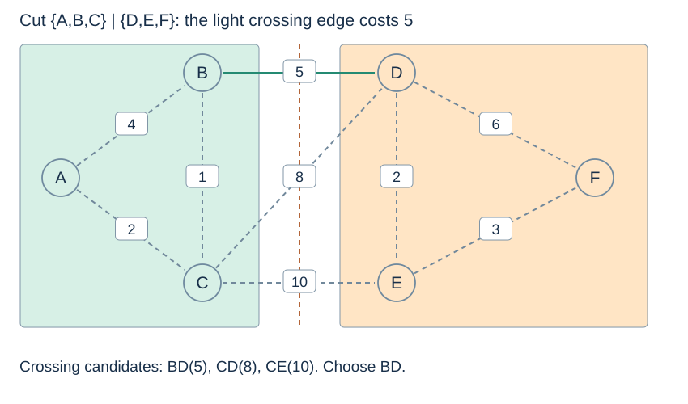

# Spanning trees and safe edges

(minimum-spanning-tree)=
## Minimise the cost of connecting every vertex

A **spanning tree** of a connected undirected graph includes every vertex, is connected, and has no cycle. With n vertices it has n−1 edges. A **minimum spanning tree (MST)** minimises the sum of its chosen edge weights. There is no designated source and no requirement to preserve shortest routes from any particular vertex.

For a disconnected graph, a spanning tree of the entire graph does not exist. A **minimum spanning forest (MSF)** contains an MST for each component, including isolated singleton components. If there are c components, the forest has n−c chosen edges.

```python
vertices = list("ABCDEF")
edges = [
    (4, "A", "B"), (2, "A", "C"), (1, "B", "C"),
    (5, "B", "D"), (8, "C", "D"), (10, "C", "E"),
    (2, "D", "E"), (6, "D", "F"), (3, "E", "F"),
]

def weighted_adjacency(vertices, edges):
    graph = {v: [] for v in vertices}
    for weight, u, v in edges:
        graph[u].append((v, weight))
        graph[v].append((u, weight))
    return graph
```

Vertices are unique; each undirected edge appears once in this edge list and twice in adjacency storage. Endpoints must be present in the vertex list. An isolated vertex belongs in that list even though no edge names it.

(mst-cut-property)=
## A light crossing edge can be safe

A **cut** divides the vertices into two nonempty groups. An edge crosses it when its endpoints are in different groups. Suppose the already accepted forest is contained in some optimum spanning tree, and no accepted edge crosses the cut. A minimum-weight crossing edge can be added while retaining the possibility of an optimum completion.



(mst-exchange-argument)=
## Exchange an edge without increasing total cost

If an optimum completion omits the light edge, add it. This creates a cycle, which must contain another edge crossing the same cut. Remove that other edge. Its weight is at least the chosen light edge's weight, and it was not an earlier accepted edge because the cut respects the accepted forest. The result is another optimum completion including the new choice.

The condition about respecting accepted edges is important: an arbitrary greedy edge is not safe merely because it looks locally small. Prim and Kruskal maintain cuts for which the argument applies.

(mst-ties-negative-cycle-property)=
## Ties and negative weights need precise claims

Equal weights can allow several optimum trees. A light crossing edge belongs to **some** optimum completion; it need not belong to every MST. If all edge weights are distinct, the MST is unique, but distinct weights are not necessary for uniqueness.

Negative weights are valid for MSTs: the selected edges form a finite acyclic structure, so there is no opportunity to repeat a negative cycle to reduce a route indefinitely. Another useful rule is the **cycle property**: a uniquely heaviest edge on a cycle cannot belong to any MST. If the maximum is tied, the stronger exclusion claim no longer follows.

Next: [Prim](prim.md).
