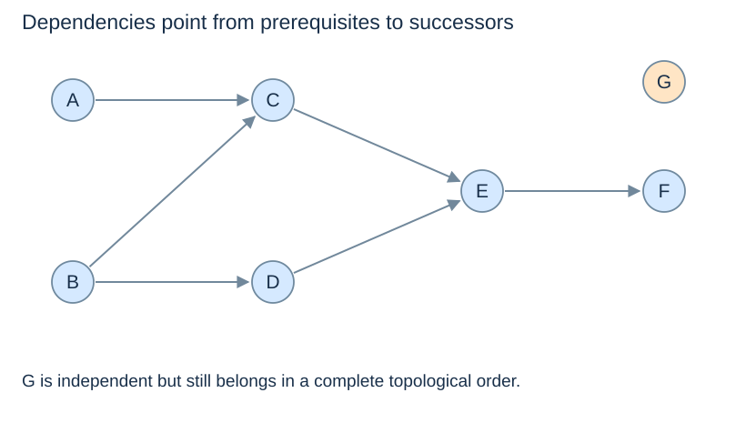
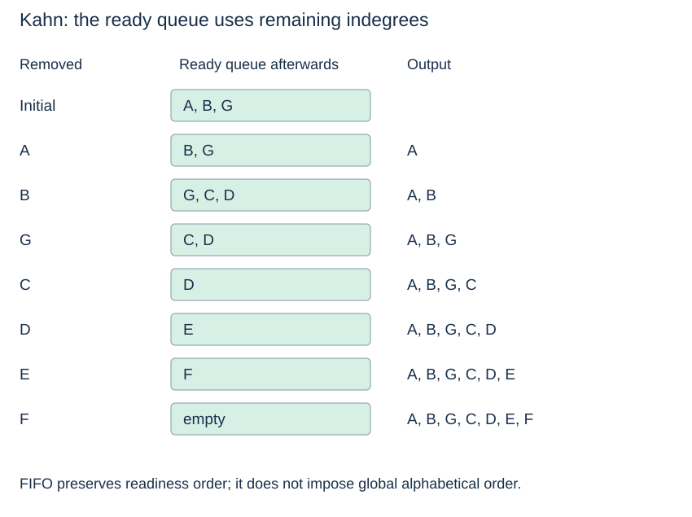

# DAGs and topological order

**After this page, you should be able to:**

- Specify Kahn outputs and trace remaining-indegree/ready-queue invariants.
- Distinguish valid-order choices from cycle detection and blocked vertices.

**Builds on:** [Directed graph lists](../graphs/graph-representations.md) and [FIFO queues](../linear-structures/queues-and-deques.md).

**Code languages:** Python defines the explanations, figures and self-checks. Use the [language guide](../../code-languages.md) for native conventions and dependencies. Complete runnable topic examples: [JavaScript](../../examples/languages/graph-algorithms.js) · [Julia](../../examples/languages/graph-algorithms.jl).

These versions reuse the translated deque, heap and disjoint-set definitions. Julia Dict order can select a different valid topological order or tied forest; compare the objective, feasibility and optimum cost rather than requiring an identical printed edge order. Heap counters avoid comparing payloads.

(directed-acyclic-graph)=
## Dependencies require direction without cycles

A **directed acyclic graph (DAG)** has no directed cycle. An edge u → v means u must precede v. A **topological order** lists every vertex exactly once with every edge pointing forward in the list. It need not be unique, and unrelated vertices need no specified relative order.



::::{tab-set}
:class: code-language-tabs

:::{tab-item} Python
:sync: python

```python
dag = {
    "A": ["C"], "B": ["C", "D"],
    "C": ["E"], "D": ["E"],
    "E": ["F"], "F": [], "G": [],
}

def valid_topological_order(graph, order):
    if len(order) != len(graph) or set(order) != set(graph):
        return False
    position = {v: i for i, v in enumerate(order)}
    return all(position[u] < position[v]
               for u in graph for v in graph[u])
```

:::

:::{tab-item} JavaScript
:sync: javascript

```javascript
var dag = new Map([["A", ["C"]], ["B", ["C", "D"]], ["C", ["E"]],
    ["D", ["E"]], ["E", ["F"]], ["F", []], ["G", []]]);
function valid_topological_order(graph, order) {
    if (order.length !== graph.size || new Set(order).size !== graph.size || order.some(v => !graph.has(v))) return false;
    const position = new Map(order.map((v, i) => [v, i]));
    for (const [u, adjacent] of graph) for (const v of adjacent)
        if (position.get(u) >= position.get(v)) return false;
    return true;
}
```

:::

:::{tab-item} Julia
:sync: julia

```julia
dag = Dict("A"=>["C"], "B"=>["C","D"], "C"=>["E"], "D"=>["E"], "E"=>["F"], "F"=>String[], "G"=>String[])
function valid_topological_order(graph, order)
    (length(order) == length(graph) && Set(order) == Set(keys(graph))) || return false
    position = Dict(v=>i for (i,v) in enumerate(order))
    return all(position[u] < position[v] for u in keys(graph) for v in graph[u])
end
```

:::

::::

Length and membership checks together exclude missing vertices, duplicates and unexpected labels. As throughout this topic, every listed destination must be a graph key.

(topological-contract)=
## Specify ordering, failure and mutation

`topological_sort(graph)` accepts well-formed outgoing **unweighted directed** lists and returns a new list containing every vertex once. It leaves the graph unchanged. A cycle anywhere raises `ValueError`; an empty graph returns `[]`. `valid_topological_order(graph, order)` observes a candidate sequence and returns a boolean under the same graph contract.

FIFO readiness follows dictionary insertion order initially and neighbour order when indegrees become zero. The result is deterministic for those orders, but need not be the alphabetically smallest valid order. Sinks and isolated vertices must be explicit keys. Logical edge removal is represented by decreasing temporary counts, not by editing input adjacency lists.

(kahn-algorithm)=
## Ready vertices have no remaining prerequisites

**Indegree** counts incoming edges. Kahn's algorithm maintains indegrees within the **unprocessed** graph, removes a zero-indegree vertex, and decreases its outgoing neighbours' counts.

::::{tab-set}
:class: code-language-tabs

:::{tab-item} Python
:sync: python

```python
from collections import deque

def topological_sort(graph):
    degree = {v: 0 for v in graph}
    for u in graph:
        for v in graph[u]:
            degree[v] += 1
    ready = deque(v for v in graph if degree[v] == 0)
    order = []
    while ready:
        u = ready.popleft()
        order.append(u)
        for v in graph[u]:
            degree[v] -= 1
            if degree[v] == 0:
                ready.append(v)
    if len(order) != len(graph):
        raise ValueError("directed cycle: no complete order")
    return order
```

:::

:::{tab-item} JavaScript
:sync: javascript

```javascript
function topological_sort(graph) {
    const degree = new Map([...graph.keys()].map(v => [v, 0]));
    for (const adjacent of graph.values()) for (const v of adjacent) degree.set(v, degree.get(v) + 1);
    const ready = new DequeBuffer([...graph.keys()].filter(v => degree.get(v) === 0)), order = [];
    while (!ready.is_empty()) {
        const u = ready.remove_first(); order.push(u);
        for (const v of graph.get(u)) {
            degree.set(v, degree.get(v) - 1);
            if (degree.get(v) === 0) ready.add_last(v);
        }
    }
    if (order.length !== graph.size) throw new RangeError("directed cycle: no complete order");
    return order;
}
```

:::

:::{tab-item} Julia
:sync: julia

```julia
function topological_sort(graph)
    degree = Dict(v=>0 for v in keys(graph))
    for adjacent in values(graph), v in adjacent; degree[v] += 1; end
    ready = DequeBuffer(v for v in keys(graph) if degree[v] == 0); order = Any[]
    while ready.n > 0
        u = db_remove_first!(ready); push!(order, u)
        for v in graph[u]
            degree[v] -= 1
            degree[v] == 0 && db_add_last!(ready, v)
        end
    end
    length(order) == length(graph) || throw(ArgumentError("directed cycle: no complete order"))
    return order
end
```

:::

::::

(kahn-invariant-trace)=
## Counts describe what remains, not original degree

At each iteration, the queue contains the unprocessed vertices whose remaining indegree is zero. Removing one is safe: all its prerequisites have already been output. Every removed edge is accounted for by exactly one decrement.



For the declared dictionary and neighbour order, the result is **A, B, G, C, D, E, F**. Choosing another ready vertex can give another valid order. A min-heap could choose the smallest ready label, but adds heap work; FIFO is not globally alphabetical.

(topological-cycle-detection)=
## Failure to process all vertices proves a cycle exists

Every nonempty finite DAG has a zero-indegree vertex: following incoming edges forever would otherwise revisit a vertex and form a cycle. Therefore if vertices remain but none are ready, the remainder contains a directed cycle. The empty graph correctly returns an empty order.

Unprocessed vertices are **not necessarily all on cycles**. A vertex downstream of a cycle can also remain blocked. With A → B, B → A and B → C, C is blocked but not part of the A–B cycle. The processed-count test reports existence of a cycle, not its exact members.

With adjacency lists, time is $O(n+m)$ and auxiliary storage is $O(n)$ under expected constant-time dictionary operations.

## Choices, costs and use

Use topological order for dependency scheduling and DAG dynamic programming. FIFO Kahn takes O(n+m+1) time and O(n+1) working storage, plus O(n+1) returned order storage, under expected dictionary access. Validating one candidate order also takes O(n+m+1) time with O(n+1) position/set storage. No vertex-label comparisons are needed by FIFO readiness.

Replacing the ready deque with a min-heap can choose a smallest-ready label under a stated ordering, adding O(n log(n+1)) heap work. A DFS-based ordering is another implementation choice that needs explicit directed-cycle handling; reversing an arbitrary DFS discovery list is insufficient. Kahn reports that a cycle exists, not a cycle witness or strongly connected groups.

:::{tip} Common misconception
**Every unprocessed vertex lies on a cycle.** Some may merely depend on a cycle and remain blocked downstream.
:::

(topological-checks)=
## Check your understanding

Predict the result or state change before opening the explanation.

**1. A→B, B→A and B→C remain after the ready queue empties. Must C lie on a cycle?**

:::{dropdown} Show explanation
No. C is blocked by the A–B cycle but need not belong to it. The function reports a cycle exists somewhere in the remainder.
:::

**2. If two vertices are ready, must the alphabetically smaller one leave the FIFO queue first?**

:::{dropdown} Show explanation
Only if it was queued first. The shared initial queue A, B, G produces A, B, G, C, D, E, F rather than a globally alphabetical order.
:::

Next: [Shortest-path state](shortest-path-state.md).
