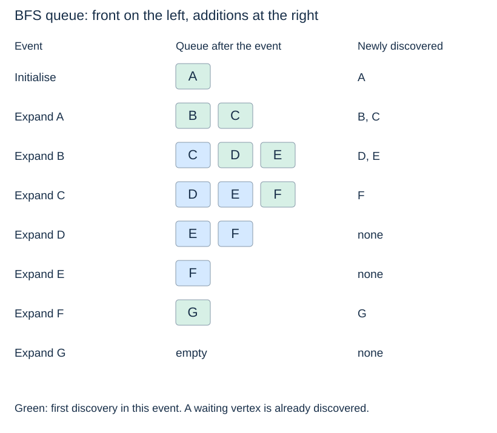
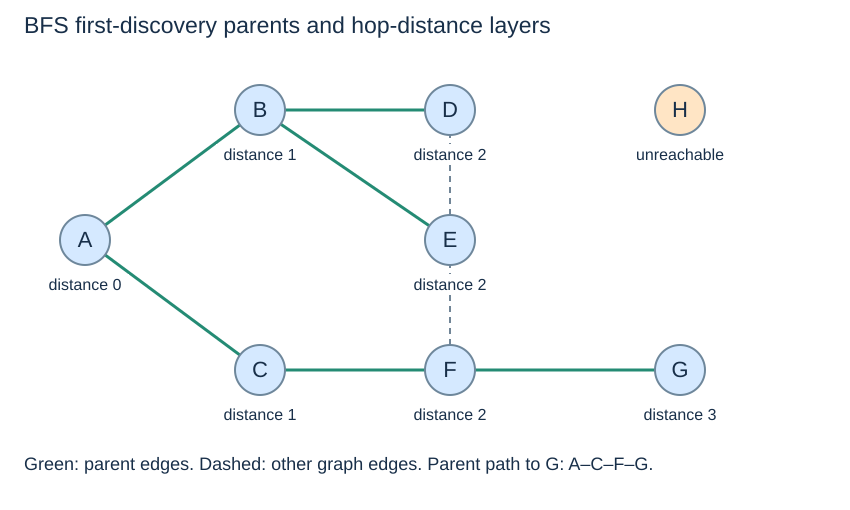

# Breadth-first search: layers and a FIFO frontier

**After this page, you should be able to:**

- State BFS outputs and explain why discovery happens before enqueueing.
- Recover one shortest-hop path and account for frontier and result storage.

**Builds on:** [Graph representations](graph-representations.md), [graph operations](graph-operations.md) and [FIFO queues](../linear-structures/queues-and-deques.md).

**Code languages:** Python defines the explanations, figures and self-checks. Use the [language guide](../../code-languages.md) for native conventions and dependencies. Complete runnable topic examples: [JavaScript](../../examples/languages/graphs.js) · [Julia](../../examples/languages/graphs.jl).

JavaScript graphs use Map; Julia graphs use Dict. Stored neighbour order is preserved, but Julia Dict vertex iteration can change valid component ordering or tied choices. The shared DequeBuffer supplies constant-time linked endpoints. The figures and check answers use Python’s declared iteration order.

(breadth-first-search)=
## Expand the earliest discovered waiting vertex

**Breadth-first search (BFS)** starts with one vertex and explores its reachable region in layers of hop distance. A FIFO queue stores the **frontier**: discovered vertices whose neighbour lists have not yet been fully examined.

A vertex is **discovered** when first encountered and recorded. It is **expanded** when removed from the queue so that its neighbours can be examined. Returning a vertex's neighbours is different from returning the vertex itself as a result.

(bfs-contract)=
## Specify the returned reachable-region result

`bfs(graph, start)` observes a well-formed outgoing adjacency-list graph; it leaves that graph unchanged and returns `(order, parent, distance)`. `order` records expansion order, `parent` records one discovery parent, and `distance` gives minimum hop counts. The dictionaries contain only reached vertices. The start has parent `None` and distance 0; a missing start raises `KeyError`, including any start in an empty graph.

`path_to(parent, target)` expects a parent dictionary from that same traversal with non-`None` labels. It returns a new source-to-target vertex list, or `None` if the target was not reached. It does not validate an arbitrary parent structure or look up the original graph. Stored neighbour order breaks ties between equally short paths; no weighted-cost guarantee is supplied.

(bfs-code)=
## Mark a vertex when it joins the queue

This code uses the adjacency-list contract from the previous page. `distance` also serves as the discovered set. Invalid start labels raise `KeyError`; isolated but valid vertices are ordinary inputs.

::::{tab-set}
:class: code-language-tabs

:::{tab-item} Python
:sync: python

```python
from collections import deque

def bfs(graph, start):
    if start not in graph:
        raise KeyError(start)
    distance = {start: 0}
    parent = {start: None}
    order = []
    queue = deque([start])
    while queue:
        u = queue.popleft()
        order.append(u)
        for v in graph[u]:
            if v not in distance:
                distance[v] = distance[u] + 1
                parent[v] = u
                queue.append(v)
    return order, parent, distance
```

:::

:::{tab-item} JavaScript
:sync: javascript

```javascript
function bfs(graph, start) {
    if (!graph.has(start)) throw new KeyError(String(start));
    const distance = new Map([[start, 0]]), parent = new Map([[start, null]]), order = [];
    const queue = new DequeBuffer([start]);
    while (!queue.is_empty()) {
        const u = queue.remove_first(); order.push(u);
        for (const v of graph.get(u)) if (!distance.has(v)) {
            distance.set(v, distance.get(u) + 1); parent.set(v, u); queue.add_last(v);
        }
    }
    return [order, parent, distance];
}
```

:::

:::{tab-item} Julia
:sync: julia

```julia
function bfs(graph, start)
    haskey(graph, start) || throw(KeyError(start))
    distance = Dict{Any,Int}(start=>0); parent = Dict{Any,Any}(start=>nothing); order = Any[]
    queue = DequeBuffer([start])
    while queue.n > 0
        u = db_remove_first!(queue); push!(order, u)
        for v in graph[u]
            if !haskey(distance, v)
                distance[v] = distance[u] + 1; parent[v] = u; db_add_last!(queue, v)
            end
        end
    end
    return (order, parent, distance)
end
```

:::

::::

(bfs-discovery-marking)=
## Discovery prevents duplicate work

Record a neighbour **before** enqueueing it. Once E is discovered from B, D must not enqueue E again. Once F is discovered from C, E must not enqueue F again. Waiting in the queue still counts as discovered; it does not mean available for rediscovery.

If marking were delayed until removal, different vertices could enqueue the same neighbour before its first expansion. That can duplicate work or overwrite parent choices. The shown invariant is simpler: each discovered vertex is queued at most once and receives one parent on first discovery.



With the stored alphabetical lists, expansion order from A is **A, B, C, D, E, F, G**. H is absent because it is unreachable from A. From H alone, the order is `[H]`, its distance is 0 and its parent is `None`.

(bfs-hop-distance)=
## Why first discovery gives shortest hop distance

The queue processes vertices in nondecreasing distance. Expanding a vertex at distance d discovers any new neighbour at d+1, after all earlier layers have already had the opportunity to discover it. A shorter path would have supplied a predecessor in an earlier layer, so an undiscovered neighbour cannot require fewer hops than its assigned distance.



The distances are A:0; B,C:1; D,E,F:2; G:3. This is a **shortest-hop** guarantee for unweighted graphs, or equal positive edge costs. It does not minimise arbitrary unequal weights.

(bfs-parent-path)=
## Parents recover one route

::::{tab-set}
:class: code-language-tabs

:::{tab-item} Python
:sync: python

```python
def path_to(parent, target):
    if target not in parent:
        return None
    path = []
    current = target
    while current is not None:
        path.append(current)
        current = parent[current]
    path.reverse()
    return path
```

:::

:::{tab-item} JavaScript
:sync: javascript

```javascript
function path_to(parent, target) {
    if (!parent.has(target)) return null;
    const path = []; let current = target;
    while (current !== null) { path.push(current); current = parent.get(current); }
    return path.reverse();
}
```

:::

:::{tab-item} Julia
:sync: julia

```julia
function path_to(parent, target)
    haskey(parent, target) || return nothing
    path = Any[]; current = target
    while current !== nothing; push!(path, current); current = parent[current]; end
    return reverse!(path)
end
```

:::

::::

Here parent dictionaries come from a traversal and vertex labels are non-`None` strings. `None` marks the start's missing parent. Following G's parents backwards gives G, F, C, A; reversing yields **A, C, F, G**. A path to the start is `[A]`; an unreachable H returns `None`.

Parents form a tree of first discoveries, not a copy of all graph edges. If several shortest paths exist, neighbour order can select a different parent without changing the shortest distance. Recovering a path of length k takes $O(k+1)$ time and output space.

## Implementation choices, correctness and costs

The queue invariant is that waiting vertices are discovered exactly once and have nondecreasing hop distance. Parents join successive distance layers. These facts justify both termination and the shortest-hop result; a queue alone would not do so if discovery were delayed.

For n_R reached vertices and m_R examined outgoing entries, time is O(n_R+m_R+1) under expected hash-table costs. Returned dictionaries/order use O(n_R+1) space; the queue uses O(n_R+1) working space. These bounds exclude existing input storage. `path_to` takes O(k+1) time and returned space for a k-edge path, plus O(1) local workspace. A matrix-backed variant adds row scans; replacing `popleft()` with `list.pop(0)` adds shifts.

Use BFS for reachable regions and shortest hop counts, including directed graphs when following outgoing edges. Use [Dijkstra](../graph-algorithms/dijkstra.md) or [DAG relaxation](../graph-algorithms/dag-shortest-paths.md) when unequal weights define the objective.

:::{tip} Common misconception
**A vertex waiting in the queue is still undiscovered.** It is already discovered; the queue records work waiting to be expanded.
:::

(bfs-checks)=
## Check your understanding

Predict the result or state change before opening the explanation.

**1. In the shared graph, B discovers E before D is expanded. Should D enqueue E again?**

:::{dropdown} Show explanation
No. E already has a distance entry and a first-discovery parent, even while it waits in the queue.
:::

**2. What do bfs(graph, "H") and path_to(parent, "H") return for isolated H?**

:::{dropdown} Show explanation
The BFS result is (["H"], {"H": None}, {"H": 0}); using that result, path recovery returns ["H"]. Being isolated does not make H an invalid start.
:::

Next: [Depth-first search](depth-first-search.md).
