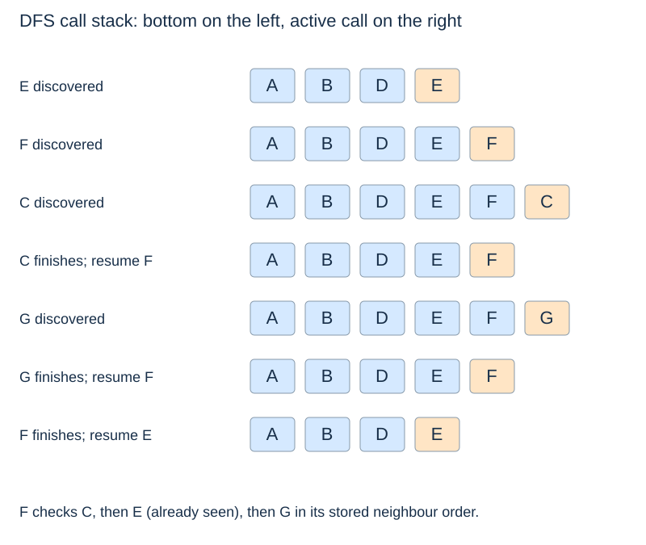
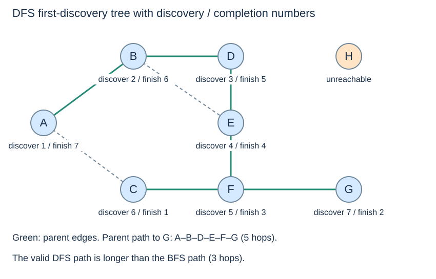

# Depth-first search: active paths and returns

(depth-first-search)=
## Finish a branch before resuming its caller

**Depth-first search (DFS)** explores an undiscovered neighbour immediately, continuing deeper until it must return. Recursion supplies the stack of waiting calls. Each caller resumes at its next unchecked neighbour after the deeper call finishes.

The input is the same adjacency-list graph as for BFS. We keep its alphabetical neighbour order, so differences in the traces come from the frontier policy.

(dfs-code)=
## Mark on entry and finish after neighbour checks

```python
def dfs(graph, start):
    if start not in graph:
        raise KeyError(start)
    seen = set()
    parent = {start: None}
    discovery, finish = [], []

    def visit(u):
        seen.add(u)
        discovery.append(u)
        for v in graph[u]:
            if v not in seen:
                parent[v] = u
                visit(v)
        finish.append(u)

    visit(start)
    return discovery, finish, parent
```

(dfs-discovery-completion)=
## Discovery and completion are different events

A vertex is discovered when its call begins. It completes only after all its neighbours have been checked and all child calls have returned. Some discovered vertices are still **active** on the stack; others have already finished.

For the shared graph, discovery order from A is **A, B, D, E, F, C, G**. Completion order is **C, G, F, E, D, B, A**. Completion is not generally the reverse of discovery: F discovers both C and G, finishing C before G is even discovered.



When C returns, A's original call is still waiting on the branch through B. A's neighbour C will later be skipped because C was already reached through F. Return order describes waiting work, not a rule that every vertex returns immediately after discovery.

(dfs-parent-tree)=
## A DFS path need not minimise hops

The first-discovery parents give the route **A, B, D, E, F, G** to G: five edges. BFS finds **A, C, F, G**, with three. Both are valid paths; the DFS code has no shortest-hop guarantee.



(dfs-cycles)=
## Seeing a discovered neighbour does not always mean a cycle

The seen set prevents a cycle such as B–D–E–B from making recursion repeat forever. In an undirected graph, however, a child also sees its parent as already discovered. That reverse appearance of the tree edge alone does not establish a cycle. An undirected cycle detector must distinguish the parent edge from other revisits.

In directed DFS, an edge to an active ancestor can establish a directed cycle, while an edge to an already finished vertex need not. A single discovered set does not distinguish those two states. Cycle detection needs additional state beyond the traversal shown here.

(iterative-dfs)=
## An explicit stack must remember where to resume

A stack can replace recursion, which is useful when a long path would exceed Python's recursion limit. But pushing all neighbours at once can change discovery order or parents, depending on push order and when vertices are marked.

To reproduce the recursive trace exactly, each explicit frame needs the active vertex **and** its next-neighbour position or iterator. Descend when it finds an undiscovered neighbour; finish and pop the frame only when its neighbour sequence is exhausted. This matches the suspended work in a recursive call.

DFS may have $O(n)$ active calls in a graph with n vertices. Linear total work therefore does not imply a small call stack. For a full graph rather than just one start's reachable region, continue to [components and restarts](graph-components.md).
