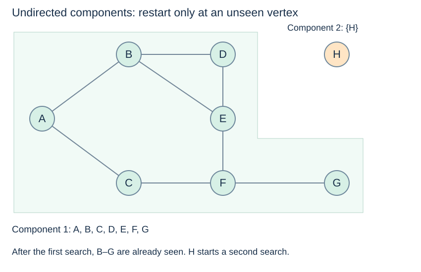

# Reachability and connected components

(graph-reachability)=
## A single start explores only what it can reach

On the shared undirected graph, BFS or DFS from A reaches A through G and stops. H is never discovered. This is correct single-source traversal: reaching every graph vertex is a different requirement, requiring additional starts when the graph is disconnected.

Starting at isolated H reaches H itself. An empty graph has no valid starting label, but it does have a well-defined full-graph component result: no components.

(connected-components)=
## Components partition an undirected graph

A **connected component** is a maximal group of vertices connected by paths. “Maximal” means no additional vertex from this graph can be added while preserving that property. In an undirected graph, every vertex belongs to exactly one component, including singleton components for isolated vertices.



The component groups are `{A, B, C, D, E, F, G}` and `{H}`. Within a group, list order is a traversal choice. Component membership does not depend on which vertex happens to be processed first.

(connected-components-code)=
## Restart with one shared discovered set

This routine assumes **undirected**, reciprocal adjacency lists. It uses `deque` from the BFS page and iterates vertices in dictionary insertion order.

```python
def connected_components(graph):
    seen, groups = set(), []
    for start in graph:
        if start in seen:
            continue
        seen.add(start)
        queue, group = deque([start]), []
        while queue:
            u = queue.popleft()
            group.append(u)
            for v in graph[u]:
                if v not in seen:
                    seen.add(v)
                    queue.append(v)
        groups.append(group)
    return groups
```

For the shared graph, the result is `[['A', 'B', 'C', 'D', 'E', 'F', 'G'], ['H']]`. After A's traversal, the outer checks at B through G do not launch another search because those vertices are already seen. H starts the second search.

(component-forest)=
## Several starts produce a forest

If parent links were also recorded, each component's start would have no parent and each other vertex would have one discovery parent. These traversal trees form a **forest**. The original graph can still have cycles and many non-tree edges; the discovery forest records how the algorithm reached vertices, not all the graph's connections.

The shared seen set is essential. Resetting it for every outer-loop vertex would repeat traversals and output overlapping groups rather than a partition.

(directed-connectivity)=
## Directed connectivity asks different questions

For outgoing lists `A: [B]`, `B: []`, `C: [B]`, both A and C can reach B, but neither reaches the other. Running the undirected restart routine on those lists can produce groups dependent on outer order. Those groups are not a valid general definition of directed components.

**Weak connectivity** ignores arrow direction when testing connection. **Strong connectivity** requires a directed path in both directions between every pair within a group. They need appropriate algorithms; a sequence of outgoing-only BFS restarts does not compute either notion in general.

Next: [Traversal costs and choices](graph-traversal-costs.md).
