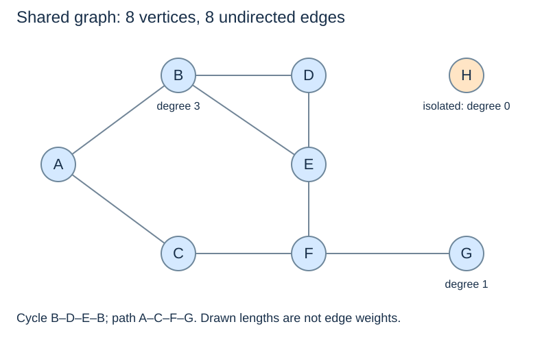
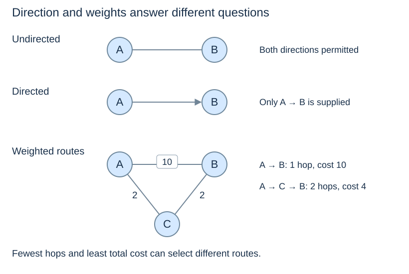

# Graph concepts and modelling

(graph-vertices-edges)=
## Decide what the connections mean

A **graph** $G=(V,E)$ has a set of **vertices** $V$ and a collection of **edges** $E$ connecting them. A vertex can represent a junction, webpage, task or person; an edge represents the relationship needed by the question. An edge's meaning must be stated before interpreting a path.

For a transport model, junctions might be vertices and traversable road segments edges. For a course model, vertices could be courses and an arrow from one to another could mean “must be completed before.” The same drawing can encode different problems under different modelling choices.

Our shared edges are **AB, AC, BD, BE, CF, DE, EF and FG**. A line represents a connection, not a measured road length. H is a vertex even though it has no incident edge.

(directed-undirected-graphs)=
## Direction changes which moves are permitted

An **undirected** edge joins two vertices in both directions. A **directed** edge, or arc, has a source and destination. `A → B` permits a move from A to B but does not imply a move from B to A. Reachability must follow the arrows.

(weighted-graphs)=
## A weight is separate from the connection

A **weighted** edge carries a value such as travel time, length or cost. An unweighted graph treats every traversed edge as one hop. The route with the fewest edges can differ from the route with the smallest weight sum.

For example, a direct edge costing 10 is more expensive than two edges costing 2 each. BFS minimises hops in an unweighted graph; a weighted shortest-path algorithm must use the actual edge costs. This topic does not treat visual line lengths as weights.

(graph-paths-cycles)=
## Paths, cycles and reachability

A **walk** follows consecutive edges and can repeat vertices. A **path** here does not repeat vertices. A **cycle** returns to its starting vertex without repeating the other vertices. In a simple undirected graph, going out along an edge and immediately returning along that same edge is not treated as a cycle.

In the shared graph, A–C–F–G is a path of three edges. B–D–E–B is a cycle. G is **reachable** from A because some permitted path connects them; H is not. A path's unweighted length counts edges, so a path containing four vertices has length three. The zero-edge path makes a vertex reachable from itself.

(graph-degree)=
## Degree counts incident connections

In a simple undirected graph, a vertex's **degree** is its number of neighbours. B has degree 3, G has degree 1, and H has degree 0. Each edge contributes to two vertex degrees, so the shared degree sum is $2|E|=16$.

In a directed graph, **outdegree** counts outgoing edges and **indegree** counts incoming edges; their totals each equal the number of directed edges. Our teaching graph is **simple**: it has no self-loops and no repeated parallel edges. Other models can allow these, but their representations and counting conventions must say so.

Next: [Representing graphs](graph-representations.md).
