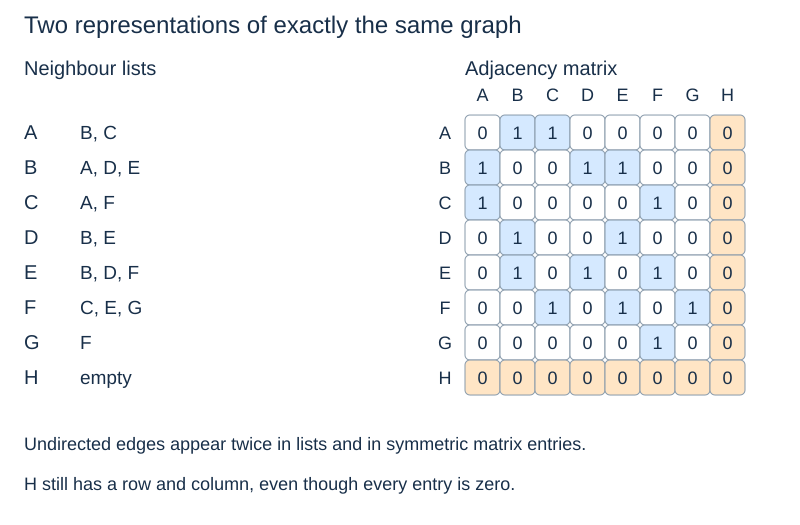

# Adjacency lists and matrices

(adjacency-list)=
## Store each vertex's neighbours

An **adjacency list** records the neighbours reachable by one edge from each vertex. In Python, a dictionary can map each label to a list. Lists give a specified iteration order; this example uses alphabetical neighbour order.

```python
graph = {
    "A": ["B", "C"],
    "B": ["A", "D", "E"],
    "C": ["A", "F"],
    "D": ["B", "E"],
    "E": ["B", "D", "F"],
    "F": ["C", "E", "G"],
    "G": ["F"],
    "H": [],
}
```

(graph-representation-contract)=
## Keep vertices and edges consistent

Every vertex, including H, appears as a key. Every listed neighbour must also be a key. Undirected lists are reciprocal: B in A's list requires A in B's list. A directed representation instead lists outgoing neighbours, without automatically adding the reverse edge.

The eight undirected edges occupy sixteen neighbour entries because each appears at both endpoints. The empty list at H records an isolated vertex; omitting H would represent a different vertex set.

(adjacency-matrix)=
## Store an entry for every ordered pair

Fix the vertex order A through H. An **adjacency matrix** has entry 1 in row u, column v when the edge exists, and 0 otherwise. An undirected graph's matrix is symmetric; a directed graph's need not be. The diagonal is zero for this graph because it has no self-loops.



```python
vertices = list(graph)
index = {v: i for i, v in enumerate(vertices)}
n = len(vertices)
matrix = [[0] * n for _ in range(n)]
for u in vertices:
    for v in graph[u]:
        matrix[index[u]][index[v]] = 1
```

Each row is a separate list. `[[0] * n] * n` would alias a single row: changing one entry would unexpectedly change the same column in every row. This is the [reference-sharing issue from Topic 1](../foundations/mutation-and-copying.md).

(graph-representation-costs)=
## Ask which operation needs to be fast

Let $n=|V|$ and $m=|E|$, with constant-time label hashing, comparisons and indexed access.

| Operation or storage | Dictionary of neighbour lists | Matrix plus label-to-index map |
|---|---|---|
| Input storage | $\Theta(n+m)$ | $\Theta(n^2)$ |
| Test whether u–v exists | $O(\deg(u))$ scan | $O(1)$ entry lookup |
| Enumerate neighbours of u | $\Theta(\deg(u))$ entries | $\Theta(n)$ row scan |
| Initialise the shown structure | Depends on supplied vertices and edges | $\Theta(n^2)$ zero initialisation |

A neighbour **set** can provide expected constant-time membership at the cost of an additional ordering decision for exact traces. That is a different representation from the lists above.

(sparse-dense-graphs)=
## Space depends on how many edges exist

A **sparse** graph has relatively few edges compared with the possible number of vertex pairs. A **dense** graph has many. Adjacency lists avoid allocating a slot for every absent edge, making them attractive for sparse networks. A matrix can be useful when pairwise edge tests dominate and quadratic storage is acceptable.

For weighted matrices, choose an explicit no-edge marker rather than using zero if zero-weight edges are legal. For weighted lists, store each neighbour together with its weight. Neither extension changes the distinction between a connection and its cost.

Next: [Breadth-first search](breadth-first-search.md).
