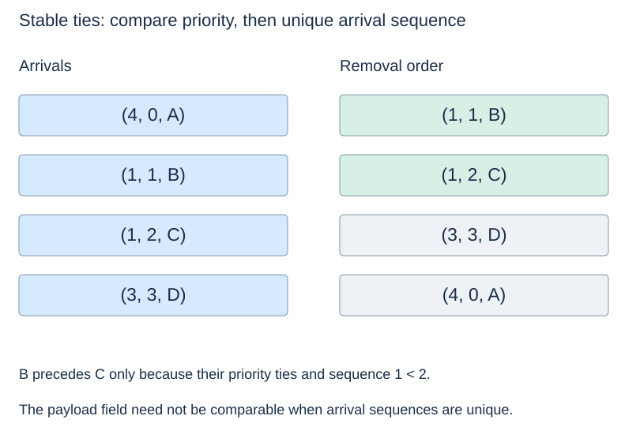

# Python heaps, records and ties

**After this page, you should be able to:**

- Select payloads by priority with deliberate FIFO tie handling.
- Use the min/max interfaces without confusing an inserted duplicate with a priority update.

**Builds on:** [Numeric heap operations](heap-insertion.md) and [extraction](heap-removal.md), plus [Python tuples](../foundations/collections-and-classes.md).

**Code languages:** Python defines the explanations, figures and self-checks. Use the [language guide](../../code-languages.md) for native conventions and dependencies. Complete runnable topic examples: [JavaScript](../../examples/languages/heaps.js) · [Julia](../../examples/languages/heaps.jl).

The Julia heap array starts at 1: parent=floor(i/2), children=2i and 2i+1. The support MinHeap implements heap repair rather than sorting on each removal. Stable record heaps compare priority and a unique counter before the payload; max queues negate numeric priorities.

## Public contract and representation invariant

Use the [priority-queue operation table](priority-queues.md#priority-queue-adt). The classes below insert one entry per call and return items from peek/removal; repeated payloads are not deduplicated. Empty access raises `IndexError`, so `None` remains valid data. Size counts entries, not distinct payload identities. Both classes promise FIFO within equal priorities.

For `MinPriorityQueue`, `_heap` is a valid heap of `(priority,sequence,item)` entries, and sequence values are unique and increasing within the instance. The counter is ordering metadata, not a key identifying the payload for arbitrary updates.

(python-heapq)=
## A heap interface operates on an ordinary list

Python's `heapq` min-heap functions work with lists: `heapify` establishes heap order, `heappush` inserts, and `heappop` removes the minimum. The minimum can be inspected at index 0. The list still exposes ordinary list operations, so the caller must preserve the heap invariant.

::::{tab-set}
:class: code-language-tabs

:::{tab-item} Python
:sync: python

```python
import heapq

values = [9, 5, 6, 2, 3, 4]
heapq.heapify(values)
heapq.heappush(values, 1)
assert heapq.heappop(values) == 1
assert values[0] == 2
```

:::

:::{tab-item} JavaScript
:sync: javascript

```javascript
var values = build_min_heap([9, 5, 6, 2, 3, 4]);
push_min(values, 1);
console.assert(pop_min(values) === 1);
console.assert(values[0] === 2);
```

:::

:::{tab-item} Julia
:sync: julia

```julia
values = build_min_heap([9, 5, 6, 2, 3, 4])
push_min!(values, 1)
@assert pop_min!(values) == 1
@assert values[1] == 2
```

:::

::::

The teaching sift functions show one valid implementation. Their exact intermediate layout need not match the library's; compare invariants and returned results rather than requiring an identical tied layout.

(heap-record-priorities)=
## Keep the payload separate from its selection key

An application often needs jobs or records, not bare numbers. An entry `(priority, sequence, item)` associates the priority with its payload. Tuple comparison examines fields from left to right.

(priority-queue-stable-ties)=
## Use a unique arrival sequence for FIFO ties

An increasing sequence number selects earlier arrivals among equal priorities. Because sequence numbers are unique, comparison resolves before reaching `item`; payload objects such as dictionaries do not need an ordering operation.

For arrivals A with priority 4, B with 1, C with 1 and D with 3, store sequence numbers 0, 1, 2 and 3. Removal gives B, C, D, A: priority first, then arrival only within ties. The sequence does not turn the whole structure into a FIFO queue.



::::{tab-set}
:class: code-language-tabs

:::{tab-item} Python
:sync: python

```python
from itertools import count

class MinPriorityQueue:
    def __init__(self):
        self._heap = []
        self._sequence = count()

    def __len__(self):
        return len(self._heap)

    def size(self):
        return len(self)

    def is_empty(self):
        return len(self) == 0

    def extract_min(self):
        return self.remove_min()

    def insert(self, item, priority):
        entry = (priority, next(self._sequence), item)
        heapq.heappush(self._heap, entry)

    def peek_min(self):
        if not self._heap:
            raise IndexError("peek at empty priority queue")
        return self._heap[0][2]

    def remove_min(self):
        if not self._heap:
            raise IndexError("remove from empty priority queue")
        return heapq.heappop(self._heap)[2]
```

:::

:::{tab-item} JavaScript
:sync: javascript

```javascript
// MinHeap and entry_less are in the shared support file.
class MinPriorityQueue {
    constructor() { this._heap = new MinHeap(entry_less); this._sequence = 0; }
    size() { return this._heap.size(); }
    is_empty() { return this.size() === 0; }
    insert(item, priority) { this._heap.push([priority, this._sequence++, item]); }
    peek_min() { return this._heap.peek()[2]; }
    remove_min() { return this._heap.pop()[2]; }
    extract_min() { return this.remove_min(); }
}
```

:::

:::{tab-item} Julia
:sync: julia

```julia
mutable struct MinPriorityQueue
    heap::MinHeap
    sequence::Int
end
MinPriorityQueue() = MinPriorityQueue(MinHeap(entry_less), 0)
Base.length(q::MinPriorityQueue) = length(q.heap.data)
Base.isempty(q::MinPriorityQueue) = length(q) == 0
function pq_insert!(q::MinPriorityQueue, item, priority)
    heap_push!(q.heap, (priority, q.sequence, item)); q.sequence += 1; return nothing
end
peek_min(q::MinPriorityQueue) = heap_peek(q.heap)[3]
remove_min!(q::MinPriorityQueue) = heap_pop!(q.heap)[3]
extract_min!(q::MinPriorityQueue) = remove_min!(q)
```

:::

::::

This class reuses the `heapq` import above. It returns **items**, while the numeric teaching heap returns priorities. Inputs must have consistently ordered priorities. Each instance owns its own heap and arrival counter; empty operations raise, so `None` can safely be an item.

(max-priority-adapter)=
## A max-priority interface for numeric priorities

For finite numeric priorities, negation turns largest-first selection into smallest-first selection. Keep arrival numbers increasing so ties remain FIFO. This composition exposes max names, rather than inheriting misleading min-named methods.

::::{tab-set}
:class: code-language-tabs

:::{tab-item} Python
:sync: python

```python
class MaxPriorityQueue:
    def __init__(self):
        self._queue = MinPriorityQueue()

    def __len__(self):
        return len(self._queue)

    def size(self):
        return len(self)

    def is_empty(self):
        return len(self) == 0

    def insert(self, item, priority):
        self._queue.insert(item, -priority)

    def peek_max(self):
        return self._queue.peek_min()

    def remove_max(self):
        return self._queue.remove_min()

    def extract_max(self):
        return self.remove_max()
```

:::

:::{tab-item} JavaScript
:sync: javascript

```javascript
class MaxPriorityQueue {
    constructor() { this._queue = new MinPriorityQueue(); }
    size() { return this._queue.size(); }
    is_empty() { return this.size() === 0; }
    insert(item, priority) { this._queue.insert(item, -priority); }
    peek_max() { return this._queue.peek_min(); }
    remove_max() { return this._queue.remove_min(); }
    extract_max() { return this.remove_max(); }
}
```

:::

:::{tab-item} Julia
:sync: julia

```julia
struct MaxPriorityQueue
    queue::MinPriorityQueue
end
MaxPriorityQueue() = MaxPriorityQueue(MinPriorityQueue())
Base.length(q::MaxPriorityQueue) = length(q.queue)
Base.isempty(q::MaxPriorityQueue) = isempty(q.queue)
pq_insert!(q::MaxPriorityQueue, item, priority) = pq_insert!(q.queue, item, -priority)
peek_max(q::MaxPriorityQueue) = peek_min(q.queue)
remove_max!(q::MaxPriorityQueue) = remove_min!(q.queue)
extract_max!(q::MaxPriorityQueue) = remove_max!(q)
```

:::

::::

Insert A(4), B(1), C(1), D(3): this class extracts A,D,B,C. B still precedes C among equal priorities. Negative priorities also work: −1 is greater than −5, so a max queue selects the −1 item first. The minimum adapter and maximum adapter have independent storage and counters.

This transformation relies on numeric negation and is not a generic reversal for strings or arbitrary ordered objects. Python 3.14 added public `heapq` max-heap functions; this small adapter also works on older Python versions. A direct max-heap record implementation would need its own deliberate tie convention.

(heap-record-operation-costs)=
## Implementation choices and costs

Unique sequence numbers prevent comparisons from reaching nonorderable payloads such as dictionaries. Stored priority is a snapshot; changing the payload does not revise that key. `extract_min/max` are aliases for removal, so one call removes only one entry. Neither class supplies arbitrary-item removal, decrease-key or a sorted snapshot method.

Under constant-cost priority/counter operations, peek/size/empty are O(1). Insert and extraction repair O(log(n+2)) paths, with amortised dynamic-array allocation costs; individual resizing/shrinking calls can copy O(n+1) references. Persistent entry storage is O(n+1); ordinary heap repair uses O(1) workspace and resizing can temporarily need linear storage. Negation and delegation do not change these asymptotic bounds. Library layouts may differ from the teaching sifts while satisfying the same invariant.

(heap-changing-priorities)=
## Changing a key requires a maintenance strategy

The stored priority is a snapshot used for ordering. Editing a field inside the payload does not update that entry's tuple key. Directly changing an ordering field in the underlying heap can invalidate parent–child order.

One design maintains an item-to-index map and repairs the affected path, updating the map during swaps. Another adds a revised entry and skips obsolete entries when they are removed. That lazy design needs an explicit way to recognise obsolete entries and may store more entries than active items. These are additional algorithms, not features of the small class above.

Scheduled events, repeated next-job selection and maintaining a small set of best candidates are common uses. [Topic 13](../graph-algorithms/graph-algorithms.md) uses priorities in graph algorithms. Interface reference: [Python's heapq documentation](https://docs.python.org/3/library/heapq.html).

:::{tip} Common misconception
**Equal-priority items must be comparable payload objects.** A unique sequence number resolves ties before payload comparison.
:::

(heap-records-checks)=
## Check your understanding

Predict the returned result and remaining heap before opening the explanation.

**1. A(4), B(1), C(1), D(3) arrive in that order. Give min and max extraction orders.**

:::{dropdown} Show explanation
Min: B,C,D,A. Max: A,D,B,C. Both classes retain FIFO order B before C within priority one.
:::

**2. If a payload field changes, does its stored tuple priority automatically change?**

:::{dropdown} Show explanation
No. The tuple key is a snapshot. Revising priorities needs index tracking/repair or a deliberate lazy-entry strategy.
:::

Next: [Heapsort, operation costs and choices](heap-sorting-costs.md).
