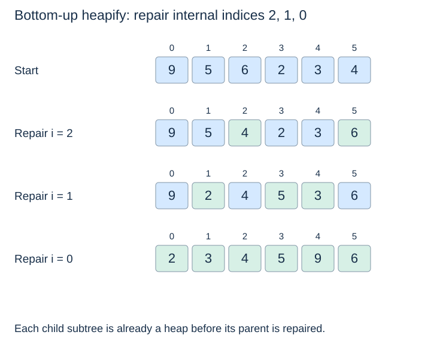
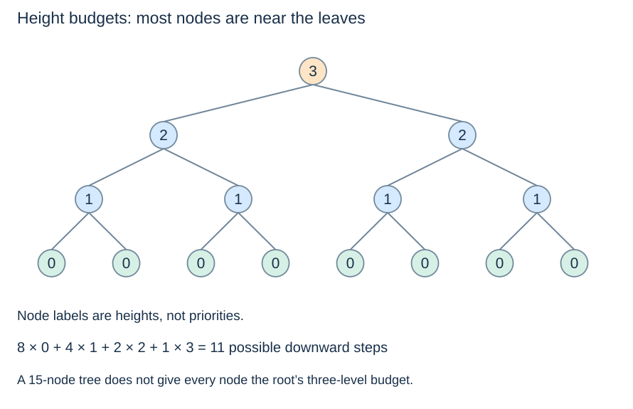

# Bottom-up heap construction

**After this page, you should be able to:**

- Trace bottom-up construction with valid child-subtree preconditions.
- Explain linear building work and distinguish copied output from in-place heapify.

**Builds on:** [Sift-down](heap-removal.md) repairs a root whose child subtrees are already heaps.

**Code languages:** Python defines the explanations, figures and self-checks. Use the [language guide](../../code-languages.md) for native conventions and dependencies. Complete runnable topic examples: [JavaScript](../../examples/languages/heaps.js) · [Julia](../../examples/languages/heaps.jl).

The Julia heap array starts at 1: parent=floor(i/2), children=2i and 2i+1. The support MinHeap implements heap repair rather than sorting on each removal. Stable record heaps compare priority and a unique counter before the payload; max queues negate numeric priorities.

## Construction contract and implementation choice

`build_min_heap(values)` returns a **new list** holding exactly the supplied priorities with their multiplicities, arranged as a min-heap. It does not sort them or mutate an input list. The copy is shallow. Finite numeric priorities satisfy this topic's comparison contract; empty input returns a new empty list. For a general iterable, iteration consumes it to produce the copy.

The public record queues start empty; this numeric builder is not a bulk-construction method on those classes. For a record batch, constructing `(priority,sequence,item)` entries then using heapify would also need an explicit arrival-order policy.

(heapify)=
## Begin where every child is already a heap

Given an unordered collection, repeated insertion is valid, but a bottom-up builder can do less work. Every leaf is already a one-item heap. Visit internal nodes from the last one back to the root, applying sift-down at each position.

::::{tab-set}
:class: code-language-tabs

:::{tab-item} Python
:sync: python

```python
def build_min_heap(values):
    heap = list(values)
    for i in range(len(heap) // 2 - 1, -1, -1):
        sift_down(heap, i)
    return heap
```

:::

:::{tab-item} JavaScript
:sync: javascript

```javascript
function build_min_heap(values) {
    const heap = [...values];
    for (let i = Math.floor(heap.length / 2) - 1; i >= 0; i--) sift_down(heap, i);
    return heap;
}
```

:::

:::{tab-item} Julia
:sync: julia

```julia
function build_min_heap(values)
    heap = collect(values)
    for i in div(length(heap), 2):-1:1
        sift_down!(heap, i)
    end
    return heap
end
```

:::

::::

This function reuses `sift_down` from the preceding page. It copies the input once, then modifies and returns that new list. Empty and singleton inputs need no repair iterations. An in-place version would omit the initial copy and operate on a supplied list.

(heapify-invariant)=
## Children are repaired before their parent

Before processing index i, all subtrees rooted at larger indices are valid heaps. Its child indices are larger, so sift-down's precondition holds. Repairing i preserves the already valid descendant structure. When index 0 is repaired, the entire array is a heap.

Notice the direction: a top-down scan of arbitrary input does not establish this precondition. Moving a small root into place before its descendants are repaired can leave a violation behind.

(heapify-trace)=
## Build from 9, 5, 6, 2, 3, 4



| Internal index | Array after sift-down |
|---|---|
| 2 | `[9, 5, 4, 2, 3, 6]` |
| 1 | `[9, 2, 4, 5, 3, 6]` |
| 0 | `[2, 3, 4, 5, 9, 6]` |

The final result satisfies every parent–child comparison, although the array is not sorted. Heap construction establishes enough order to select minima efficiently; it does not solve the full sorting problem.

(heapify-linear-time)=
## Most nodes cannot move far

Multiplying n nodes by the maximum height gives a valid but loose $O(n\log n)$ upper bound. Most nodes are near the leaves and have a much smaller downward budget.

One way to count tightly is to group possible downward steps by distance j from a node. A complete n-node tree has at most $\lfloor n/2^j\rfloor$ nodes with height at least j. Each can contribute at most one j-th downward step. Thus the total downward-step budget is bounded by

$$\sum_{j\geq1}\left\lfloor\frac{n}{2^j}\right\rfloor < n.$$

Each step makes only constant comparison work, and each internal node adds constant loop overhead. This gives $O(n)$ repair work; copying the n input items also takes $\Theta(n)$ time, so the shown builder is $\Theta(n)$ overall.



Repeated insertion has an $O(n\log n)$ bound and can take $\Theta(n\log n)$ comparisons for descending distinct priorities. Bottom-up construction is preferable when the whole batch is already available. The builder uses $\Theta(n)$ additional list storage; iterative in-place heapify uses $O(1)$ auxiliary storage beyond its existing array.

## Space, choices and suitability

The returned list occupies O(n) result storage and retains the payload references; the iterative repairs use O(1) workspace beyond it. The source and copied result coexist for a list input. An in-place heapify has a different mutation contract and omits that growing output allocation. Appending one at a time is useful for interleaved arrivals; bottom-up construction avoids repeated long upward repairs when the entire batch is available.

:::{tip} Common misconception
**n nodes times logarithmic height proves heapify needs n log n time.** That is loose: most nodes have very little downward work.
:::

(heap-build-checks)=
## Check your understanding

Predict the returned result and remaining heap before opening the explanation.

**1. Which internal indices are processed for six items?**

:::{dropdown} Show explanation
2,1,0. Their children are already valid heaps when each parent is repaired.
:::

**2. Does build_min_heap change the supplied input list?**

:::{dropdown} Show explanation
No. It copies it and returns a new heap list. In-place heapify would have a different mutation contract.
:::

Next: [Python heaps and application records](heap-applications.md).
