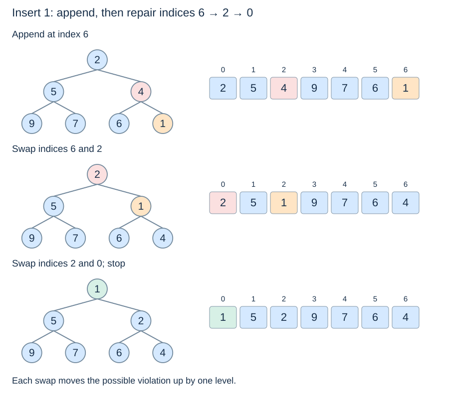

# Insertion and sift-up

**After this page, you should be able to:**

- Trace append followed by sift-up without changing existing off-path branches.
- Separate repair comparisons, resizing and returned results.

**Builds on:** [Heap shape, order and indices](heap-representation.md).

## Operation contracts

| Helper | Precondition | Result and state change |
|---|---|---|
| `push_min(heap, priority)` | Existing list is a valid min-heap | Return `None`; add one priority and preserve the original list object |
| `sift_up(heap, i)` | i is the newly appended last position; all other heap relations were valid | Return `None`; repair along its ancestor path without adding/removing entries |

An empty heap accepts its first item at index zero. Duplicate priorities add another entry. Consistent comparable finite priorities are the input contract; these small functions do not add runtime type-validation code.

(heap-insertion)=
## Preserve shape before repairing order

Insert a new item at the end of the array. That fills the next leaf position, preserving completeness. The old heap's links and priorities remain valid except possibly the comparison between the new leaf and its parent.

(sift-up)=
## Move the possible violation towards the root

Compare the item with its parent. If the parent is already at most the item, stop. Otherwise swap them and continue at the parent's index. Each step preserves the stored items and moves the only possible violation one level upward.

```python
def sift_up(heap, i):
    while i > 0:
        parent = (i - 1) // 2
        if heap[parent] <= heap[i]:
            break
        heap[parent], heap[i] = heap[i], heap[parent]
        i = parent

def push_min(heap, priority):
    heap.append(priority)
    sift_up(heap, len(heap) - 1)
```

The helper assumes the array arose from appending one item to a valid heap. It is not a general way to fix an arbitrary unordered array. `push_min` changes the same list and returns `None`.

(sift-up-trace)=
## Insert 1 into the lecture heap

Start with `[2, 5, 4, 9, 7, 6]`. Appending gives `[2, 5, 4, 9, 7, 6, 1]`. Index 6 has parent 2, containing 4, so swap them. The new item now at index 2 has parent 0, containing 2; swap again. At the root, stop.



The final heap is `[1, 5, 2, 9, 7, 6, 4]`. The existing left branch is unchanged. The result need not match the array another construction method would produce: several heap layouts can represent the same priorities.

(sift-up-correctness-cost)=
## Why one path is enough

Before a swap, the parent was at most all priorities in its original descendant subtrees. Moving it down onto this path therefore does not make it exceed its new children. Moving the smaller item up can only create another violation with its new parent. When the root or a correctly ordered parent edge is reached, all edges satisfy heap order again.

There are at most $\lfloor\log_2 n\rfloor$ upward steps for the resulting heap size n. Repair uses $O(\log n)$ worst-case comparisons and $O(1)$ auxiliary space. It can stop immediately when the new item is large enough.

## Implementation choices and space

Appending first preserves completeness. Adjacent-on-path swaps make the repair visible; a hole-moving implementation can instead save the new item and shift parents, but needs its own careful bookkeeping. Equal priorities stop at `<=`; that local tie decision does not promise FIFO for attached records. Each sift uses O(1) workspace and allocates no new logical entry beyond the appended value.

The list append can separately resize the backing array and copy $O(n)$ references on one insertion. With geometric growth, insertion is amortised $O(\log(n+1))$ overall; logarithmic repair is not a promise that every Python-list insertion avoids a resizing pause.

:::{tip} Common misconception
**Logarithmic sift-up means every insertion avoids a linear pause.** The list can separately resize and copy references.
:::

(heap-insert-checks)=
## Check your understanding

Predict the returned result and remaining heap before opening the explanation.

**1. Insert 1 into [2,5,4,9,7,6]. Which indices does it visit on the upward path?**

:::{dropdown} Show explanation
6,2,0. It swaps with 4 and then 2, leaving [1,5,2,9,7,6,4].
:::

**2. Does inserting another equal priority leave size unchanged?**

:::{dropdown} Show explanation
No. A priority queue permits duplicate entries. The size increases by one even if no sift swap is needed.
:::

Next: [Root removal](heap-removal.md).
