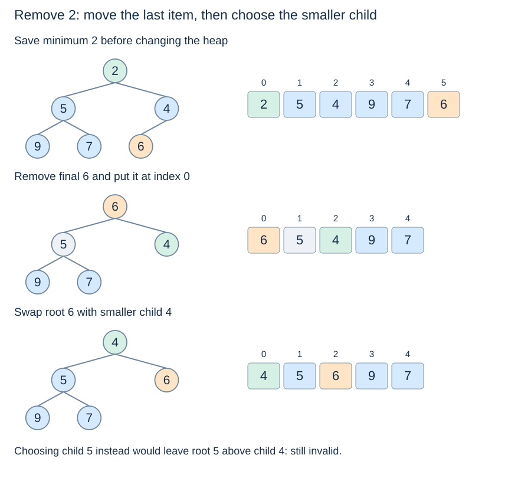

# Root removal and sift-down

**After this page, you should be able to:**

- Distinguish minimum inspection from removal and repair the correct child path.
- Handle empty, singleton and one-child boundaries without losing records.

**Builds on:** [Heap representation](heap-representation.md) and [insertion](heap-insertion.md) establish the valid starting state.

## Operation contracts

| Helper | Return | Mutation / empty policy |
|---|---|---|
| `peek_min(heap)` | Minimum stored priority | Observe only; empty raises `IndexError` |
| `pop_min(heap)` | Removed minimum priority | Reduce length by one; empty raises `IndexError` before mutation |
| `sift_down(heap,i)` | `None` | Repair from a valid occupied index with heap-ordered child subtrees; preserve all entries |

The full input list must be a valid min-heap for peek/pop. Duplicates are separate entries. Public record queues call the same selection idea `remove_min` or `extract_min`, but return the item rather than the priority.

(heap-minimum)=
## Inspecting and removing are different operations

The root holds a minimum, so `peek_min` only needs to check emptiness and read index 0. Removal must additionally repair the remaining heap.

```python
def peek_min(heap):
    if not heap:
        raise IndexError("peek at empty heap")
    return heap[0]
```

(sift-down)=
## Swap with the smaller child

Assume the two child subtrees are already valid heaps. If the current item exceeds a child, choose the **smaller existing child** and swap. Choosing the larger child could leave the smaller child below a parent that is still too large.

```python
def sift_down(heap, i):
    n = len(heap)
    while 2 * i + 1 < n:
        child = 2 * i + 1
        right = child + 1
        if right < n and heap[right] < heap[child]:
            child = right
        if heap[i] <= heap[child]:
            break
        heap[i], heap[child] = heap[child], heap[i]
        i = child
```

The loop requires a left child. A right child is compared only when its index is valid. If children tie, this code chooses the left one; it does not thereby promise stable removal of equal-priority records.

(heap-remove-min)=
## Remove the final leaf, then move its item to the root

```python
def pop_min(heap):
    if not heap:
        raise IndexError("pop from empty heap")
    result = heap[0]
    last = heap.pop()
    if heap:
        heap[0] = last
        sift_down(heap, 0)
    return result
```

Removing the last slot preserves complete shape. Moving its item to the root can violate order downwards, but the remaining child subtrees are still valid. Sift-down restores their connection to the root. Removing index 0 with `pop(0)` would instead shift the array and destroy this structural reasoning.

(sift-down-trace)=
## Remove 2 from the lecture heap

Save root 2 for return. Remove final item 6, move it into the root, then compare children 5 and 4. Choose 4 and swap. The result is `[4, 5, 6, 9, 7]`; return 2.



(heap-removal-boundaries)=
## Empty, singleton and one-child cases

| Input heap | Result or error | Final heap |
|---|---|---|
| `[]` | `IndexError` | `[]` |
| `[4]` | 4 | `[]` |
| `[2, 5]` | 2 | `[5]` |
| `[1, 3, 2]` | 1 | `[2, 3]` |

The singleton guard avoids assigning index 0 after the array becomes empty. A sift-down node with only a left child uses that child normally. At most one downward path is repaired, giving $O(\log(n+1))$ repair time and constant auxiliary space. A backing-array shrink can add an occasional copying cost; the comparison bound and allocation policy are separate claims.

## Implementation choices, correctness and costs

Saving the old root separates the returned result from the remaining storage. Removing the final leaf preserves shape; the child-selection rule preserves heap order off the repair path. Empty pop raises before changing anything, and a singleton is removed without writing into an empty list.

Choosing the left child on a tie is deterministic but not stable record selection. The swap-based repair uses O(1) workspace; a hole-moving variant would make different assignments. Peek uses O(1) time and space; pop repairs one path in O(log(n+2)) time with O(1) workspace. A Python-list shrink can add O(n+1) time/storage work on an individual call, while ordinary geometric storage policies support amortised bounds. This differs from shifting all elements with `pop(0)`.

:::{tip} Common misconception
**Removing slot zero with pop(0) implements the same heap repair.** Shifting the array destroys the intended parent-child layout.
:::

(heap-remove-checks)=
## Check your understanding

Predict the returned result and remaining heap before opening the explanation.

**1. What does pop_min([4]) return and leave?**

:::{dropdown} Show explanation
It returns 4 and leaves an empty list; the guard avoids writing a replacement root into that empty list.
:::

**2. Why choose the smaller child during min-heap sift-down?**

:::{dropdown} Show explanation
Swapping with the larger child could leave the smaller one beneath a still-too-large parent, violating order.
:::

Next: [Bottom-up construction](heap-construction.md).
