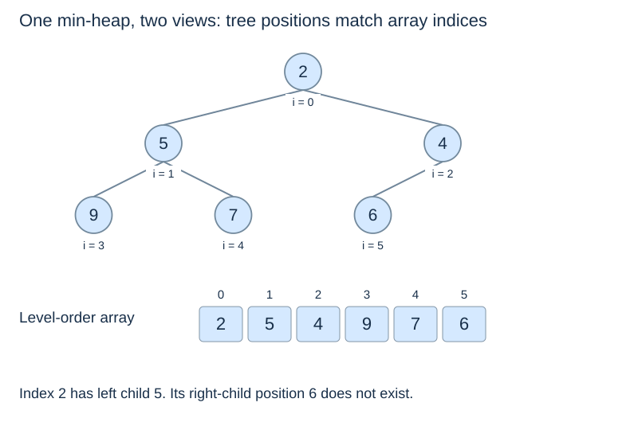
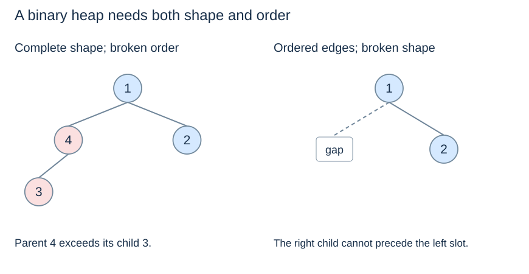

# Heap order, complete shape and array indices

**After this page, you should be able to:**

- Check complete shape and parent-child heap order separately.
- Translate logical relationships into valid array indices and operation costs.

**Builds on:** [Priority-queue behaviour](priority-queues.md) defines what the representation must support.

## Representation contract

The teaching functions use the entire list as the active heap, storing one finite numeric priority in each slot. Duplicates are permitted and count as separate entries. The level-order array prefix enforces complete shape; comparisons enforce min-heap order. Read-only peek accesses slot zero after checking emptiness; insertion and extraction must preserve both properties.

A drawn linked heap is another representation, but it would need a way to find the next/final leaf efficiently. The code here does not implement that alternative. Its array layout is an implementation choice, not the Priority Queue ADT itself.

(complete-binary-tree)=
## Shape fixes the next leaf position

A **complete binary tree** has every level full except possibly the last, and the last level fills from left to right. A missing position before a later occupied position on that level violates completeness.

For $n\geq1$ nodes, this shape has edge-height $\lfloor\log_2 n\rfloor$. Appending fills the next available leaf; removing the final leaf retains complete shape. The representation does not need an AVL balance factor to keep paths logarithmic.

(min-heap-invariant)=
## Parent priority is at most each child's

A **binary min-heap** combines complete shape with **heap order**: every parent priority is less than or equal to each existing child's priority. Following a path from the root never decreases the priority, so the root is a global minimum. The mirrored max-heap has parent priority at least each child's.

(heap-versus-bst)=
## Siblings and subtrees need no total order

The lecture heap `[2, 5, 4, 9, 7, 6]` is valid even though 5 precedes 4 and 9 precedes 7. Siblings need not be sorted, and the left subtree need not contain smaller priorities than the right subtree. Inorder traversal does not produce sorted heap output.

A BST instead uses whole-subtree bounds around a key. That supports eliminating an entire side during arbitrary-key lookup. Heap order does not justify the same search decision: a larger target could occur in either child subtree.

(heap-array-indices)=
## Store the tree in level order

For zero-based position i:

| Relationship | Position |
|---|---|
| Left child | `2 * i + 1` |
| Right child | `2 * i + 2` |
| Parent, for i > 0 | `(i - 1) // 2` |

A child exists only when its index is below the active heap size. The root at index 0 has no parent; calculating its parent formula in Python gives −1, which is a valid list index with the **wrong meaning** here. Test `i > 0` first.

In the six-item example, index 1 has children 3 and 4. Index 5 has parent 2. Index 2 has a left child at 5, but its right-child position 6 is outside the heap.

(heap-shape-order)=
## Check both invariants separately

An array prefix naturally encodes complete shape; the priority comparisons still need checking. In a drawn linked tree, both shape and order must be checked. The last internal index is `n // 2 - 1`; positions `n // 2` through `n - 1` are leaves. Empty and singleton heaps have no internal node needing repair.

## Implementation choices, costs and suitability

Computed child/parent indices avoid allocating explicit link objects or storing AVL height metadata. A valid occupied index is directly accessible in O(1) time; that does not make finding an arbitrary priority O(1). Inspecting every parent-child edge costs O(n+1) if a full validation is needed. Persistent storage is O(n+1) references under ordinary dynamic-array capacity management, and index calculation uses O(1) workspace.

Choose this representation when repeated extreme selection and compact storage matter. It supplies no subtree key ranges, sorted traversal order or item-to-index directory; those would require different information and maintenance.

:::{tip} Common misconception
**A heap is a BST with a different drawing.** Heap order constrains parent-child priorities, not whole left/right key ranges.
:::

(heap-representation-checks)=
## Check your understanding

Predict the returned result and remaining heap before opening the explanation.

**1. In the six-item lecture heap, does index 2 have a right child?**

:::{dropdown} Show explanation
No. Its right-child position is 6, outside size six. The left child at index 5 exists.
:::

**2. Can a complete tree with one parent larger than its child be a valid min-heap?**

:::{dropdown} Show explanation
No. Completeness and heap order are separate requirements, and both must hold.
:::

Next: [Insertion and sift-up](heap-insertion.md).
