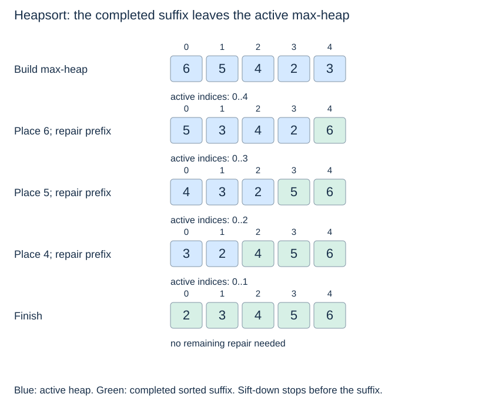

# Heapsort, operation costs and choices

**After this page, you should be able to:**

- Separate priority-queue extraction from in-place heapsort.
- Compare repair, allocation, stability and output costs under stated assumptions.

**Builds on:** [Heap construction](heap-construction.md), [record priorities](heap-applications.md) and [sorting properties](../sorting/sorting-properties.md).

## Sorting and queue contracts are different

`heapsort(a)` rearranges a supplied list into ascending order, preserves every record/multiplicity and returns `None`. Empty and singleton lists are valid. Repeated min extraction instead consumes a heap and returns its removed values one by one; collecting them creates a separate ordered result. The [record queue](heap-applications.md) returns payloads under its tie policy, not necessarily bare priorities.

(heap-extraction-sorting)=
## Repeated minima produce ordered output

For a fixed batch, build a min-heap and repeatedly remove its root. Each removal returns the smallest remaining value, so the emitted sequence is ascending. Construction costs $\Theta(n)$; n removals take $O(n\log(n+1))$ total time. Saving the emitted values creates an additional output collection.

That process differs in space usage from the in-place heapsort below, although both use heap order to organise sorting.

(in-place-heapsort)=
## A max-heap places the next largest item at the end

To sort an existing array in ascending order, build a **max-heap**. Swap its root with the last item in the active prefix, shorten the prefix, and sift down within that prefix. The completed suffix is sorted and is no longer part of the active heap.

```python
def heapsort(a):
    def sift_down_max(i, end):
        while 2 * i + 1 < end:
            child = 2 * i + 1
            right = child + 1
            if right < end and a[right] > a[child]:
                child = right
            if a[i] >= a[child]:
                break
            a[i], a[child] = a[child], a[i]
            i = child

    for i in range(len(a) // 2 - 1, -1, -1):
        sift_down_max(i, len(a))
    for end in range(len(a) - 1, 0, -1):
        a[0], a[end] = a[end], a[0]
        sift_down_max(0, end)
```

`end` is **exclusive** in the helper. It prevents a repair from moving completed suffix values back into the heap. The function changes `a` and returns `None`; empty and singleton inputs require no sorting iterations.



(heapsort-properties)=
## State time, space and stability separately

This heapsort has $O(n\log(n+1))$ worst-case time and $O(1)$ auxiliary space: it uses iterative sifting and no growing temporary list or recursion stack. Its worst-case comparison growth is asymptotically optimal for comparison sorting. This is a worst-case statement; equal keys can allow early stops during individual sifts.

Ordinary heapsort is **not stable**. Equal-key records can cross during root–end swaps even if every local comparison treats ties consistently. For `[2_A, 2_B, 1]`, the shown max-heap sort comparing numeric keys can produce `[1, 2_B, 2_A]`. A stable application priority queue uses additional arrival keys; the bare heapsort has no such guarantee.

## Implementation choices and suitability

This heapsort uses an iterative max-heap over an exclusive active prefix, so it has no recursion stack or copied sublists. Root–end swaps establish the sorted suffix and can reorder equal-key records. A stable priority queue with arrival metadata is a different implementation; it does not make this bare heapsort stable.

Worst-case time is O(n log(n+2)). The early-stop sifts shown can make all-equal input Θ(n), consistent with the [sorting comparison](../sorting/comparing-strategies.md#sorting-cost-comparison). This does not change the worst-case bound. Use the function to understand in-place comparison sorting; for everyday Python application sorting, prefer the built-in stable interface.

(heap-operation-costs)=
## Separate heap repair from storage management

| Operation | Time and assumption | Extra workspace / output |
|---|---|---|
| Peek extreme | O(1); empty raises | O(1) |
| Size / empty | O(1), list length | O(1) |
| Insert | O(log(n+2)) repair; amortised with geometric growth; O(n+1) individual resize | O(1) repair; up to O(n+1) allocation |
| Remove / extract extreme | O(log(n+2)) repair; occasional shrink can add O(n+1) copying | O(1) repair; up to O(n+1) allocation |
| Bottom-up build | Θ(n+1), shown copying builder | O(n) returned list; O(1) repair workspace |
| Find arbitrary key/item | O(n+1) worst-case scan without an index | O(1) scan workspace |
| Sorted output by extraction | O(n log(n+2)+1), including build | O(n) heap and O(n) collected output |
| In-place heapsort | O(n log(n+2)+1) worst case | O(1) beyond supplied array |

The min/max record adapters have the same path/allocation bounds. No arbitrary-key search path follows from heap order, and no stable tie guarantee follows from choosing a child consistently. Neither a membership scan nor arbitrary-item deletion is part of the supplied queue class interface.

These bounds assume constant-time comparisons and array access. The heap's own array stores $O(n)$ references with geometric capacity management. That input storage is distinct from a sift operation's constant auxiliary space.

(heap-versus-avl)=
## Match the invariant to the workload

An [AVL tree](../balanced-trees/balanced-trees.md) supports logarithmic arbitrary-key lookup and linear sorted inorder traversal. A binary heap exposes a minimum immediately but supplies much less information about other keys. A basic AVL minimum query follows left links in $O(\log(n+1))$ time unless an extra minimum reference is maintained.

For repeated extreme selection with interleaved arrivals, a heap is a natural fit. For changing ordered data requiring arbitrary lookup and ordered traversal, a balanced search tree offers a different set of strengths. For ordinary batch sorting, Python's stable `sorted` and `.sort` are useful application interfaces; implementing heapsort explains another strategy and its space trade-off.

:::{tip} Common misconception
**A stable priority-queue class makes ordinary heapsort stable.** The class has arrival metadata; the sorting function has no such guarantee.
:::

(heap-costs-checks)=
## Check your understanding

Predict the returned result and remaining heap before opening the explanation.

**1. Does building a heap make its array globally sorted?**

:::{dropdown} Show explanation
No. Parent-child heap order is sufficient for extreme selection but leaves siblings and many other pairs unordered.
:::

**2. Can an O(1) root peek provide O(1) lookup of an arbitrary key?**

:::{dropdown} Show explanation
No. Heap order gives no whole-subtree key partition, so arbitrary lookup may require a linear scan.
:::

Return to the [topic overview](heaps.md), compare [sorting strategies](../sorting/comparing-strategies.md), or continue to [graph algorithms](../graph-algorithms/graph-algorithms.md).
