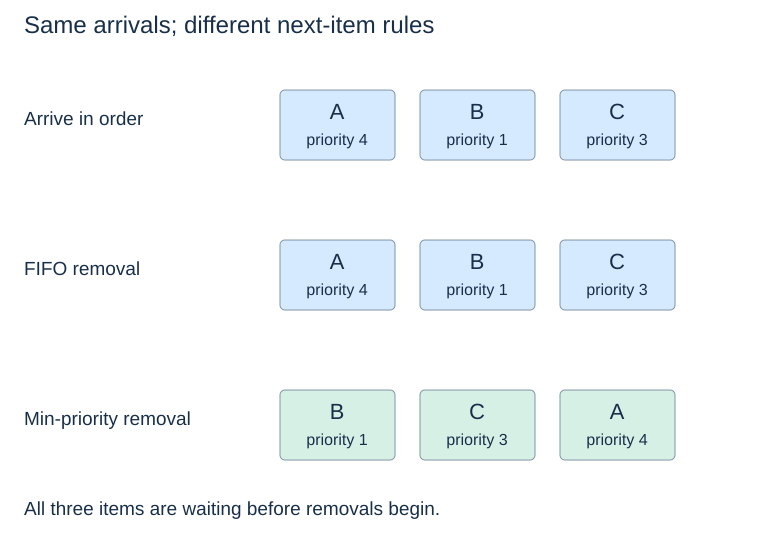

# Priority queues: select by importance

**After this page, you should be able to:**

- Specify insertion, observation and extraction for min/max priority selection.
- Distinguish priority, arrival ties, duplicate entries and empty behaviour.

**Builds on:** [ADT contracts](../linear-structures/adts-and-contracts.md) specify results and state changes independently of storage.

(priority-queue-adt)=
## Specify which priority wins

A **priority queue** manages items with associated priorities. A **min-priority queue** returns the item with the smallest priority among the items currently stored. A **max-priority queue** selects the largest. Whether a small number means “urgent” belongs to the application convention, not to the word *priority* itself.

| Min-priority operation | Max-priority counterpart | Returned result and state change |
|---|---|---|
| `insert(item, priority)` | Same name | `None`; add one entry, including a repeated item/priority |
| `peek_min()` | `peek_max()` | Selected item; no mutation; empty raises `IndexError` |
| `remove_min()` / `extract_min()` | `remove_max()` / `extract_max()` | Remove and return selected item; empty raises `IndexError` |
| `size()` / `len(q)` | Same names | Number of stored entries; observe only |
| `is_empty()` | Same name | Boolean; observe only |

“Remove” here already means remove **and return** the extreme; extract is an alias, not an additional deletion after removal. No arbitrary-item remove operation is promised. The supplied record classes select FIFO among equal priorities and use finite numeric priorities. Inserting the same payload twice adds two entries; it does not replace a previous entry or update its priority. Payloads may be `None` and need not support ordering.

The lower-level [numeric heap functions](heap-removal.md) store priorities themselves, so they return a number instead of a separate payload. The [application classes](heap-applications.md) make the public item/priority distinction explicit.

(priority-versus-fifo)=
## Arrival and priority are different policies

Suppose A, B and C arrive with priorities 4, 1 and 3. FIFO removes A, B, C; a min-priority queue removes B, C, A if all three are waiting before removals start.

Selection applies to **currently stored** items. Removing B now does not promise that its priority is below every priority that will arrive later. A scheduler may insert new events between removals; the queue is not necessarily sorting one fixed batch.

(priority-queue-contract)=
## Empty states and ties belong to the contract

The code in this topic raises `IndexError` for empty minimum inspection or removal. A singleton has a clear minimum; removing it leaves an empty queue. The application may use `None` as a payload because empty operations raise rather than returning an ambiguous sentinel.

If two items have equal priority, the basic priority rule does not specify which comes first. The stable classes in this topic refine that basic contract with FIFO ties. Some systems require FIFO within each priority; others permit any tied item. A stable tie rule must be implemented deliberately. A heap's tree shape alone does not supply it.

(priority-queue-implementations)=
## One ADT has several possible implementations

An unsorted list can append cheaply but may scan all items to locate a minimum. A sorted list exposes an extreme at an end, but insertion can shift many references. A binary heap balances efficient extreme selection with logarithmic path repairs during updates.

These are implementation trade-offs under the same behaviour, following [Topic 5's ADT distinction](../linear-structures/adts-and-contracts.md). A variable named `heap` does not establish the required invariant; arbitrary list operations can break it.

## Implementation choices, costs and use

The binary-heap representation uses O(n+1) entry storage. Extreme inspection and cached size/empty are O(1); insert/extract repair is O(log(n+2)) worst-case, with amortised allocation costs for a growing array and occasional O(n+1) resizing work. A numeric bottom-up builder has O(n+1) time. These are implementation bounds, not part of every possible Priority Queue ADT; the [final comparison](heap-sorting-costs.md#heap-operation-costs) separates them.

Use priority selection for scheduled events or next-job choice. If arbitrary-key lookup, predecessor or ordered ranges dominate, compare the [ordered-set interface](../searching/ordered-set-operations.md) instead. A heap does not provide a globally sorted sequence for free.

:::{tip} Common misconception
**Inserting the same item again updates its priority.** These classes add a separate entry; priority updates require another contract and algorithm.
:::

(heap-contract-checks)=
## Check your understanding

Predict the returned result and remaining heap before opening the explanation.

**1. Insert A(4), B(1), C(3) before any removals. Which min-priority item leaves first?**

:::{dropdown} Show explanation
B. Priority selects among currently waiting entries, rather than choosing the first arrival A.
:::

**2. Does extract_min inspect the minimum without changing the queue?**

:::{dropdown} Show explanation
No. It removes and returns an item; peek_min is the observer.
:::

Next: [Heap representation](heap-representation.md).
