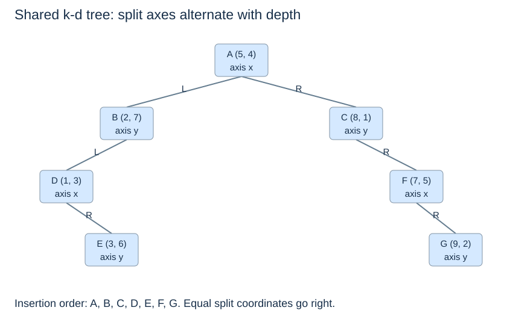
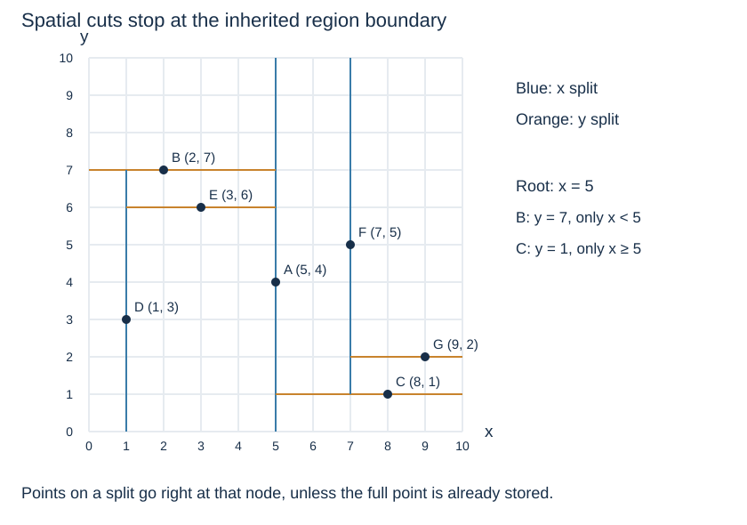

# Split rules and k-d-tree construction

**After this page, you should be able to:**

- Trace insertion by the active axis while keeping the strict-left/ties-right rule.
- Describe the inherited region of a descendant rather than extending every cut across the whole plot.

**Builds on:** Use the [shared points and query contracts](spatial-queries.md); depth zero compares x.

(kd-tree)=
## A coordinate determines the next branch

A **k-d tree** organises points in $k$ dimensions. In the two-dimensional implementation here, nodes at depth 0 compare x, depth 1 compares y, depth 2 compares x again, and so on. The **active axis** is `depth % 2`.

(kd-split-invariant)=
## Keep one explicit tie policy

At a node with active-axis coordinate $s$, every point in the left subtree has that coordinate **less than** $s$; every point in the right subtree has it **greater than or equal to** $s$. Both children obey their own next-axis rules too. An exactly identical point is detected before branching and is not inserted twice.

A coordinate tie is not full equality. Distinct points `(5, 4)` and `(5, 7)` have equal x values, so the second goes right at an x split, even though y differs. At a y split, compare y instead. Do not replace this rule with ordinary tuple ordering.

(kd-construction)=
## Insert the shared points in order

| Name | Point | Final parent and branch |
|---|---|---|
| A | (5, 4) | Root; compares x |
| B | (2, 7) | A's left child; compares y |
| C | (8, 1) | A's right child; compares y |
| D | (1, 3) | B's left child; compares x |
| E | (3, 6) | D's right child; compares y |
| F | (7, 5) | C's right child; compares x |
| G | (9, 2) | F's right child; compares y |



```python
class KDNode:
    def __init__(self, point):
        self.point = point
        self.left = None
        self.right = None

def kd_insert(node, point, depth=0):
    if node is None:
        return KDNode(point)
    if point == node.point:
        return node
    axis = depth % 2
    if point[axis] < node.point[axis]:
        node.left = kd_insert(node.left, point, depth + 1)
    else:
        node.right = kd_insert(node.right, point, depth + 1)
    return node

points = [(5, 4), (2, 7), (8, 1), (1, 3), (3, 6), (7, 5), (9, 2)]
root = None
for point in points:
    root = kd_insert(root, point)
```

Call with depth 0 for the full tree and reconnect the returned root. Recursion supplies the correct axis for each child. Inserting E follows A left by x, B left by y, then D right by x. The insertion-order tree is not automatically balanced.

(kd-spatial-region)=
## Each split is restricted to an inherited region

The root divides the plane at x = 5. B splits only the region x < 5 at y = 7; C splits only x ≥ 5 at y = 1. A deeper split does not extend across the entire plane.



For example, the region below D's right branch satisfies `1 <= x < 5` and `y < 7`, not merely `x >= 1`. Ancestor constraints accumulate just as BST key bounds do, but across different coordinates.

:::{tip} Common misconception
**Alternating axes automatically balances the tree.** It changes the comparison at each depth, but an insertion order can still produce a chain.
:::

(pilot-kd-construction-checks)=
## Check your understanding

Predict the answer before opening the explanation.

**1. Starting from the shared tree, predict where a new point H=(5,7) would be inserted.**

:::{dropdown} Show explanation
At A=(5,4), the x tie goes right. At C=(8,1), compare y: 7≥1 goes right to F. At F=(7,5), compare x: 5<7 goes to its empty left child. H would become F’s left child; matching A’s x did not make H a duplicate.
:::

**2. If B=(2,7) were inserted first instead of A, would the root split still be x=5? Would that change which points satisfy the shared range query?**

:::{dropdown} Show explanation
The root would be B and its x split would be 2. The shape and later cuts could change, but the geometric answer set remains B,D,E after all seven distinct points are stored correctly. Representation and result contract are different things.
:::

Next: [Exact search](kd-exact-search.md).
