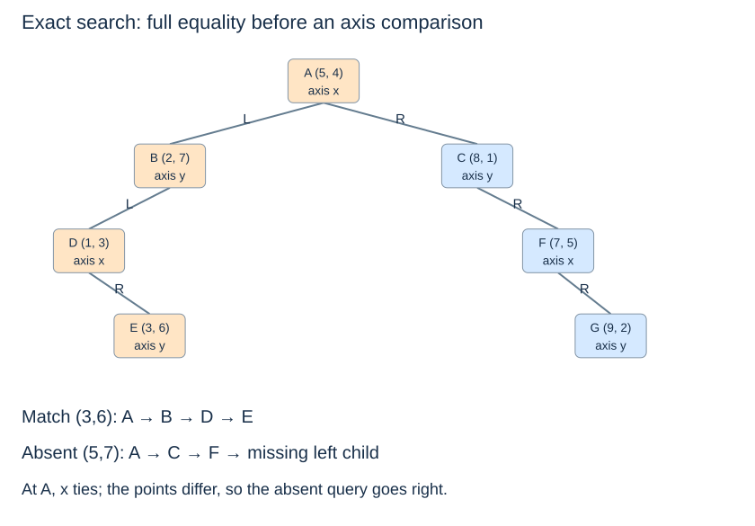

# Exact-point search and coordinate ties

**After this page, you should be able to:**

- Trace successful and failed exact searches, distinguishing a coordinate tie from full equality.
- Explain why a subtree search must keep the subtree’s actual depth.

**Builds on:** [Construction](kd-construction.md) establishes the axis and tie rules that lookup must follow.

**Code languages:** Python defines the explanations, figures and self-checks. Use the [language guide](../../code-languages.md) for native conventions and dependencies. Complete runnable topic examples: [JavaScript](../../examples/languages/kd-trees.js) · [Julia](../../examples/languages/kd-trees.jl).

JavaScript points are arrays compared by same_point; Julia points are value tuples. Julia coordinate/child indices are one-based (x=1, y=2; SW/SE/NW/NE=1/2/3/4), while depth still starts at zero. R-tree orientation uses exact big-integer arithmetic for the supplied integer-coordinate geometry; nearest distances remain floating calculations. General R-tree update code is still conceptual in every language.

(kd-exact-search)=
## Check the entire point before choosing a side

Exact search asks whether a particular coordinate tuple is stored. At each node, first test full-point equality. Otherwise compare the active coordinate and use the same `<` left, `>=` right rule as insertion.

::::{tab-set}
:class: code-language-tabs

:::{tab-item} Python
:sync: python

```python
def kd_search(node, point, depth=0):
    while node is not None:
        if point == node.point:
            return node
        axis = depth % 2
        if point[axis] < node.point[axis]:
            node = node.left
        else:
            node = node.right
        depth += 1
    return None
```

:::

:::{tab-item} JavaScript
:sync: javascript

```javascript
function kd_search(node,point,depth=0) {
    while (node!==null) {
        if (same_point(point,node.point)) return node;
        const axis=depth%2;
        node=point[axis]<node.point[axis] ? node.left : node.right;
        depth++;
    }
    return null;
}
```

:::

:::{tab-item} Julia
:sync: julia

```julia
function kd_search(node,point,depth=0)
    while node!==nothing
        point==node.point && return node
        axis=mod(depth,2)+1
        node=point[axis]<node.point[axis] ? node.left : node.right
        depth+=1
    end
    return nothing
end
```

:::

::::

The result is a node or `None`. The full-tree call starts at depth 0. An arbitrary subtree starts at its actual depth, since resetting that depth would change the axes and invalidate the decisions.

(kd-exact-traces)=
## A successful and unsuccessful path

| Current point; axis | Query E = (3, 6) | Query (5, 7) |
|---|---|---|
| A = (5, 4); x | 3 < 5: left | 5 = 5 but points differ: right |
| Next node | B = (2, 7); y | C = (8, 1); y |
| Decision there | 6 < 7: left to D | 7 ≥ 1: right to F |
| Next decision | At D = (1, 3), x: 3 ≥ 1, right to E | At F = (7, 5), x: 5 < 7, left is empty |
| Result | Full equality at E | Absent |



(kd-search-correctness)=
## Why one path is enough here

If the target's active coordinate is smaller than the current split, no equal point can exist in the right subtree. Otherwise, left points have strictly smaller active coordinates and cannot equal the target. The retained branch therefore contains every possible exact match. Reaching `None` proves absence under the stated invariant.

This reasoning fails if construction placed equal split coordinates on both sides while lookup still sends ties only right. A search policy must match the builder, including its handling of ties.

The iterative function uses constant auxiliary space and follows $O(h+1)$ nodes. Balanced height makes this logarithmic for fixed-dimensional exact lookup; a chain makes the worst case linear. This is different from a range query, which can require both branches even in a balanced tree.

:::{tip} Common misconception
**An equal active coordinate proves an exact match.** Exact membership needs equality of the entire point; a coordinate tie only chooses a branch.
:::

(pilot-kd-exact-search-checks)=
## Check your understanding

Predict the answer before opening the explanation.

**1. Predict the full search path for `(5,7)` in the unchanged shared tree. Is the point present?**

:::{dropdown} Show explanation
A → C → F → empty left child. A has x=5 but is (5,4), so the unequal point goes right. C compares y and sends 7 right; F compares x and sends 5 left. The empty child proves absence under the insertion invariant.
:::

**2. Search for E=(3,6) starting at subtree B. What goes wrong if its depth is incorrectly reset to zero?**

:::{dropdown} Show explanation
B is at depth 1, so it must compare y: 6<7 leads to D, then D compares x and leads to E. Resetting B to depth 0 would compare x instead, send 3≥2 right, and incorrectly report absence from an empty branch.
:::

Next: [Range search](kd-range-search.md).
