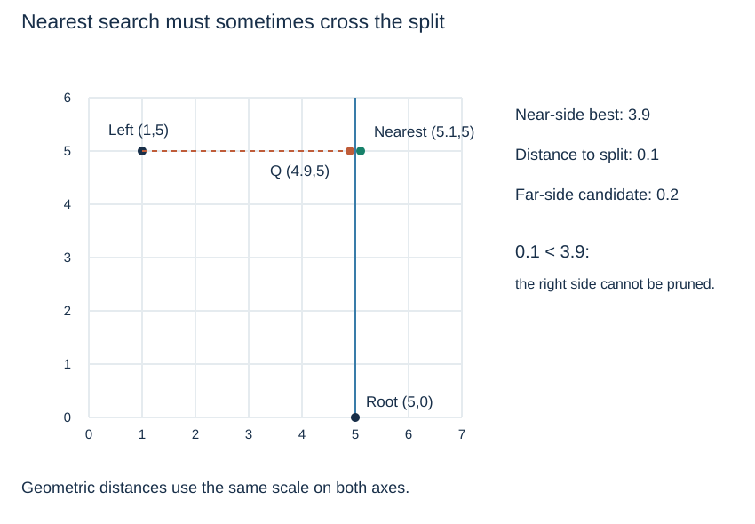

# Nearest-neighbour search and backtracking

(kd-nearest-neighbour)=
## A nearby path is only a starting point

Nearest-neighbour search asks which stored point minimises distance to a query point; it does not ask for exact equality. Descend into the side containing the query first to obtain a promising candidate, but keep a **best-so-far** point and distance. Another side can still contain a closer point.

For two-dimensional Euclidean distance, compare squared distances:

$$d^2(p,q)=(p_x-q_x)^2+(p_y-q_y)^2.$$

Squaring avoids square roots without changing which distance is smallest. This page extends the lecture's conceptual introduction with a complete teaching implementation.

(kd-nearest-bound)=
## Use a lower bound to decide whether to cross the split

At an active-axis split $s$, every point on the other side is at least $|q_{axis}-s|$ away in that coordinate. If its squared value exceeds the current best squared distance, that entire far side cannot improve the result.



In the picture, root (5,0) splits x at 5, query Q = (4.9,5) goes left to (1,5), but the nearest stored point is (5.1,5) on the right. The split distance is 0.1, smaller than the current best distance 3.9 after the left visit, so the right side remains a candidate.

(kd-nearest-code)=
## Search the near side, then reconsider the far side

```python
def kd_nearest(root, query):
    best_point = None
    best_d2 = float("inf")

    def visit(node, depth):
        nonlocal best_point, best_d2
        if node is None:
            return
        p = node.point
        d2 = sum((p[i] - query[i]) ** 2 for i in range(2))
        if best_point is None or d2 < best_d2:
            best_point, best_d2 = p, d2
        axis = depth % 2
        delta = query[axis] - p[axis]
        if delta < 0:
            near, far = node.left, node.right
        else:
            near, far = node.right, node.left
        visit(near, depth + 1)
        if delta * delta <= best_d2:
            visit(far, depth + 1)

    visit(root, 0)
    return best_point
```

The far-side test uses the **updated** best distance after the near-side recursion. `nonlocal` allows inner calls to update the shared candidate held by this query; no state is shared across separate function calls. Return `None` for an empty tree. For equal nearest distances, this implementation keeps the first point encountered, so it promises one nearest point rather than a particular tie order.

(kd-nearest-correctness-cost)=
## A skipped region needs proof, not a guess

Every visited point can improve the candidate. Every skipped far region has a valid distance lower bound larger than the current best distance, so it cannot contain a better answer. These two facts justify returning the final candidate.

The split-plane bound is safe but may be loose. Distance to the whole inherited bounding rectangle can provide a stronger bound when those rectangles are maintained. Good pruning can reduce visits substantially, but the worst case still visits $O(n)$ nodes, with $O(h+1)$ recursive stack space. Exact search's one path does not establish the nearest-neighbour result.

Concept reference: [Princeton's description of region-based range and nearest-neighbour pruning](https://www.cs.princeton.edu/courses/archive/spr13/cos226/assignments/kdtree.html). Continue to [point quadtrees](point-quadtrees.md) to split through a stored point along both axes, or return to the [spatial-search overview](kd-trees.md).
