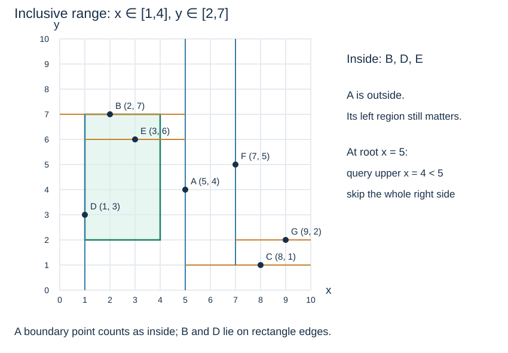

# Range search and safe pruning

**After this page, you should be able to:**

- Choose every child region that can intersect a closed query, including split-coordinate equality.
- Distinguish point tests, subtree pruning and the cost of reporting results.

**Builds on:** [Exact lookup](kd-exact-search.md) follows one path; range reporting may need more than one.

(kd-range-query)=
## Report all points inside an inclusive rectangle

Let `low = (xmin, ymin)` and `high = (xmax, ymax)`, with lower bounds no larger than upper bounds. A point belongs to the query if both coordinate comparisons lie inside the closed intervals. Points on an edge or corner count as inside.

The shared query is `low = (1, 2)`, `high = (4, 7)`. It reports B = (2, 7), D = (1, 3) and E = (3, 6).



(kd-pruning-boundaries)=
## Test the point and the child regions separately

At an active-axis split $s$, query interval $[l,u]$ can reach:

| Child region | Condition to explore |
|---|---|
| Left: coordinate < s | `l < s` |
| Right: coordinate ≥ s | `u >= s` |

If `l == s`, the left region contains no answer because all its coordinates are strictly below the query. If `u == s`, the right region can contain equal-coordinate matches and must not be skipped. Both branches may be necessary when the query straddles the split.

The current point being outside the rectangle does **not** justify pruning both children. Root A = (5, 4) is outside the shared query but its left descendants contain every answer.

(kd-range-code)=
## Traverse every region that can still contribute

```python
def kd_range(root, low, high):
    if any(low[i] > high[i] for i in range(2)):
        raise ValueError("lower bounds must not exceed upper bounds")
    out = []

    def visit(node, depth):
        if node is None:
            return
        p = node.point
        if all(low[i] <= p[i] <= high[i] for i in range(2)):
            out.append(p)
        axis = depth % 2
        if low[axis] < p[axis]:
            visit(node.left, depth + 1)
        if high[axis] >= p[axis]:
            visit(node.right, depth + 1)

    visit(root, 0)
    return out
```

This function checks the current point, then visits left before right when permitted. It returns traversal order, not sorted order or distance order. The output list is created separately for each call, avoiding a shared mutable default argument.

(kd-range-trace)=
## Account for visited nodes and reported results

The shared query visits A, B, D and E. At A it explores only left. At B both regions could intersect, although its right child is empty. At D it skips the left region because the query's lower x bound equals the split x = 1, and visits E on the right. The output is B, D, E.

With two coordinates, time is $O(v)$ for $v$ visited nonempty nodes, including point tests and report work. It is at least proportional to the number of reported points, and can be $O(n)$ in the worst case. Recursive stack space is $O(h+1)$, plus $O(r)$ output storage for $r$ reported points.

:::{tip} Common misconception
**If the current point is outside, its entire subtree is outside.** Only a bound on the descendants can establish that. A is outside the shared query but its left subtree supplies every answer.
:::

(pilot-kd-range-search-checks)=
## Check your understanding

Predict the answer before opening the explanation.

**1. At root A’s x=5 split, a query has x interval `[5,5]` and y interval `[0,10]`. Which sides may be explored, and does A itself qualify?**

:::{dropdown} Show explanation
Skip left: its points have x<5, and the query’s lower x bound is 5. Explore right because the query’s upper x bound is 5 and that side includes equality. Test A separately: A=(5,4) satisfies the query and must be reported. Among the shared points, it is the only result.
:::

**2. For the usual shared rectangle, A=(5,4) is outside. Why must the algorithm still visit B’s subtree?**

:::{dropdown} Show explanation
The query’s x interval [1,4] lies in A’s left region. It contains B,D,E even though A itself fails the point test. Testing a node’s record and testing the possibility of child-region answers serve different purposes.
:::

Next: [Shape and limitations](kd-shape.md).
