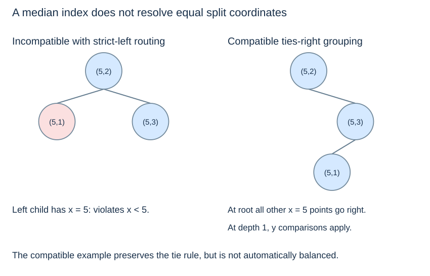

# Shape, median construction and limitations

**After this page, you should be able to:**

- Qualify height, construction cost and spatial-query cost as separate claims.
- Identify why coordinate ties and ordinary BST rotations need special care in a k-d tree.

**Builds on:** [Insertion](kd-construction.md) uses a depth-dependent axis rather than one global key order.

(kd-height-cost)=
## Axis alternation does not maintain balance

Repeatedly inserting increasing points `(1,1), (2,2), (3,3), ...` always takes the right branch in our implementation. Alternating axes does not prevent this chain. An exact query or insertion can then take $\Theta(n)$ time, and repeated insertion can take $\Theta(n^2)$ total time.

Balanced height gives short exact-search paths, but a spatial query may still visit many branches. Reporting all $n$ points necessarily takes $\Omega(n)$ time, regardless of balance.

(kd-median-construction)=
## Static construction can choose useful splits

For a fixed dataset, choose a median on the active axis, divide the remaining points into appropriate subsets, and recursively build the children. With suitable split and tie policies, comparable subset sizes give logarithmic height. This differs from inserting points in their original arrival order.

The implementation determines construction cost. Sorting each recursive subset on its active axis gives $O(n\log^2 n)$ time when partitions remain balanced. More careful selection or presorting methods can improve this; a logarithmic-height result alone does not establish the builder's running time.

(kd-median-ties)=
## Median position does not resolve coordinate ties

Suppose the active split is x = 5 and the distinct points `(5,1), (5,2), (5,3)` are present. A builder that divides them by list position may put equal-x points into both children. Our strict-left, ties-right exact search would then miss points placed on the left.

Possible designs include putting ties consistently on the right, introducing a secondary comparison rule and using it throughout, or storing suitable groups in leaves. The first option preserves this chapter's search rule but need not preserve balanced subset sizes. Do not claim both automatic balance and strict-left tie routing without explaining how ties are handled.

(kd-rotations)=
## Ordinary AVL rotations are not a drop-in repair

A BST rotation preserves one global key ordering. In this k-d tree, changing a node's depth changes its active axis, and moving subtrees changes their inherited spatial regions. A mechanical AVL rotation can therefore invalidate the partition invariant even if some coordinate comparisons still look correct.

Height control requires a k-d-tree construction or maintenance method designed for those spatial constraints. Rebuilding selected parts is one possible strategy; the AVL code from Topic 8 is not used here.

(kd-query-limitations)=
## Geometry and dimensionality affect pruning

Useful pruning depends on the distribution of points, the query shape, dimension, and the chosen distance. In higher dimensions or poorly separated data, many regions may remain plausible. A balanced tree does not guarantee logarithmic nearest-neighbour or range-query time for arbitrary inputs.

For geographical data, Euclidean distance in the given coordinates must have the intended meaning. Longitude and latitude in degrees are not a uniform metre grid. Choose a suitable projected coordinate system or a method supporting the intended metric before interpreting “nearest” as a geographical distance. The following page illustrates only ordinary planar Euclidean distance.

:::{tip} Common misconception
**A balanced tree guarantees logarithmic time for every spatial query.** A range can report every point, and a nearest query can leave many branches plausible.
:::

(pilot-kd-shape-checks)=
## Check your understanding

Predict the answer before opening the explanation.

**1. Insert `(1,1),(2,2),(3,3),(4,4)` in that order. Predict the shape and the number of nonempty nodes visited when finding `(4,4)`.**

:::{dropdown} Show explanation
Every comparison goes right, producing a four-node chain of edge height 3. Exact lookup visits all four points. Changing the active axis does not help when both coordinates increase together.
:::

**2. A median builder chooses `(5,2)` as an x-split pivot and puts `(5,1)` in the left child by list position. Can the existing ties-right search reliably find `(5,1)`?**

:::{dropdown} Show explanation
No. Its x equals 5, so the unequal point is routed right, although the builder placed it left. The builder and search must share a tie rule. Sending every x tie right preserves the stated invariant but does not by itself guarantee balanced subsets.
:::

Next: [Nearest-neighbour search](kd-nearest.md).
