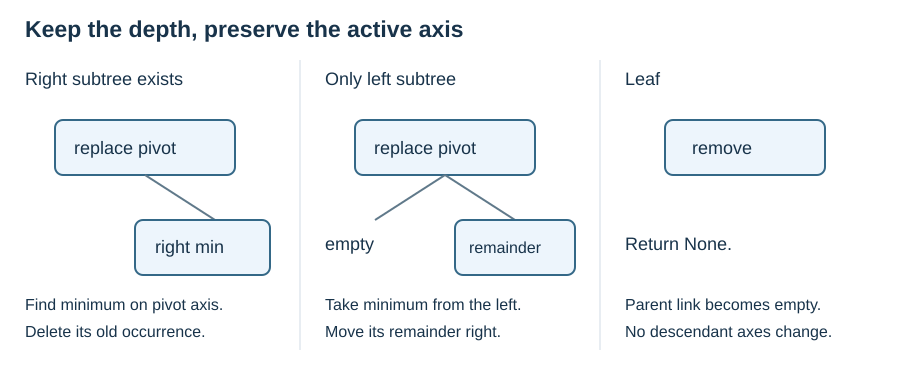

# K-d deletion and operation costs

**After this page, you should be able to:**

- Delete a pivot while preserving strict-left/ties-right ownership and depth-dependent axes.
- Account for replacement searches as well as the path to the deleted point.

**Builds on:** [Construction](kd-construction.md), [exact lookup](kd-exact-search.md) and [shape constraints](kd-shape.md).

(kd-deletion)=
## Delete the point, preserve the split rules

Promoting an ordinary BST child changes its depth and therefore its active axis. Instead, keep the node in place and replace its stored point. At depth d, let a=d mod 2.

1. If there is a right subtree, take a point with minimum coordinate a in that subtree. Copy it here, then delete its old occurrence from the right subtree.
2. If there is only a left subtree, take its minimum on axis a, delete that occurrence, and move the remaining left subtree to the right. All remaining points have coordinate at least the replacement coordinate; the old left link becomes empty.
3. A leaf disappears. For a nonmatching node, descend using the usual active-axis comparison.

The second case deliberately uses a **minimum**, not the ordinary BST maximum-left rule. With coordinate ties, other maximum-coordinate points could remain on a strict-left side incorrectly. Moving the subtree sideways preserves its depth; promoting it upwards would not.



## Find a minimum on the requested axis

If a node splits on that axis, its right subtree cannot improve on the node, so only the left side needs consideration. At the other axis, either child may contain the requested minimum.

```python
def kd_axis_min(node, axis, depth):
    if node is None:
        return None
    if depth % 2 == axis:
        if node.left is None:
            return node.point
        return kd_axis_min(node.left, axis, depth + 1)
    candidates = [node.point]
    for child in (node.left, node.right):
        point = kd_axis_min(child, axis, depth + 1)
        if point is not None:
            candidates.append(point)
    return min(candidates, key=lambda point: point[axis])

def kd_delete(node, point, depth=0):
    if node is None:
        return None
    axis = depth % 2
    if point == node.point:
        if node.right is not None:
            replacement = kd_axis_min(node.right, axis, depth + 1)
            node.point = replacement
            node.right = kd_delete(node.right, replacement, depth + 1)
        elif node.left is not None:
            replacement = kd_axis_min(node.left, axis, depth + 1)
            node.point = replacement
            node.right = kd_delete(node.left, replacement, depth + 1)
            node.left = None
        else:
            return None
    elif point[axis] < node.point[axis]:
        node.left = kd_delete(node.left, point, depth + 1)
    else:
        node.right = kd_delete(node.right, point, depth + 1)
    return node
```

Call `root = kd_delete(root, point)`; an absent point leaves the stored set unchanged. The code uses the same finite numeric tuple and duplicate policy as insertion. On the seven-point tree, deleting A=(5,4) takes F=(7,5), the minimum x in A's right subtree, as the root replacement. The right subtree then loses F while all six other points remain searchable.

(kd-operation-cost-summary)=
## Count each operation's work

Let v count visited point nodes, r returned points, and s the number of points in an affected subtree. Bounds below are for these teaching algorithms in two dimensions.

| Operation | Time | Extra working space, excluding output |
|---|---|---|
| Repeated insertion construction | Sum of insertion path lengths; O(n²) worst case | O(h+1) recursive stack |
| One insertion | O(h+1) | O(h+1) |
| Exact lookup | O(h+1) | O(1), iterative listing |
| Range reporting | O(v+1), worst O(n); includes reporting r≤v | O(h+1), plus O(r) output |
| Nearest neighbour | O(v+1), worst O(n) | O(h+1) |
| Delete an absent point or a leaf | O(h+1) | O(h+1) |
| Delete with replacements | O(h+1) descent plus all axis-minimum and replacement searches | O(h+1) |

A minimum search may examine O(s) nodes; it is not an ordinary one-path lookup. A conservative upper bound for the complete deletion listing is O(n(h+1)): there are at most h+1 successive replacement levels and each minimum search examines at most n nodes. This is a safe upper bound, not a tight claim for every shape. Do not infer O(log n) deletion just from initial height. Persistent tree storage is O(n).

Median construction has its own costs and tie assumptions, described in [shape and limitations](kd-shape.md); this script does not implement that builder. Deep unbalanced examples can exceed Python's recursion limit even though the abstract algorithm is valid.

The replacement rule is described in [Mount's k-d dictionary lecture](https://www.cs.umd.edu/class/fall2019/cmsc420-0201/Lects/slides-13-kd-dict.pdf).

:::{tip} Common misconception
**Deleting a k-d node is ordinary BST deletion on its current coordinate.** Descendants also depend on their depth's active axis, and equal coordinates must preserve strict-left ownership.
:::

(pilot-kd-updates-costs-checks)=
## Check your understanding

**1. A root (5,5) has only left points (2,1) and (2,8). Why can copying a maximum-x point and retaining the other on the left be wrong?**

:::{dropdown} Show explanation
The remaining point also has x=2, equal to the replacement. Strict-left requires x<2. Taking a minimum and moving the remainder right permits the equality.
:::

**2. Does finding the node to delete finish the cost analysis?**

:::{dropdown} Show explanation
No. Replacement minimum searches may inspect several branches, and deleting the old replacement can require further replacements.
:::

Continue to [point quadtrees](point-quadtrees.md), or return to the [method route](kd-methods.md).
