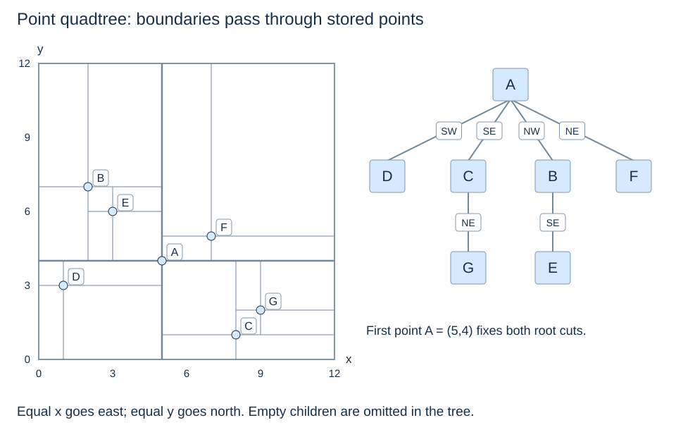

# Point quadtrees: split through a stored point

(point-quadtree-split)=
## Extend the familiar point-based split to both axes

Our two-dimensional k-d tree splits through the current point along one active axis. A **point quadtree** splits through the current point along both x and y, producing four possible children. Each node stores one point; the split is restricted to its inherited region.

This is a change in the branching rule, not a midpoint subdivision. Inserting another first point can move the initial boundaries, just as it can change the insertion-order k-d tree. No balancing guarantee follows from having four children.

(point-quadtree-ties)=
## Assign every coordinate tie to exactly one quadrant

Use Cartesian axes, with y increasing northwards. West means `x < sx`; east means `x >= sx`. South means `y < sy`; north means `y >= sy`. Detect an identical point before branching. This gives child order **SW, SE, NW, NE**.

```python
def point_quadrant(point, pivot):
    return int(point[0] >= pivot[0]) + 2 * int(point[1] >= pivot[1])

class PointQuadNode:
    def __init__(self, point):
        self.point = point
        self.children = [None] * 4

def point_quad_insert(root, point):
    if root is None:
        return PointQuadNode(point)
    node = root
    while True:
        if point == node.point:
            return root
        quadrant = point_quadrant(point, node.point)
        child = node.children[quadrant]
        if child is None:
            node.children[quadrant] = PointQuadNode(point)
            return root
        node = child

def point_quad_contains(root, point):
    node = root
    while node is not None:
        if point == node.point:
            return True
        node = node.children[point_quadrant(point, node.point)]
    return False

point_root = None
for point in shared_points:
    point_root = point_quad_insert(point_root, point)
```

The code assumes finite numeric two-element tuples, as on the k-d-tree pages. It returns the resulting root and ignores repeated identical points. These iterative operations use constant working space. Insert/search follow one path, costing $O(h+1)$ for nonempty tree height h, with linear worst-case paths; an empty tree takes constant time. Persistent storage is $O(n)$ for n distinct points.

(point-quadtree-shared-trace)=
## Reuse the seven-point insertion order

At A=(5,4), D goes SW, C goes SE, B goes NW and F goes NE. E=(3,6) first goes NW to B=(2,7), then SE because 3≥2 and 6<7. G=(9,2) first goes SE to C=(8,1), then NE.



A split line drawn on the plot is a decision boundary, not a stored object or a road. Deeper cross-shaped cuts stop at inherited boundaries. Labels on the tree identify stored points rather than rectangular cells.

(point-quadtree-range)=
## Visit every quadrant the closed query can reach

```python
def point_quad_range(root, rect):
    rect = checked_rect(rect)
    xmin, ymin, xmax, ymax = rect
    out, stack = [], []
    if root is not None:
        stack.append(root)
    while stack:
        node = stack.pop()
        x, y = node.point
        if in_closed_rect(node.point, rect):
            out.append(node.point)
        west, east = xmin < x, xmax >= x
        south, north = ymin < y, ymax >= y
        possible = (west and south, east and south,
                    west and north, east and north)
        for i in range(3, -1, -1):
            if possible[i] and node.children[i] is not None:
                stack.append(node.children[i])
    return out
```

The shared rectangle visits A, D, B and E, reporting **D, B, E** in this traversal order. It skips A's entire east side, but must search both north and south on the west side. Equal upper query bounds can include north/east ties; equal lower bounds cannot reach strictly west/south points.

Each visited nonempty node performs a constant amount of work, so time is $O(v+1)$ for v visits, up to $O(n)$. A depth-first stack has $O(h+1)$ pending nodes because branching is bounded by four, plus $O(r)$ result storage. The split tests may explore more than an exact inherited-cell intersection test, but never exclude a valid answer.

**Think first:** if a point lies on the vertical split but below the horizontal split, which child owns it? **Reasoning:** SE. Equality goes east, while the smaller y goes south.

The point-quadtree idea is also described in [OpenDSA's spatial-structure comparison](https://opendsa-server.cs.vt.edu/OpenDSA/Books/Catalog/html/OtherSpatial.html). Next: [Point-region quadtrees](point-region-quadtrees.md), where the split positions change.
