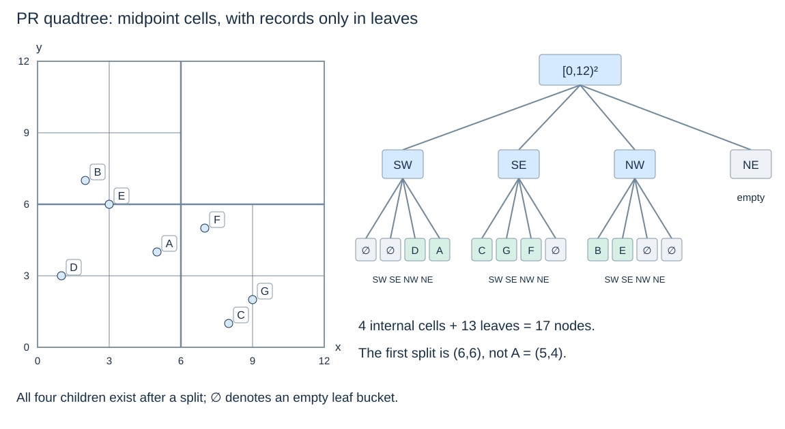
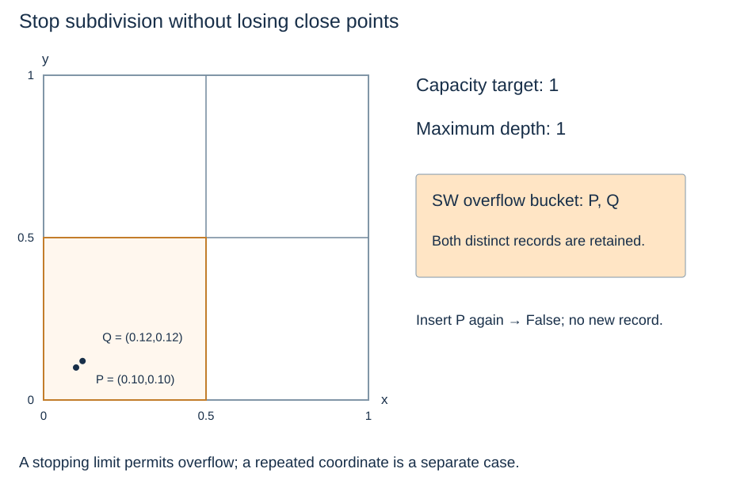

# Point-region quadtrees: split the region at its midpoint

(pr-quadtree-midpoints)=
## The cell determines where a split occurs

A **point-region (PR) quadtree** starts with a fixed bounded region. When a leaf bucket overflows, subdivide its cell into four equal quadrants. Internal nodes represent subdivision; point records live in leaves. Data determine whether subdivision is needed, but the cell bounds determine its location.

The shared example uses root extent **[0,12) × [0,12)** and bucket capacity one. Its first split is at (6,6), even though the first inserted point A is (5,4). A is stored in a leaf bucket; it is not promoted into an internal pivot.

(pr-quadtree-boundary-ownership)=
## Separate cell ownership from query inclusion

All storage cells are **half-open**: include their lower x/y boundaries and exclude their upper boundaries. At a midpoint, equal x goes east and equal y goes north. Four children partition a parent cell without duplicating stored points. Points on the root's excluded maximum edges are outside the configured extent.

The range query is still **closed**, just like the k-d and point-quadtree queries. A point at query xmax can be a result while belonging to the eastern cell. These contracts describe different things and must not be conflated.

| Structure | What fixes a split? | Where are point records? |
|---|---|---|
| Point quadtree | A stored point's x and y | At every occupied node |
| PR quadtree | The current cell's midpoint | In leaf buckets |

(pr-quadtree-shared-trace)=
## Follow occupied cells rather than stored pivots

At the root, A and D belong to SW; C, F and G to SE; B and E to NW; NE is empty. Each occupied root child contains multiple points and splits once more at its own midpoint. In SW, the midpoint is (3,3); in SE it is (9,3); in NW it is (3,9). All seven points then occupy separate buckets.

The final capacity-one tree has four internal nodes, thirteen leaves and seventeen total nodes, including empty leaves. Inserting the same distinct points in another order produces the same final region partition for this capacity/depth policy. Bucket order can differ. This contrasts with the data-dependent point-quadtree shape.

(pr-quadtree-stopping-rules)=
## A capacity threshold needs a termination policy

Repeated coordinates should not trigger endless subdivision. The implementation on the next page stores a point set, so a duplicate is rejected before splitting. A record-oriented version could keep multiple identifiers together at one coordinate.

Distinct points can also be extremely close. A maximum depth limits subdivision; floating-point midpoints must also lie strictly inside the cell to make progress. When a limit is reached, keep an **overflow bucket** rather than lose records or recurse forever. Capacity is therefore a splitting target, not an unconditional maximum leaf occupancy.

(quadtree-variant-terminology)=
## Keep region quadtrees distinct too

A **region quadtree** commonly subdivides raster/image regions until each leaf is homogeneous in value. It shares regular four-way subdivision but stores a different kind of information from a PR tree of point records. The word quadtree names a family, not one universal node contract.

[OpenDSA's PR-quadtree chapter](https://opendsa-server.cs.vt.edu/OpenDSA/Books/Catalog/html/PRquadtree.html) introduces regular point-region subdivision and varying bucket thresholds. Our finite-depth implementation adds explicit stopping and half-open boundary policies. Next: [PR-quadtree operations](pr-quadtree-operations.md).
