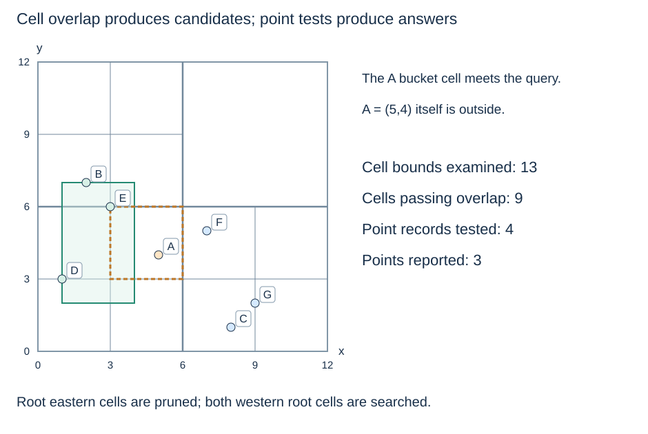

# PR-quadtree insertion, lookup and range reporting

**After this page, you should be able to:**

- Follow redistribution from a leaf bucket into four children without losing or duplicating records.
- Explain exact lookup and range reporting when empty cells or overflow buckets are present.

**Builds on:** Use the [spatial-query helpers](spatial-queries.md), [quadrant function](point-quadtrees.md#point-quadtree-ties) and [PR storage rules](point-region-quadtrees.md).

(pr-quadtree-cell-helpers)=
## Encode one ownership rule in shared helpers

These listings reuse `checked_rect`, `in_closed_rect` and `shared_points` from the spatial-query page. Points are finite numeric two-element tuples; exact duplicates are ignored. Child order remains SW, SE, NW, NE.

```python
def in_half_open_cell(point, cell):
    x, y = point
    xmin, ymin, xmax, ymax = cell
    return xmin <= x < xmax and ymin <= y < ymax

def cell_query_overlap(cell, query):
    xmin, ymin, xmax, ymax = cell
    qxmin, qymin, qxmax, qymax = query
    return (qxmax >= xmin and qxmin < xmax
            and qymax >= ymin and qymin < ymax)

def midpoint_cells(cell):
    xmin, ymin, xmax, ymax = cell
    mx, my = xmin / 2 + xmax / 2, ymin / 2 + ymax / 2
    if not (xmin < mx < xmax and ymin < my < ymax):
        return None
    return ((xmin, ymin, mx, my), (mx, ymin, xmax, my),
            (xmin, my, mx, ymax), (mx, my, xmax, ymax))

class PRNode:
    def __init__(self, bounds):
        self.bounds = bounds
        self.points = []
        self.children = None
```

The overlap test is intentionally asymmetric: a query whose minimum equals the cell's excluded maximum cannot find a point in that cell. A query whose maximum equals the cell's included minimum can. Midpoint calculation avoids summing two large same-sign endpoints before halving; the strict interior test also detects numerical failure to shrink a cell.

(pr-quadtree-insertion)=
## Redistribute records when a leaf becomes internal

```python
class PRQuadTree:
    def __init__(self, bounds, capacity=1, max_depth=16):
        bounds = checked_rect(bounds)
        if bounds[0] == bounds[2] or bounds[1] == bounds[3]:
            raise ValueError("root extent must have positive width and height")
        if type(capacity) is not int or capacity < 1:
            raise ValueError("capacity must be a positive integer")
        if type(max_depth) is not int or max_depth < 0:
            raise ValueError("max_depth must be a nonnegative integer")
        self.root = PRNode(bounds)
        self.capacity = capacity
        self.max_depth = max_depth
        self.members = set()

    def insert(self, point):
        if not in_half_open_cell(point, self.root.bounds):
            raise ValueError("point lies outside the configured extent")
        if point in self.members:
            return False
        pending = [(self.root, point, 0)]
        while pending:
            node, p, depth = pending.pop()
            if node.children is not None:
                cells = node.children
                pivot = (cells[0].bounds[2], cells[0].bounds[3])
                index = point_quadrant(p, pivot)
                pending.append((cells[index], p, depth + 1))
                continue
            subdivisions = midpoint_cells(node.bounds)
            if (len(node.points) < self.capacity
                    or depth >= self.max_depth or subdivisions is None):
                node.points.append(p)
                continue
            records = node.points + [p]
            node.points = []
            node.children = [PRNode(cell) for cell in subdivisions]
            pivot = (subdivisions[0][2], subdivisions[0][3])
            for old in records:
                index = point_quadrant(old, pivot)
                pending.append((node.children[index], old, depth + 1))
        self.members.add(point)
        return True

    def contains(self, point):
        if not in_half_open_cell(point, self.root.bounds):
            return False
        node = self.root
        while node.children is not None:
            pivot = (node.children[0].bounds[2], node.children[0].bounds[3])
            node = node.children[point_quadrant(point, pivot)]
        return point in node.points

    def range_query(self, rect):
        rect = checked_rect(rect)
        out, stack = [], [self.root]
        while stack:
            node = stack.pop()
            if not cell_query_overlap(node.bounds, rect):
                continue
            if node.children is None:
                out.extend(p for p in node.points if in_closed_rect(p, rect))
            else:
                stack.extend(reversed(node.children))
        return out

pr_tree = PRQuadTree((0, 0, 12, 12), capacity=1)
for point in shared_points:
    pr_tree.insert(point)
```

`point_quadrant` comes from the preceding point-quadtree page. Every successful insertion increases the point set by one. Splitting moves the old bucket records into children and clears the internal bucket, preserving each stored point exactly once. The `members` set prevents duplicate insertion; `contains` deliberately demonstrates the spatial path and terminal bucket test rather than merely consulting that set. Clients must preserve these internal structures.

(pr-quadtree-range-trace)=
## Query cells conservatively, then test bucket points exactly

`pr_tree.range_query(shared_query)` reports D, B and E. The root's eastern cells cannot contribute because their x starts at 6. Its two western children can contribute, so descend into both. An intersecting leaf cell can still hold an outside point: A's leaf cell meets the query, but A=(5,4) fails the exact point test.



This stack pushes all four children of an internal node and rejects disjoint ones when popped. Thus a trace should distinguish examined cell bounds, accepted cells and tested point records. It examines thirteen node bounds, accepts nine cells and tests four point records for this shared query. Empty accepted leaves still incur a cell test.

(pr-quadtree-operation-costs)=
## Depth, bucket occupancy and subdivision all matter

For height H and terminal bucket occupancy k, lookup costs $O(H+k+1)$ with constant working space. An overflow bucket can contain many records, so bounded depth does not guarantee a constant-size scan. A range query costs $O(V+P+1)$ for V examined nodes and P point records tested, plus its output; P can be n in the worst case. A four-way depth-first stack needs $O(H+1)$ working storage, plus results.

For bucket target b and s new splits during one insertion, redistribution work is $O((b+1)s)$, in addition to an existing descent of at most $O(H+1)$. A splitting bucket has b old records; an overflow bucket at a stopping limit simply appends. Duplicate-set operations are expected constant-time and bucket append is amortised constant-time. The pending redistribution stack has a conservative $O((b+1)(H+1))$ upper bound.

With n distinct points and I internal nodes, the explicit four-child representation has 4I+1 total nodes and $O(n+I+1)$ persistent storage, including the duplicate set. Maximum depth bounds paths, not occupied buckets; empty children still use memory. This implementation covers insertion, exact membership and ranges, not deletion, merging or nearest-neighbour traversal.

:::{tip} Common misconception
**Capacity is an unconditional maximum bucket size.** At a depth or numerical stopping limit, a bucket can retain more records than the splitting target.
:::

(pilot-pr-quadtree-operations-checks)=
## Check your understanding

Predict the answer before opening the explanation.

**1. What does the shared PR tree return for the closed query `(3,6,3,6)`? Which boundary rule keeps that point in exactly one storage cell?**

:::{dropdown} Show explanation
Only E=(3,6). Its leaf is [3,6) × [6,9), whose lower boundaries are included. A western cell ending at x=3 and a southern cell ending at y=6 exclude those maximum edges. The closed query still includes its one coordinate.
:::

**2. Create a tree over `[0,1)²` with capacity 1 and max_depth=0. Insert `(0.10,0.10)` and `(0.12,0.12)`, then insert the first point again. Predict the bucket and return values.**

:::{dropdown} Show explanation
The first two insertions return True and both points remain in the root overflow bucket; depth zero forbids subdivision. The third insertion returns False because the duplicate set already contains that tuple. No record is discarded merely to satisfy capacity.
:::

Next: [R-tree representation](r-tree-representation.md).
