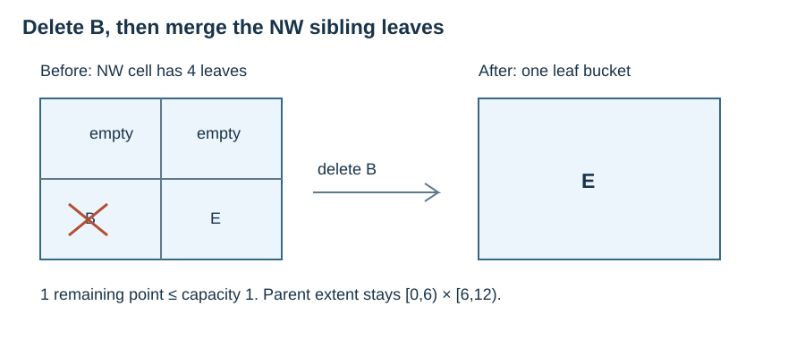

# PR-quadtree nearest search, deletion and costs

**After this page, you should be able to:**

- Combine cell lower bounds with exact bucket distances for nearest search.
- Remove a point and merge eligible siblings without changing midpoint ownership.

**Builds on:** [PR construction, exact lookup and range search](pr-quadtree-operations.md), plus the shared [box-distance helper](point-quadtree-updates.md#spatial-box-distance). These functions take an existing `PRQuadTree`.

**Code languages:** Python defines the explanations, figures and self-checks. Use the [language guide](../../code-languages.md) for native conventions and dependencies. Complete runnable topic examples: [JavaScript](../../examples/languages/kd-trees.js) · [Julia](../../examples/languages/kd-trees.jl).

JavaScript points are arrays compared by same_point; Julia points are value tuples. Julia coordinate/child indices are one-based (x=1, y=2; SW/SE/NW/NE=1/2/3/4), while depth still starts at zero. R-tree orientation uses exact big-integer arithmetic for the supplied integer-coordinate geometry; nearest distances remain floating calculations. General R-tree update code is still conceptual in every language.

(pr-quadtree-nearest)=
## Query outside the root, too

Insertion must respect the root's half-open extent. A nearest query can be anywhere: a point outside the root can still have a nearest stored point inside. Use cell distance to prioritise children and exact point distance to update the answer.

::::{tab-set}
:class: code-language-tabs

:::{tab-item} Python
:sync: python

```python
def pr_nearest(tree, query):
    best, best_d2 = None, float("inf")
    stack = [tree.root]
    while stack:
        node = stack.pop()
        if box_distance2(query, node.bounds) > best_d2:
            continue
        if node.children is None:
            for point in node.points:
                d2 = sum((point[i] - query[i]) ** 2 for i in range(2))
                if best is None or d2 < best_d2:
                    best, best_d2 = point, d2
        else:
            stack.extend(sorted(node.children,
                                key=lambda child: box_distance2(
                                    query, child.bounds), reverse=True))
    return best
```

:::

:::{tab-item} JavaScript
:sync: javascript

```javascript
function pr_nearest(tree,query) {
    let best=null,best_d2=Infinity; const stack=[tree.root];
    while (stack.length) {
        const node=stack.pop(); if (box_distance2(query,node.bounds)>best_d2) continue;
        if (node.children===null) {
            for (const point of node.points) {
                const d2=(point[0]-query[0])**2+(point[1]-query[1])**2;
                if (best===null || d2<best_d2) { best=point; best_d2=d2; }
            }
        } else stack.push(...node.children.slice().sort((a,b)=>box_distance2(query,b.bounds)-box_distance2(query,a.bounds)));
    }
    return best;
}
```

:::

:::{tab-item} Julia
:sync: julia

```julia
function pr_nearest(tree,query)
    best=nothing; best_d2=Inf; stack=Any[tree.root]
    while !isempty(stack)
        node=pop!(stack); box_distance2(query,node.bounds)>best_d2 && continue
        if node.children===nothing
            for point in node.points
                d2=sum((point[i]-query[i])^2 for i in 1:2)
                if best===nothing || d2<best_d2; best=point; best_d2=d2; end
            end
        else
            append!(stack,sort(collect(node.children);by=c->box_distance2(query,c.bounds),rev=true,alg=MergeSort))
        end
    end
    return best
end
```

:::

::::

An empty leaf cannot improve the candidate; an overflow bucket must test all its points. Return `None` for an empty tree and one first-encountered nearest point on ties. The closure-based bound is safe even when the nearest boundary belongs to a different half-open cell. For the shared data, Q=(12,2) returns G=(9,2), squared distance 9, although Q is outside `[0,12)²`.

(pr-quadtree-deletion)=
## Remove from the owning bucket, then merge upwards

Keep the descent path. After removal, if a parent has four leaf children whose combined occupancy is at most the bucket target, replace them with one leaf bucket. Repeat towards the root. If a parent cannot merge, its ancestors cannot yet have four leaf children along this path either.

::::{tab-set}
:class: code-language-tabs

:::{tab-item} Python
:sync: python

```python
def pr_delete(tree, point):
    if point not in tree.members:
        return False
    node, path = tree.root, []
    while node.children is not None:
        path.append(node)
        pivot = (node.children[0].bounds[2], node.children[0].bounds[3])
        node = node.children[point_quadrant(point, pivot)]
    node.points.remove(point)
    tree.members.remove(point)
    for parent in reversed(path):
        children = parent.children
        if any(child.children is not None for child in children):
            break
        total = sum(len(child.points) for child in children)
        if total > tree.capacity:
            break
        parent.points = [p for child in children for p in child.points]
        parent.children = None
    return True
```

:::

:::{tab-item} JavaScript
:sync: javascript

```javascript
function pr_delete(tree,point) {
    const key=JSON.stringify(point); if (!tree.members.has(key)) return false;
    let node=tree.root; const path=[];
    while (node.children!==null) {
        path.push(node); const pivot=[node.children[0].bounds[2],node.children[0].bounds[3]];
        node=node.children[point_quadrant(point,pivot)];
    }
    node.points.splice(node.points.findIndex(p=>same_point(p,point)),1); tree.members.delete(key);
    for (const parent of path.reverse()) {
        const children=parent.children;
        if (children.some(c=>c.children!==null) || children.reduce((s,c)=>s+c.points.length,0)>tree.capacity) break;
        parent.points=children.flatMap(c=>c.points); parent.children=null;
    }
    return true;
}
```

:::

:::{tab-item} Julia
:sync: julia

```julia
function pr_delete!(tree,point)
    point in tree.members || return false
    node=tree.root; path=Any[]
    while node.children!==nothing
        push!(path,node); pivot=(node.children[1].bounds[3],node.children[1].bounds[4])
        node=node.children[point_quadrant(point,pivot)]
    end
    deleteat!(node.points,findfirst(==(point),node.points)); delete!(tree.members,point)
    for parent in Iterators.reverse(path)
        children=parent.children
        any(c.children!==nothing for c in children) && break
        sum(length(c.points) for c in children)>tree.capacity && break
        parent.points=Any[p for c in children for p in c.points]; parent.children=nothing
    end
    return true
end
```

:::

::::

Return `True` only if a point was removed; the same point can be inserted again afterwards. The last deletion leaves an empty root leaf with its original extent. Keep `members` and the buckets consistent by using the public insertion and deletion functions rather than editing node fields.



On the shared capacity-one tree, removing B=(2,7) merges the four leaves of the root's NW child into a leaf containing E. The root still has other internal children, so merging stops there. Neither deleting B nor the merge moves the root's x=6 or y=6 boundaries.

(pr-quadtree-all-costs)=
## Include empty cells and overflow buckets

Use height H, target bucket size b, actual terminal occupancy k, I internal nodes, V examined cells, P tested points, r range results, and S total splits during construction.

| Operation | Time | Extra working space, excluding output |
|---|---|---|
| Build n points by insertion | O(n(H+1)+(b+1)S), using final height H | O((b+1)(H+1)) pending work |
| One insertion with s new splits | O(H+1+(b+1)s), expected/amortised set/list operations | O((b+1)(H+1)) |
| Spatial exact lookup | O(H+k+1) | O(1) |
| Range reporting | O(V+P+1), includes emitting r≤P results | O(H+1), plus O(r) output |
| Nearest query | O(V+P+1) | O(H+1) |
| Delete and merge | O((b+1)(H+1)+k), expected set operations | O(H+b+1) |

Deletion scans the terminal list, then checks four children per level and copies at most b records at each successful merge. Lookup and deletion can scan a large overflow bucket. Nearest/range worst cases examine all O(I+1) cells and n points. Persistent storage is O(n+I+1): explicit children include empty leaves and `members` holds n tuples. Here S=I when starting empty and only inserting; deleting and reinserting can create further splits over time.

Depth limits bound H but do not by themselves make k small or space O(n). With one long cluster path, many empty siblings are still allocated. No distribution-independent O(log n) nearest guarantee follows from fixed midpoint splitting.

:::{tip} Common misconception
**Deleting a point should delete its geometric cell.** Empty cells still represent a subdivision. A merge removes a complete sibling subdivision only when the parent's bucket policy permits it.
:::

(pilot-pr-quadtree-updates-checks)=
## Check your understanding

**1. Must a nearest query at (12,2) be rejected by the shared PR tree?**

:::{dropdown} Show explanation
No. That coordinate is forbidden for insertion into the half-open extent, but querying distances from it is valid. G=(9,2) is the nearest shared point.
:::

**2. Four leaf children contain 0,1,0,1 points, with capacity 1. Can they merge?**

:::{dropdown} Show explanation
No. The total is 2, exceeding the target. Empty siblings alone do not justify a merge.
:::

Next: [R-tree representation](r-tree-representation.md), where bounding groups can overlap.
