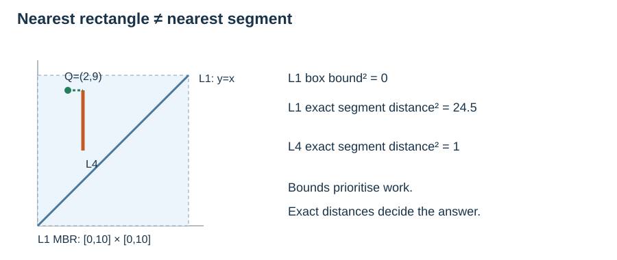

# R-tree construction, exact lookup, nearest search and deletion

**After this page, you should be able to:**

- Distinguish exact object equality and distance from bounding-rectangle tests.
- Trace insertion, overflow splitting and deletion condensation, including their maintenance costs.

**Builds on:** [R-tree nodes and the shared line records](r-tree-representation.md), [range candidates and exact refinement](r-tree-queries.md), and the shared [box-distance helper](point-quadtree-updates.md#spatial-box-distance).

**Code languages:** Python defines the explanations, figures and self-checks. Use the [language guide](../../code-languages.md) for native conventions and dependencies. Complete runnable topic examples: [JavaScript](../../examples/languages/kd-trees.js) · [Julia](../../examples/languages/kd-trees.jl).

JavaScript points are arrays compared by same_point; Julia points are value tuples. Julia coordinate/child indices are one-based (x=1, y=2; SW/SE/NW/NE=1/2/3/4), while depth still starts at zero. R-tree orientation uses exact big-integer arithmetic for the supplied integer-coordinate geometry; nearest distances remain floating calculations. General R-tree update code is still conceptual in every language.

## The complete operation route

The preceding [range-search reading](r-tree-queries.md) defines the candidate traversal reused below. On this page, read construction/insertion concepts, exact lookup, nearest search and deletion; return to range refinement when comparing the five operations. The supplied `r_root` remains a deliberately small, given tree. Exact and nearest functions below are runnable against it. General insertion, splitting, bulk loading and condensation are explained algorithmically, not supplied as Python implementations. Do not edit `segments` without also maintaining the tree entries and ancestor bounds.

(rtree-insertion)=
## Construct by insertion, or pack a static collection

An R-tree groups records rather than cutting the plane into disjoint owned cells. Let M be maximum entries per node and m its nonroot minimum occupancy, with 2m≤M+1 so an overflowing node can split into two legal groups. Leaves have equal depth; the root has special occupancy rules.

**Incremental insertion:** compute the object's minimum bounding rectangle (MBR). At each internal node choose the child requiring the least area enlargement to enclose it, breaking ties by smaller area and then a fixed deterministic rule. At the chosen leaf, add the object entry. Walk back towards the root, enlarging enclosing rectangles as necessary.

If a node has M+1 entries, split those entries into two groups of size between m and M. A split policy chooses the grouping to control area and overlap; a quadratic policy examines entry pairs to select seeds and then assigns remaining entries while respecting minimum occupancy. Replace the old parent entry by two child entries. A parent can overflow too, propagating splits upwards. Splitting the root creates a new root and increases every leaf's depth by one.

For the shared tree, use M=3 and m=2. Inserting L6=((11,0),(12,1)) would enlarge U's `(0,0,10,10)` box by 20 area units and V's `(3,0,10,9)` box by 18. Choose V, which then has four entries and must split into two groups of two. Recompute both groups' MBRs and replace V's root entry with their two entries; the root then has three children and does not overflow. A particular split policy is needed to decide which records pair together: least enlargement alone does not decide that.

**Static construction:** a packing algorithm can order/group a complete dataset before building higher levels. Packing and incremental insertion need not produce the same tree or overlap. This book's hand-grouped U/V example illustrates invariants and queries; it is not the output of a claimed packing algorithm.

(rtree-exact-lookup)=
## Exact lookup refines candidates by object equality

A coordinate pair is not the identity of a line record. Here exact geometry lookup returns **all identifiers whose undirected segment has the same two endpoints**. Reversing endpoint order counts as the same segment; distinct identifiers with that geometry remain distinct records. This is different from asking which segments merely touch a query point or cross a rectangle.

::::{tab-set}
:class: code-language-tabs

:::{tab-item} Python
:sync: python

```python
def rtree_exact_segment(root, query_segment, records):
    candidates = rtree_candidates(root, segment_bounds(query_segment))
    a, b = query_segment
    return [key for key in candidates
            if records[key] == (a, b) or records[key] == (b, a)]
```

:::

:::{tab-item} JavaScript
:sync: javascript

```javascript
function rtree_exact_segment(root,query_segment,records) {
    const candidates=rtree_candidates(root,segment_bounds(query_segment)),[a,b]=query_segment;
    return candidates.filter(key=>{
        const [c,d]=records.get(key);
        return (same_point(c,a)&&same_point(d,b))||(same_point(c,b)&&same_point(d,a));
    });
}
```

:::

:::{tab-item} Julia
:sync: julia

```julia
function rtree_exact_segment(root,query_segment,records)
    candidates=rtree_candidates(root,segment_bounds(query_segment)); a,b=query_segment
    return [key for key in candidates if records[key]==(a,b) || records[key]==(b,a)]
end
```

:::

::::

The existing range-candidate function may admit many other lines with overlapping MBRs. The final endpoint test establishes equality. A tighter traversal could descend only into child boxes containing the query MBR, but this reuse is correct because an equal geometry necessarily has an overlapping MBR. For lookup by a known record identifier alone, an ordinary dictionary is usually the direct tool.

:::{note} Pause and trace
This page supports two study blocks. First connect construction and exact lookup to the given tree and range helpers. Then study nearest search and deletion separately: predict a lower bound before a heap pop, and account for every surviving entry during condensation.
:::

(rtree-nearest)=
## Nearest line means exact point-to-segment distance

Project the query onto the segment's supporting line, clamp the parameter to [0,1], then measure to that closest point. A zero-length segment is a point. The following numeric teaching code uses ordinary floating arithmetic for projection; it is not a robust exact-geometry kernel for extreme magnitudes or roundoff-sensitive ties.

::::{tab-set}
:class: code-language-tabs

:::{tab-item} Python
:sync: python

```python
def point_segment_distance2(query, segment):
    a, b = segment
    dx, dy = b[0] - a[0], b[1] - a[1]
    length2 = dx * dx + dy * dy
    t = 0 if length2 == 0 else max(0, min(1,
        ((query[0] - a[0]) * dx + (query[1] - a[1]) * dy) / length2))
    return ((query[0] - (a[0] + t * dx)) ** 2
            + (query[1] - (a[1] + t * dy)) ** 2)

def rtree_nearest(root, query, records):
    import heapq
    from itertools import count

    serial, pending = count(), []
    best, best_d2 = None, float("inf")

    def enqueue(node):
        for box, item in node.entries:
            bound = box_distance2(query, box)
            if bound <= best_d2:
                heapq.heappush(pending,
                              (bound, next(serial), node.leaf, item))

    enqueue(root)
    while pending:
        bound, _, is_record, item = heapq.heappop(pending)
        if bound > best_d2:
            break
        if is_record:
            d2 = point_segment_distance2(query, records[item])
            if best is None or d2 < best_d2:
                best, best_d2 = item, d2
        else:
            enqueue(item)
    return best
```

:::

:::{tab-item} JavaScript
:sync: javascript

```javascript
function point_segment_distance2(query,[a,b]) {
    const dx=b[0]-a[0],dy=b[1]-a[1],length2=dx*dx+dy*dy;
    const t=length2===0 ? 0 : Math.max(0,Math.min(1,((query[0]-a[0])*dx+(query[1]-a[1])*dy)/length2));
    return (query[0]-(a[0]+t*dx))**2+(query[1]-(a[1]+t*dy))**2;
}
function rtree_nearest(root,query,records) {
    let serial=0,best=null,best_d2=Infinity; const pending=new MinHeap(entry_less);
    function enqueue(node) {
        for (const [box,item] of node.entries) {
            const bound=box_distance2(query,box);
            if (bound<=best_d2) pending.push([bound,serial++,node.leaf,item]);
        }
    }
    enqueue(root);
    while (pending.size()) {
        const [bound,sequence,is_record,item]=pending.pop(); if (bound>best_d2) break;
        if (is_record) {
            const d2=point_segment_distance2(query,records.get(item));
            if(best===null||d2<best_d2){best=item;best_d2=d2;}
        } else enqueue(item);
    }
    return best;
}
```

:::

:::{tab-item} Julia
:sync: julia

```julia
function point_segment_distance2(query,segment)
    a,b=segment; dx,dy=b[1]-a[1],b[2]-a[2]; length2=dx^2+dy^2
    t=length2==0 ? 0 : clamp(((query[1]-a[1])*dx+(query[2]-a[2])*dy)/length2,0,1)
    return (query[1]-(a[1]+t*dx))^2+(query[2]-(a[2]+t*dy))^2
end
function rtree_nearest(root,query,records)
    serial=0; best=nothing; best_d2=Inf; pending=MinHeap(entry_less)
    function enqueue(node)
        for (box,item) in node.entries
            bound=box_distance2(query,box)
            if bound<=best_d2; heap_push!(pending,(bound,serial,node.leaf,item)); serial+=1; end
        end
    end
    enqueue(root)
    while !isempty(pending.data)
        bound,sequence,is_record,item=heap_pop!(pending); bound>best_d2 && break
        if is_record
            d2=point_segment_distance2(query,records[item])
            if best===nothing || d2<best_d2; best=item; best_d2=d2; end
        else; enqueue(item); end
    end
    return best
end
```

:::

::::

The heap orders **lower bounds**, not final answers. The serial number prevents comparisons between nodes or identifiers on equal bounds. When the smallest remaining bound exceeds the best exact distance, every pending entry can be skipped. Return one nearest record identifier; ties retain the first encountered, and an empty root returns `None`.



For Q=(2,9), L1's MBR contains the query, giving bound 0, but its segment distance squared is 24.5. L4's vertical segment at x=3 has distance squared 1 and is the nearest line. Stopping at the closest rectangle would give the wrong answer. The same lower-bound principle underlies [Roussopoulos, Kelley and Vincent's nearest-neighbour R-tree search](https://www.cs.umd.edu/~nick/papers/nnpaper.html).

(rtree-deletion)=
## Delete a record, then condense the tree

For the standard dynamic algorithm:

1. Find the leaf containing the intended record, using its identifier and geometry/MBR. Overlapping child bounds can require searching several branches.
2. Remove its leaf entry. Walk upwards and recompute affected enclosing bounds, which may shrink.
3. If a nonroot node has fewer than m entries, detach it from its parent. Save its remaining entries for reinsertion. An eliminated internal node's child entries must be reinserted at their appropriate level so that all leaves stay at equal depth.
4. Reinsert the saved entries using the insertion algorithm. Reinsertion may cause new splits. If the root has a single child, replace it with that child; an empty tree becomes an empty leaf root.

On the original M=3, m=2 example, deleting L3 leaves V with L4 and L5: no underflow, but its bounding rectangle shrinks. Deleting L4 next leaves V with only L5. Detach V, reinsert L5 into U, and remove the one-child root. The resulting root is a leaf containing L1, L2 and L5. Removing V must not discard L5, and merely tightening V's box would not fix its occupancy violation.

These are the insertion and **CondenseTree** principles from [Guttman's original R-tree paper](https://postgis.net/docs/support/rtree.pdf). A page-oriented implementation also needs parent/path tracking, a concrete split policy and careful entry-level reinsertion; none of those update routines is hidden inside the given-tree query code.

(rtree-operation-costs)=
## Separate height, entry checks, geometry work and reinsertion

Let h be height, E the number of entries examined, c candidate records, r range results, and T the number of entries placed on the nearest heap. Treat our two-endpoint geometry predicates as constant-cost arithmetic; more complex geometries add their own refinement cost.

| Operation | Time and qualification | Extra working space, excluding results |
|---|---|---|
| Incremental build | Sum of insertion costs; depends on split policy | Depends on insertion/splitting implementation |
| One insertion | O(M(h+1)+Σ split costs) for a single descent and upward repair; quadratic splitting gives O(M²) per split | O(h+M) with a path and one split workspace |
| Exact lookup, code above | O(E+c+1); worst O(n) for fixed M | O(M(h+1)) traversal stack, plus O(c+r) lists |
| Range plus exact refinement | O(E+c+1), including r≤c reports; worst O(n) for fixed M | O(M(h+1)) stack, plus O(c+r) lists |
| Nearest, heap code above | O(E+T log(T+1)+1); worst O(n log(n+1)) for fixed M | O(T+1), worst O(n) |
| Dynamic deletion | Find-leaf work + O(M(h+1)) repair + **all reinsertion costs** | Search/path plus saved entries; potentially linear |

Minimum occupancy with m≥2 bounds height logarithmically, but overlapping boxes can still make a query examine the entire tree. The heap listing's worst-case log factor comes from its priority queue; it is not a universal lower bound for nearest search. A depth-first alternative can trade traversal order for a smaller frontier.

With fixed fanout and valid occupancy, persistent storage is O(n+1). Record geometry storage is additional if the objects themselves have variable size. A conceptual update algorithm's performance is not measured by the supplied static-tree script. In particular, condensation reinsertion prevents a blanket O(log n) deletion claim.

:::{tip} Common misconception
**Balanced leaves imply one branch per spatial query.** Balance controls height; overlapping enclosures can make many branches eligible.
:::

(pilot-r-tree-operations-checks)=
## Check your understanding

**1. At Q=(2,9), is L1 nearest because its MBR has distance zero?**

:::{dropdown} Show explanation
No. Its exact squared segment distance is 24.5; L4's is 1. An MBR distance is only a lower bound.
:::

**2. After deleting L3 and L4, can we detach underfull V and forget its remaining entry?**

:::{dropdown} Show explanation
No. L5 survives the deletions and must be reinserted. Detachment repairs occupancy only if every remaining record stays represented at the correct leaf depth.
:::

Finish with the [spatial-index comparison](spatial-index-choices.md).
