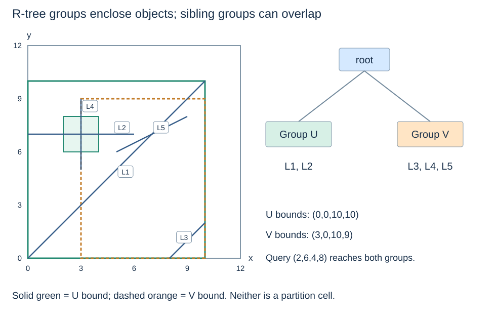
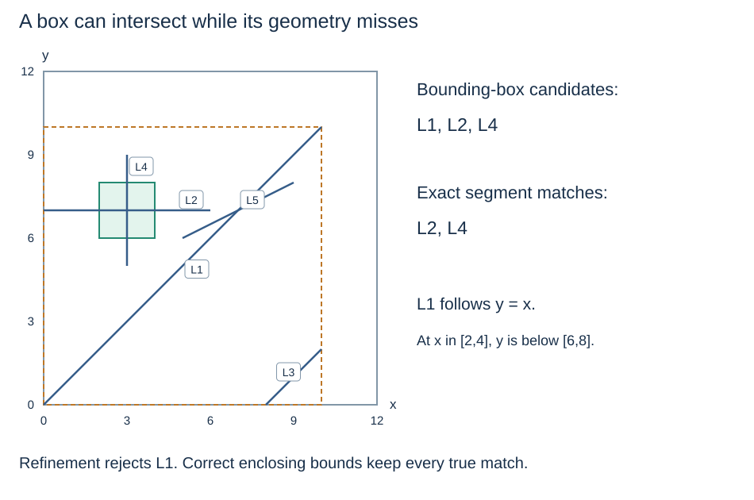

# R-trees: group objects inside enclosing rectangles

**After this page, you should be able to:**

- Explain the enclosing-bound invariant and why sibling rectangles can overlap.
- Distinguish a bounding-box candidate from an exact geometry match.

**Builds on:** A [PR tree](point-region-quadtrees.md) partitions cells; an R-tree groups object bounds instead.

## Follow the five operations

| Operation | Read here |
|---|---|
| Construction and insertion | Representation below, then [least enlargement and splitting](r-tree-operations.md#rtree-insertion) |
| Exact object lookup | [Endpoint equality after candidate filtering](r-tree-operations.md#rtree-exact-lookup) |
| Range search | [MBR candidates and exact intersection](r-tree-queries.md) |
| Nearest neighbour | [Bound ordering and exact segment distance](r-tree-operations.md#rtree-nearest) |
| Deletion and costs | [Condensation, reinsertion and operation summary](r-tree-operations.md#rtree-deletion) |


(r-tree-enclosing-invariant)=
## A parent bound encloses every descendant object

A line or polygon can cross many fixed partition cells. An **R-tree** instead groups objects and stores a minimum bounding rectangle (MBR) for each object or child group. Every parent entry must enclose all bounds below that entry. Internal entries refer to child nodes; leaf entries associate object bounds with record identifiers.

An ordinary R-tree is a balanced multiway structure with all leaves at the same depth and configured node-occupancy limits. Its construction and splitting policy tries to keep bounds useful. This reading starts with a given small tree; it does not implement general insertion, balancing or node splitting.

(r-tree-overlapping-groups)=
## Sibling rectangles may overlap

R-tree sibling bounds are enclosures, not a disjoint partition of the plane. A query can intersect several siblings, requiring more than one branch. Tree balance limits path length but does not guarantee that a query follows only one path.



The following original example stores five **line segments**. It uses a different object/query example from the shared point comparison so that filtering and exact geometry can be distinguished.

(r-tree-given-example)=
## Build the bounds of a given two-leaf tree

```python
segments = {
    "L1": ((0, 0), (10, 10)),
    "L2": ((0, 7), (6, 7)),
    "L3": ((8, 0), (10, 2)),
    "L4": ((3, 5), (3, 9)),
    "L5": ((5, 6), (9, 8)),
}
line_query = (2, 6, 4, 8)

def segment_bounds(segment):
    a, b = segment
    return (min(a[0], b[0]), min(a[1], b[1]),
            max(a[0], b[0]), max(a[1], b[1]))

def enclosing_bounds(boxes):
    boxes = list(boxes)  # requires a nonempty collection
    return (min(b[0] for b in boxes), min(b[1] for b in boxes),
            max(b[2] for b in boxes), max(b[3] for b in boxes))

class RNode:
    def __init__(self, entries, leaf):
        self.entries = list(entries)  # (enclosing_box, child_or_id)
        self.leaf = leaf

line_boxes = {key: segment_bounds(value) for key, value in segments.items()}
group_u = RNode([(line_boxes[key], key) for key in ["L1", "L2"]], True)
group_v = RNode([(line_boxes[key], key) for key in ["L3", "L4", "L5"]], True)
r_root = RNode([
    (enclosing_bounds(box for box, _ in group_u.entries), group_u),
    (enclosing_bounds(box for box, _ in group_v.entries), group_v),
], False)
```

Group U encloses `(0,0,10,10)`; group V encloses `(3,0,10,9)`. Both intersect query `(2,6,4,8)`, so neither can be skipped. This deliberately overlapping grouping illustrates query behaviour, not an optimal packing claim. Both leaves are at depth one; their occupancies two and three fit an example maximum of three and minimum of two.

(r-tree-filter-refine)=
## A bounding-box hit can be a false positive

L1's diagonal has box `(0,0,10,10)`, which overlaps the query, but the line itself does not cross the query rectangle: at x between 2 and 4 its y is between 2 and 4, below the query. L2 and L4 do intersect the query.



The index produces **candidates**, followed by a predicate on the actual geometry. For axis-aligned rectangular objects and a rectangle-intersection question, box overlap can itself be exact. For general geometry, enclosure is sufficient to reject a disjoint box but insufficient to confirm intersection.

Reference: [Guttman's original R-tree paper](https://postgis.net/docs/support/rtree.pdf). The [PostGIS spatial-index workshop](https://postgis.net/workshops/en/postgis-intro/indexing.html) explains the same filter/refine principle in an application setting.

:::{tip} Common misconception
**R-tree siblings divide the plane into disjoint regions.** They enclose groups of objects and can overlap, so a query may need several child branches.
:::

(pilot-r-tree-representation-checks)=
## Check your understanding

Predict the answer before opening the explanation.

**1. Does diagonal L1 intersect the query `(2,6,4,8)` just because its box does?**

:::{dropdown} Show explanation
No. Its box (0,0,10,10) overlaps the query, so L1 is a candidate. On L1, y=x; for x in [2,4], y is in [2,4], below [6,8]. Exact refinement rejects L1.
:::

**2. The example’s leaves are at the same depth. Can the query choose only one of groups U and V?**

:::{dropdown} Show explanation
No. U’s box (0,0,10,10) and V’s box (3,0,10,9) both meet the query. Equal leaf depth does not make their bounds disjoint or establish a single search path.
:::

Next: [Range candidates and exact refinement](r-tree-queries.md). The following [operation reading](r-tree-operations.md) reuses that traversal for exact lookup and develops construction, nearest search and deletion.
