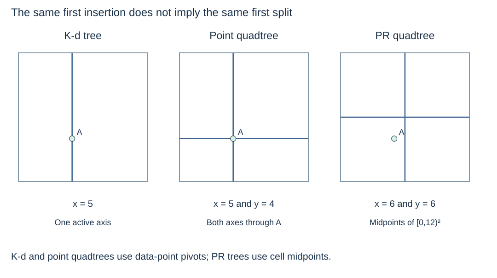

# Compare spatial-search representations

**After this page, you should be able to:**

- Compare structures using the same query and a consistent definition of work.
- Choose a point or object index without mistaking candidate filtering for final geometry evaluation.

**Builds on:** Bring together [point-based splits](point-quadtrees.md), [midpoint cells](point-region-quadtrees.md) and [R-tree enclosures](r-tree-representation.md).

(spatial-split-comparison)=
## Ask what the boundaries mean

| Structure | Boundary or grouping rule | Stored objects in these readings | Main consequence |
|---|---|---|---|
| Insertion-order k-d tree | One active-axis split through each point | Points at nodes | Binary shape depends on insertion order; axes alternate |
| Point quadtree | Both axes split through each point | Points at nodes | Four-way, data-dependent partitions; order can change the root and shape |
| Bucket PR quadtree | Fixed cell midpoints when occupancy requires subdivision | Points in leaves | Regular bounded cells; bucket/depth policy controls splitting |
| R-tree | Enclosing rectangles around object/child groups | Line records in the given example; also suitable for points or extended geometries | Groups may overlap; queries may follow several branches and need exact refinement |

Neither point-quadtree branching nor PR subdivision is an AVL rotation. Each spatial rule must preserve its own region or enclosing-bound invariant.

(spatial-shared-query-comparison)=
## Compare identical answers without requiring identical visits

All three point indexes use the same seven coordinates, insertion order and closed rectangle `[1,4] × [2,7]`. Their answer set is **{B,D,E}**.

| Implementation | Relevant work on this query | Report order |
|---|---|---|
| K-d range code | 4 nonempty point nodes visited: A,B,D,E | B,D,E |
| Point-quadtree range code | 4 nonempty point nodes visited: A,D,B,E | D,B,E |
| PR-quadtree range code | 13 cell bounds examined; 9 cells accepted; 4 point records tested | D,B,E |

An explicit empty PR cell is not equivalent to an absent point-tree child. Therefore compare definitions of visits before interpreting the counts as a performance result. These are traces of one instance, not a universal ranking or benchmark. Every method must also emit all r reported records.

(spatial-index-workload)=
## Choose using data, queries and updates

A scan is attractive for small or infrequently queried collections. K-d trees are a natural point-search example, including the nearest-neighbour traversal already developed here. PR quadtrees make regular region ownership and adaptive occupancy visible. Point quadtrees provide a close conceptual bridge from data-point splits, but may develop long paths. R-trees organise bounds of extended objects and are widely used in spatial indexing; query selectivity depends on grouping, overlap and geometry.

For nearest queries, a containing box provides a lower bound rather than an exact object distance. A nearest rectangle need not identify the nearest line or polygon without refinement. Full nearest traversals for the new structures are outside this pass, as are R-tree insertion/splitting, PR deletion/merging and compressed spatial-tree variants.

(spatial-executable-example)=
## Run the examples together

[Download the standard-library spatial-search example](../../examples/spatial_search.py), save it as `spatial_search.py`, and run `python spatial_search.py`. It includes the point and PR quadtrees, the given R-tree query, exact segment refinement and the reused k-d-tree insert/range code. No notebook, package installation or private course repository is required.

To execute these pages as listings, read them in order in one Python session: the spatial-query helpers, point quadtree, PR operations, then R-tree representation and query. The k-d-tree code remains on its existing pages with its original names and contracts.

:::{tip} Common misconception
**A larger visit count in one illustration proves one index is always worse.** Empty-cell tests, point tests, output size, data distribution and implementation choices are different costs.
:::

(pilot-spatial-index-choices-checks)=
## Check your understanding

Predict the answer before opening the explanation.

**1. The PR query examines 13 node bounds while the k-d query visits 4 nonempty point nodes. Does that prove PR trees are always slower?**

:::{dropdown} Show explanation
No. The counters measure different work. This PR representation includes explicit empty cells; it accepts nine cells and tests four point records. One small instance and different counting conventions cannot establish a universal performance ranking.
:::

**2. To find lines crossing a rectangle, could we index only line endpoints as points and return lines with an endpoint inside? Use L2 as a check.**

:::{dropdown} Show explanation
That would miss valid crossings. L2 runs from (0,7) to (6,7); neither endpoint is inside [2,4] × [6,8], but the segment crosses it. Object bounds plus an exact segment predicate preserve that case; a point-endpoint query answers a different question.
:::

Return to the [spatial-search overview](kd-trees.md), [concept index](../../concepts.md) or [coverage review](../../coverage-review.md).
