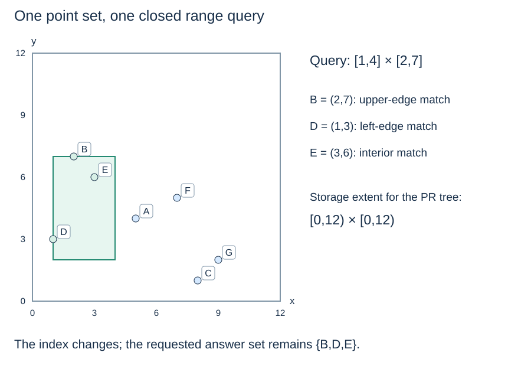

# Spatial queries, bounds and a reference scan

**After this page, you should be able to:**

- Distinguish exact, range and nearest questions, including their boundary and distance contracts.
- Explain why a region bound can justify pruning while a single outside point cannot.

**Builds on:** [BST range reporting](../searching/bst-range-queries.md) already uses ordering to exclude subtrees.

(spatial-query-contracts)=
## Specify the objects and the question

Spatial search uses coordinates and extents to exclude impossible answers. Exact lookup asks whether a point is stored; range reporting asks which objects meet a region; nearest-neighbour search asks which object minimises a specified distance. A structure useful for one workload need not be best for every workload.

For point range reporting, this topic uses a **closed** query rectangle `(xmin, ymin, xmax, ymax)`: touching an edge or corner counts. Stored point duplicates represent one point, not several records. Applications needing several observations at the same coordinate should attach a collection of record identifiers rather than silently discard observations.

(shared-spatial-dataset)=
## Keep the data and query fixed while changing the index

```python
from math import isfinite

shared_points = [(5, 4), (2, 7), (8, 1), (1, 3),
                 (3, 6), (7, 5), (9, 2)]
shared_query = (1, 2, 4, 7)

def checked_rect(rect):
    if len(rect) != 4 or not all(isfinite(v) for v in rect):
        raise ValueError("rectangle needs four finite numeric coordinates")
    xmin, ymin, xmax, ymax = rect
    if xmin > xmax or ymin > ymax:
        raise ValueError("rectangle bounds are reversed")
    return tuple(rect)

def in_closed_rect(point, rect):
    x, y = point
    xmin, ymin, xmax, ymax = rect
    return xmin <= x <= xmax and ymin <= y <= ymax

def scan_range(points, rect):
    rect = checked_rect(rect)
    return [p for p in points if in_closed_rect(p, rect)]
```

The points are A through G in the order shown. The shared query returns **B=(2,7), D=(1,3), E=(3,6)**. These are the same coordinates and inclusive bounds as the existing k-d-tree pages. The helpers assume numeric coordinate pairs; they validate rectangle order and finiteness, not arbitrary object types. The shared list contains distinct points. For another dataset, deduplicate before comparing with these point-set indexes; the scan itself reports the supplied records. Comparing result sets avoids confusing a traversal-order difference with a wrong answer.



(spatial-reference-scan)=
## A scan is both a baseline and a check

Scanning n point records takes $O(n+1)$ time and $O(r)$ result storage for r answers under fixed-cost coordinate comparisons. An index adds construction, persistent storage and update work. On a tiny collection or a query returning almost everything, a scan may be a sensible choice.

A uniform grid is another baseline: fixed cells store point buckets, and a range query inspects intersecting cells. It avoids a tree but introduces a cell-size choice. Adaptive trees organise subdivision or grouping differently; none eliminates the cost of returning many records.

(spatial-pruning-certificates)=
## Reject a region only when it cannot contribute

A point outside a rectangle does not prove its descendants are outside. Pruning needs a bound on **all** possible descendants: an inherited partition cell or an enclosing object rectangle. If that bound cannot meet the query, its subtree can be skipped.

For nearest search, a rectangle supplies a lower bound. With query `(qx,qy)`, let $d_x=\max(x_{min}-q_x,0,q_x-x_{max})$ and similarly for y. Then $d_x^2+d_y^2$ is the squared Euclidean distance to the closed rectangle. If it exceeds the best distance found, nothing enclosed can improve the answer. A half-open cell's closure still supplies a safe lower bound. The current full nearest-neighbour implementation remains in the [k-d-tree reading](kd-nearest.md).

(spatial-distance-units)=
## Coordinates need an interpretation

The shared coordinates are invented planar units, not longitude and latitude. Euclidean distance in longitude/latitude degrees is not automatically ground distance in metres. Select a distance model and compatible coordinates before interpreting nearest results. The schematic placement of a point and the chosen index cannot supply missing geographic meaning.

:::{tip} Common misconception
**An index determines the meaning of distance.** It does not: coordinates, units and a distance model must be chosen before a nearest result can be interpreted.
:::

(pilot-spatial-queries-checks)=
## Check your understanding

Predict the answer before opening the explanation.

**1. Which shared points belong to the closed rectangle `[1,4] × [2,7]`? Explain the two boundary cases.**

:::{dropdown} Show explanation
B=(2,7), D=(1,3) and E=(3,6). B is on the included upper y edge; D is on the included lower x edge. E is in the interior. A=(5,4) lies outside even though descendants of A in a point tree can be answers.
:::

**2. Could `(12,6)` satisfy the closed query rectangle `(11,5,12,7)` yet be rejected by a PR tree whose storage extent is `[0,12) × [0,12)`?**

:::{dropdown} Show explanation
Yes. The query includes its maximum x edge, so its predicate accepts `(12,6)`. The storage extent excludes x=12, so that PR tree rejects insertion. A query boundary defines what to report; a storage boundary defines which tree cell owns a record.
:::

Next: [The k-d-tree method](kd-methods.md), then follow construction, exact, range, shape, nearest and deletion in sidebar order. Point quadtrees follow that group.
